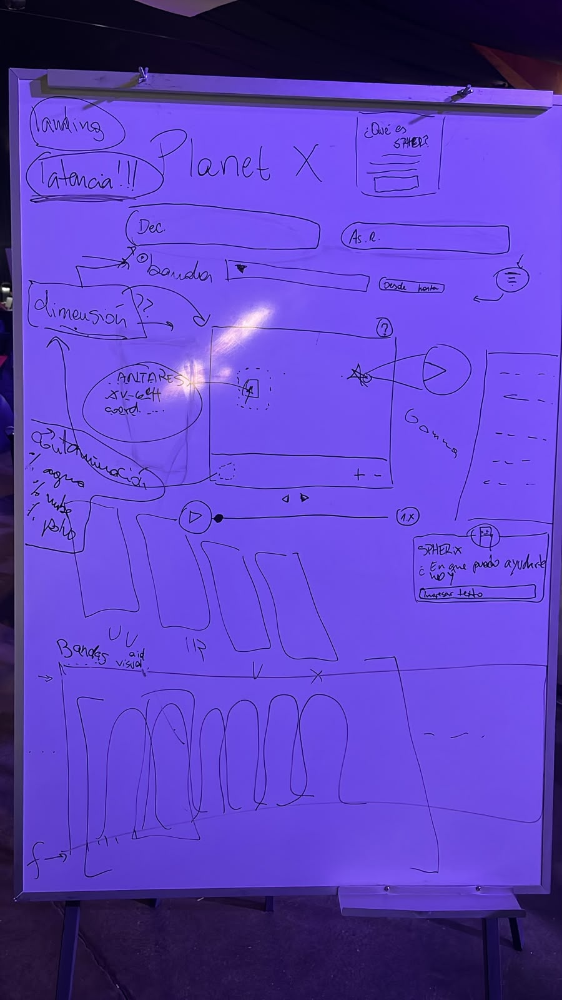
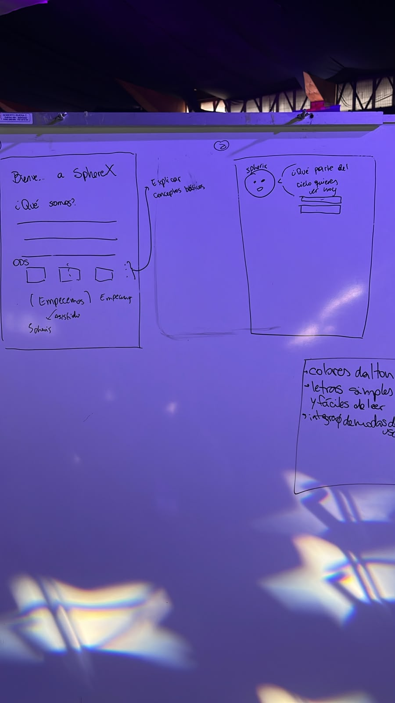

# SPHEREX — NASA Space Apps Challenge 2026 · *Planet X and SPHEREx*

**Una herramienta web pública donde cualquiera escribe unas coordenadas del cielo y ve esa zona como un
videíto: la secuencia de imágenes de SPHEREx a lo largo del tiempo, para detectar a ojo lo que se mueve
o cambia de brillo, y además de qué está hecho (las 102 bandas).**

Este README es **el plan principal del equipo**. El detalle vive en `docs/` (fuente de verdad),
y la guía de uso del kit de trabajo está en [`docs/KIT.md`](docs/KIT.md).

> Antes del inicio oficial no hay aquí código que resuelva el desafío: solo documentación, convenciones
> y andamiaje genérico. Ver [`docs/08_REGLAS_DEL_EVENTO.md`](docs/08_REGLAS_DEL_EVENTO.md).

---

## 1. Contexto

- **Desafío:** [Planet X and SPHEREx](https://www.spaceappschallenge.org/2026/challenges/planet-x-and-spherex/)
  (Advanced). Texto oficial completo en [`docs/00_DESAFIO.md`](docs/00_DESAFIO.md).
- **Qué pide:** el usuario ingresa RA/Dec; la herramienta muestra una serie de imágenes de SPHEREx de ese
  parche «like a little video». Probar con **Barnard's Star, Epsilon Indi B, WISE 0855** (se mueven) y
  **RW Aurigae, R Draconis** (cambian de brillo).
- **Rúbrica de facto (las 8 *Potential Considerations*):** fácil de actualizar con nuevos releases ·
  mostrar las 102 bandas (co-add por detector; **extra kudos: espectro al vuelo**) · sumar/restar épocas ·
  campo de visión elegible · overlays de Gaia/WISE · coordenadas en la URL · flags de contaminación ·
  usar Astropy y Aladin. Modelo de inspiración: [WiseView](http://byw.tools/wiseview).
- **Evento (Santiago):** trabajo sáb 14 10:00 → **cierre de entregas dom 15 11:00** (comunicado en vivo
  por la organización; ver [`docs/08`](docs/08_REGLAS_DEL_EVENTO.md#reglas-comunicadas-en-el-evento-14-nov-2026)),
  pitch de **2 min + 2 preguntas**. Uso de IA permitido **y su declaración es obligatoria** en la entrega.
- **Se sube:** nombre y resumen, enlace a la demo final, datos de la NASA y otras fuentes, y cómo se usó IA.
- **Jurado:** impacto, creatividad, validez, relevancia y presentación.
- **Despliegue:** Vercel para el frontend (indicado por la organización); cómo corre el backend está por decidir
  en el ADR-001. Nada se despliega sin aprobación de una persona del equipo.
- **Lo que NO es:** no es un detector automático ni un modelo de video. Es un **visor**; el humano detecta.
  Cualquier capa de ML va encima, nunca en lugar del visor ([`docs/01_ESTADO_DEL_ARTE.md`](docs/01_ESTADO_DEL_ARTE.md)).

### Trampas ya detectadas

1. **La coordenada del enunciado para WISE 0855 es de época ~2010,4.** El objeto se mueve 8,15″/año:
   hoy está a ~130″. Usar siempre las posiciones propagadas de [`data/campos_de_prueba.yml`](data/campos_de_prueba.yml).
2. **Exposiciones consecutivas = longitudes de onda distintas** (filtro lineal variable). Blinkear sin
   agrupar por banda/λ (`WCS-WAVE`) da una secuencia que muestra color, no tiempo.
3. **Usar DR1 + QR3.** QR2 ya no es buscable por SIA2.
4. **WISE 0855 no está en Gaia:** su overlay usa CatWISE2020.

---

## 2. Arquitectura (resumen de [`docs/03_ARQUITECTURA.md`](docs/03_ARQUITECTURA.md))

Dos vías en la misma pantalla:

- **Vía A — «el cielo en 102 colores», sin backend:** Aladin Lite v3 + cubo HiPS de DR1 de IRSA con
  deslizador de λ, overlay Gaia. Es el seguro si el backend falla. (Plan B: HiPS de SPHEREx del CDS.)
- **Vía B — el blink temporal, con backend:** FastAPI consulta SIA2 por posición, pide cutouts por
  época, agrupa por banda, resta ZODI, normaliza y devuelve PNG ordenados en el tiempo.

**Contrato de la API** (lo único que front y back dan por cierto; se cambia primero en `docs/03`):
`GET /api/health` · `/api/resolve?q=` · `/api/epochs?ra=&dec=&size=` ·
`/api/frames?ra=&dec=&size=&band=&stretch=&cmap=&mode=` (`raw|zodi_subtracted|diff_first|diff_prev`,
con `wavelength_um` y `flagged_fraction` por fotograma) · `/api/spectrum?ra=&dec=&aperture=` (con `caveat` obligatorio).

**URL compartible:** `/?ra=…&dec=…&size=…&band=…&fps=…&stretch=…&mode=…` o `/?target=WISE+0855`.
Caché en disco con **los cinco campos precalentados**; modo degradado offline para la demo.

Stack ([`docs/adr/ADR-001-stack.md`](docs/adr/ADR-001-stack.md)): Python 3.11 + FastAPI + astropy/astroquery/pyvo ·
React + Vite + TypeScript + Aladin Lite v3.

**Despliegue (decidido 14-nov): el visor va en Vercel.** El frontend se publica en Vercel desde `main`
(previews automáticos por PR). Para el backend, la recomendación es:
- **Los 5 campos de prueba precalculados como archivos estáticos** (PNG + JSON con la forma del contrato)
  servidos por el mismo Vercel. Resuelve la «¡Latencia!» de la pizarra y es el modo offline de la demo.
- **Coordenadas arbitrarias:** FastAPI en Vercel Python Functions si los cutouts caben en el tiempo
  límite de la función; si no, el mismo FastAPI en un contenedor (Render/Fly) detrás de `/api`.
  Se decide en el Bloque 1 con el tiempo medido de un cutout.

---

## 2b. Diseño de la interfaz (pizarra del 14-nov)

| Pantalla principal (visor) | Landing y modo asistido |
|---|---|
|  |  |

**Flujo:** Landing → (*Empecemos* directo **o** *Empecemos asistido* con Spherix) → Visor.
Desde la landing, un enlace a *Conceptos básicos*. Menú hamburguesa en todas las pantallas.

### Pantalla 1 · Landing «Bienvenido a SPHEREx»
- «¿Qué somos?»: dos o tres líneas sobre el proyecto y la misión.
- **ODS**: tarjetas con los Objetivos de Desarrollo Sostenible a los que aporta.
- Botones **Empecemos** (va directo al visor) y **Empecemos asistido** (abre Spherix).
- Enlace a **Conceptos básicos**: qué es RA/Dec, una banda, el infrarrojo, por qué se mueven las estrellas.

### Pantalla 2 · Modo asistido con **Spherix** (mascota)
- Spherix pregunta «¿Qué parte del cielo quieres ver hoy?» con campos de entrada y sugerencias
  (los 5 objetos de prueba como botones). Lleva al visor con la URL ya armada (`?target=…`).
- En el visor, Spherix queda como **chat flotante** abajo a la derecha: «¿En qué puedo ayudarte hoy?».
- **Mínimo:** flujo guiado con respuestas escritas por Javiera, sin LLM.
  **Extra:** chat con Claude a través de una función de Vercel; la clave de API va solo en las
  variables de entorno de Vercel, nunca en el frontend. Si se hace, se declara en la entrega.

### Pantalla 3 · Visor «Planet X»
| Elemento de la pizarra | Qué hace | Dato / endpoint |
|---|---|---|
| Campos **Dec** y **A.R.** | Coordenada del centro (también acepta nombre) | `/api/resolve` |
| **Bandas** (desplegable) | Elige detector D1–D6 o todas | `band` |
| **Desde – hasta** | Rango de fechas de las épocas | `from`, `to` (nuevo, ver `docs/03`) |
| **Dimensión ??** | Campo de visión del recorte | `size` |
| Tarjeta **¿Qué es SPHEREx?** | Explicación corta, con enlace a Conceptos básicos | estático |
| Imagen central con **?**, **+ / −** y minimapa | El fotograma actual con zoom; ayuda contextual | `/api/frames` + Aladin |
| **Burbuja al pasar sobre una estrella** («ANTARES, XV-644, coord…») | Nombre, identificador de catálogo y coordenadas | SIMBAD / Gaia (overlay) |
| **Clic en una estrella → ▶** | Animación recortada y centrada en esa estrella | `/api/frames` con `size` chico centrado en ella |
| **Gamma** | Control de estiramiento/gamma de la imagen | `stretch` + gamma en cliente |
| **◁ ▷**, **▶**, línea de tiempo y **1x** | Fotograma anterior/siguiente, play, posición y velocidad | `fps` |
| **Tira de fotogramas** | Miniaturas de cada época; clic para saltar | `frames[]` |
| **Panel lateral** | Lista de épocas con fecha, λ y `flagged_fraction` (metadatos) | `/api/epochs` |
| Recuadro **«Contaminación: % agua, % nube, % polvo»** | **Por confirmar en el standup:** o porcentaje de píxeles con flags de contaminación por tipo, o indicadores de composición desde el espectro (hielo de agua, polvo). Si es composición, solo cualitativo y con `caveat` | `flagged_fraction` / `/api/spectrum` |
| **Gráfico de bandas** abajo (flujo *f* vs banda, curvas por banda) | El espectro del objeto en las 102 bandas | `/api/spectrum` |
| **Ayuda visual UV · V · IR · X** sobre el gráfico | Barra del espectro electromagnético que muestra dónde cae SPHEREx (0,75–5 µm, infrarrojo cercano) | estático |
| **Spherix** (chat flotante) | Ayuda contextual | ver Pantalla 2 |
| **«¡Latencia!»** | La demo no puede esperar a IRSA | 5 campos precalculados + estados de carga |

### Accesibilidad (pizarra 2) — requisito, no extra
- **Colores aptos para daltónicos:** mapas `viridis`/`cividis` por defecto; nunca rojo/verde solos para distinguir.
- **Letras simples y fáciles de leer:** tipografía sans-serif, buen contraste, tamaño base ≥ 16 px.
- **Integración de modos de uso:** modo asistido (Spherix, explicaciones) y modo directo (todos los controles).

---

## 3. Las 6 ramas (sobre los roles D/V/C/N de [`docs/04_METODOLOGIA.md`](docs/04_METODOLOGIA.md))

| # | Frente · prefijo de rama | Responsable | Carpeta que es suya | Entregables, en orden de prioridad |
|---|---|---|---|---|
| 1 | **D1 Datos-acceso** · `d/…` (`d/sia2-epochs`, `d/cache`, `d/precalculo`) | Vladimir (programador) | `scaffold/backend/app/irsa/`, `app/cache/`, `scripts/precalcular/`; rutas `resolve`, `epochs`, `health` | Checklist de la hora 1 ([`docs/02`](docs/02_DATOS_SPHEREX.md) §9) con C, **midiendo el tiempo de un cutout** (decide Vercel Functions vs contenedor); SIA2 sobre `spherex_dr1`+`spherex_qr3`; filtro **`from`/`to`** (rango de fechas de la pizarra); cutouts en paralelo con reintento; caché; **script que precalcula los 5 campos a JSON+PNG estáticos para Vercel** («¡Latencia!»); `/api/resolve` también para la **burbuja de nombre al pasar sobre una estrella**; re-consulta de nuevos releases |
| 2 | **D2 Datos-fotogramas** · `d/…` (`d/frames-banda`, `d/diff`, `d/spectrum`) | Bryan | `scaffold/backend/app/frames/`, `app/spectrum/`; rutas `frames`, `spectrum` | Agrupar por banda y λ (`WCS-WAVE`); restar ZODI; reproyectar a grilla común; estiramiento → PNG; `wavelength_um` + `flagged_fraction` (alimenta el **panel lateral** y el recuadro **«Contaminación»**); `diff_first`/`diff_prev`; co-add por detector; **recorte chico centrado en la estrella clicada** (mismo `/api/frames` con `size` pequeño); `/api/spectrum` para el **gráfico de bandas** |
| 3 | **V1 Visor-blink** · `v/…` (`v/panel-blink`, `v/controles`, `v/url`, `v/landing`) | Antonia | `scaffold/frontend/src/blink/`, `src/controls/`, `src/state/`, `src/pages/` | Mock del contrato desde la hora 1; **pantalla Visor** de la pizarra: campos Dec/A.R., desplegable de bandas, **desde–hasta**, **dimensión**, imagen central con **?**, **◁ ▷ / ▶ / línea de tiempo / 1x**, **tira de fotogramas**, **gamma**; **landing** y navegación con **menú hamburguesa**; URL ↔ estado; estados vacío/error/carga; móvil; **accesibilidad** (paleta para daltónicos, tipografía legible); pie con atribución |
| 4 | **V2 Visor-cielo** · `v/…` (`v/aladin-hips`, `v/overlay-gaia`, `v/espectro`, `v/spherix`) | Juan Pablo | `scaffold/frontend/src/sky/`, `src/spectrum/`, `src/spherix/` | **Vía A**: Aladin Lite + cubo HiPS DR1 (CORS en la hora 1) con **zoom + / − y minimapa**; overlay Gaia DR3 **propagado a la época**; overlay WISE/CatWISE; **burbuja al pasar sobre una estrella** (nombre, ID, coordenadas) y **clic → animación recortada**; **gráfico de bandas** (flujo vs λ) con la **barra UV · V · IR · X**; componente **Spherix** (chat flotante + flujo asistido) con los textos de Javiera |
| 5 | **C Ciencia, verificación y despliegue** · `c/…` | Mauricio | `data/campos_de_prueba.yml`, `docs/02`, `docs/07`, `vercel.json`, config de despliegue | **Proyecto en Vercel** conectado al repo (producción desde `main`, preview por PR); decidir dónde corre `/api` con el tiempo medido por D1; checklist de la hora 1; verificar cada función en los 5 campos + controles (`campo_vacio`, `plano_galactico`); **aclarar qué significa «Contaminación: % agua, % nube, % polvo»** y que lo que se muestre sea correcto; `revisor-cientifico` antes de cada merge visible; modo offline; revisar PRs |
| 6 | **N Narrativa, contenido y entrega** · `n/…` | Javiera (divulgadora) | `README.md`, `docs/06`, `src/content/` (textos), video de demo, formulario | **Textos de la interfaz**: «¿Qué somos?», tarjetas **ODS** (elegir cuáles y por qué), página **Conceptos básicos**, tarjeta **¿Qué es SPHEREx?**, ayudas **?**; **personalidad y guion de Spherix** (preguntas, sugerencias, respuestas del modo asistido); revisar que todo se entienda sin saber astronomía; frase de una línea; video de demo; entrega + **declaración de uso de IA**; ensayar el pitch 3 veces |

> Vladimir (programador) toma D1; Javiera (divulgadora) toma N: el pitch, el guion de la demo, los textos
> y Spherix, para que la herramienta se entienda sin saber astronomía. Equipo completo: 6 personas.
>
> **Orden de prioridad del diseño** (si falta tiempo, se corta desde abajo): 1) visor con blink, Dec/A.R.,
> bandas, dimensión, play y tira de fotogramas · 2) landing con *Empecemos* · 3) overlay y burbuja al pasar
> sobre una estrella · 4) gráfico de bandas · 5) Spherix asistido (guion fijo) · 6) clic → animación
> recortada · 7) recuadro «Contaminación» · 8) chat de Spherix con LLM.
>
> Los roles no son jaulas: desde la hora 12, D1/D2/V1/V2 se reparten las viñetas extra. **C y N no se disuelven.**
> La detección automática (clasificador de recortes estilo ALeRCE, idea de Bryan) queda como «con 6 horas más».

---

## 4. Skills, agentes y comandos por rama

Todo vive en `.claude/` y se carga solo al abrir Claude Code en la raíz del repo.

**Para todas las ramas:** skills `spherex-datos`, `coordenadas-astro`; comandos `/standup`, `/traspaso`,
`/verifica-cifra`, `/riesgo`; y del plugin ECC: `ecc:git-workflow`, `ecc:search-first`,
`ecc:documentation-lookup`, `ecc:verification-loop`.

| Rama | Skills del repo / agentes | Skills adicionales | Agentes revisores (antes de la revisión humana del PR) |
|---|---|---|---|
| D1 acceso | `spherex-datos`, `coordenadas-astro`, agente **`explorador-datos`** | `astropy`, `ecc:python-patterns`, `ecc:python-testing`, `ecc:fastapi-patterns`, `ecc:api-connector-builder`, `ecc:content-hash-cache-pattern`, `ecc:error-handling` | `ecc:python-reviewer`, `ecc:silent-failure-hunter`, `ecc:fastapi-reviewer` |
| D2 fotogramas | `spherex-datos`, `visor-sky-blink`, agente `explorador-datos` | `astropy`, `matplotlib`, `ecc:python-patterns`, `ecc:python-testing`, `ecc:data-throughput-accelerator`, `dataviz` | `ecc:python-reviewer`, `ecc:performance-optimizer`, **`revisor-cientifico`** |
| V1 blink + landing | `visor-sky-blink`, `coordenadas-astro`, agente **`revisor-interfaz`**, `/chequeo-demo` | `ecc:react-patterns`, `ecc:vite-patterns`, `ecc:typescript-patterns`, `ecc:frontend-patterns`, `ecc:frontend-design-direction`, **`ecc:accessibility`**, `ecc:motion-foundations`, `ecc:e2e-testing`, `ecc:browser-qa` | `ecc:react-reviewer`, `ecc:typescript-reviewer`, `ecc:e2e-runner`, **`ecc:a11y-architect`** |
| V2 cielo + espectro + Spherix | `visor-sky-blink`, `coordenadas-astro`, agente `revisor-interfaz` | `astropy`, `ecc:react-patterns`, `ecc:typescript-patterns`, `dataviz`, **`claude-api`** (solo si Spherix usa LLM) | `ecc:react-reviewer`, **`revisor-cientifico`**, `ecc:security-reviewer` (clave del LLM) |
| C ciencia + Vercel | `coordenadas-astro`, `spherex-datos`, agentes **`revisor-cientifico`**, `explorador-datos`; `/verifica-cifra`, `/riesgo`, `/chequeo-demo` | `astropy`, **`ecc:deployment-patterns`** (Vercel), `ecc:verification-loop`, `ecc:code-review` | `ecc:security-reviewer`, `ecc:code-reviewer` |
| N contenido + entrega | **`demo-y-pitch`**, **`entrega-nasa`**, `/chequeo-demo` | **`ecc:brand-voice`** (voz de Spherix), `ecc:article-writing`, `ecc:frontend-slides` o `anthropic-skills:pptx`, `ecc:video-editing`, `ecc:ui-demo`, `dataviz` | `ecc:agent-evaluator`, `revisor-interfaz` |

**Origen de las skills:**
- `spherex-datos`, `coordenadas-astro`, `visor-sky-blink`, `demo-y-pitch`, `entrega-nasa` y los 3 agentes: kit de Juan Pablo.
  `spherex-datos` §11 y la nota de CatWISE en `coordenadas-astro` se añadieron con la exploración del 14-nov.
- `astropy`, `matplotlib`, `scikit-learn`: [K-Dense AI scientific skills](https://github.com/K-Dense-AI/claude-scientific-skills) (MIT),
  revisadas antes de copiarlas (solo documentación y plantillas de gráficos). `scikit-learn` solo para el extra de clasificación.
- `ecc:*`: plugin [ECC](https://github.com/affaan-m/ECC). Quien no lo tenga: `/plugin marketplace add affaan-m/ECC` → `/plugin install ecc@ecc`.
  Es opcional: las skills del repo bastan para trabajar.

---

## 5. Cómo trabajamos ([`CONTRIBUTING.md`](CONTRIBUTING.md))

1. **Nadie empuja a `main`.** Todo entra por PR, y **lo revisa una persona** (un agente puede prepararlo).
2. Ramas `<rol>/<tema>` que viven **menos de 3 horas**.
3. **Un worktree por persona:** `git worktree add ../spherex-<rol> <rol>/<tema>`.
4. El contrato de la API se cambia primero en `docs/03_ARQUITECTURA.md` y se avisa al equipo.
5. Nada de FITS ni datos descargados en el repo (van a `data/cache/`, ignorado).
6. Cada PR: *Qué hace · Cómo lo comprobé · Qué NO comprobé*, probado con al menos un campo de prueba.

```bash
git clone https://github.com/mauriciovalenzuela742/SPHEREX
cd SPHEREX
claude            # comprobación: /standup debe existir
```

---

## 6. Cronograma (detalle y criterios de corte en [`docs/05_PLAN_24H.md`](docs/05_PLAN_24H.md))

**T = domingo 11:00** (cierre de entregas). Por lo tanto: **T−6 = dom 05:00** (congelación de alcance),
**T−4 = dom 07:00**, **T−2 = dom 09:00 (entregado)**. Son ~25 h de trabajo, no 27.

| Bloque | Horas | Quién | Qué | Corte |
|---|---|---|---|---|
| 0 | h0–1 | Todos | Leer `00_DESAFIO` en voz alta, firmar ADR-001, nombres en `05`, el scaffold levanta para todos | Nadie avanza hasta que los 6 puedan correr el proyecto |
| 1 | h1–3 | D1 + D2 + C | Checklist de datos: n.º de épocas, tiempo de un cutout, **cuánto cambia la λ entre épocas**, HiPS + CORS. V1/V2 sobre el mock; N abre el formulario | A la h3, respuesta escrita a cada pregunta |
| 2 | h3–8 | Todos | `/epochs` + `/frames` de una banda con caché; coordenada → canvas → play; Vía A con Aladin; C verifica campos | **h8: una coordenada produce un videíto en pantalla**, o todos se ponen en eso |
| 3 | h8–14 | Todos | Prioridades 1→8: banda, controles, resta, nombres, URL, overlay Gaia, flags, espectro | **T−6 h: congelación de alcance** |
| 4 | T−6→T−4 | C + todos | Los 5 campos en la app **desplegada**, precalentar, estados vacíos, móvil, atribución | — |
| 5 | T−4→T−2 | N + C | Video de demo, modo degradado offline, **entrega completa con declaración de IA** | **T−2 h: entregado** |
| 6 | T−2→pitch | N + todos | Ensayar 3 veces, cronometrado, con las preguntas incómodas | — |

---

## 7. Subagentes de exploración durante el evento

- **Hora 1:** dos `explorador-datos` en paralelo (D1: filas de SIA2 y tiempo de cutout sobre WISE 0855
  y Barnard; D2: deriva de λ entre épocas con `WCS-WAVE`), más un agente que **revisa de nuevo la pestaña
  Resources** del desafío (puede cambiar) y actualiza `docs/00_DESAFIO.md`.
- **Antes de cada merge que se ve en la demo:** `revisor-cientifico`.
- **Antes de la congelación y de la demo:** `revisor-interfaz` + `/chequeo-demo`.

---

## 8. Verificación (criterio de «terminado»)

- CI ([`.github/workflows/ci.yml`](.github/workflows/ci.yml)): `pytest -q` en backend y `npm run build` en frontend.
  Al empezar el evento, quitar el `|| true` del linter.
- **Aceptación = los 5 campos en la app desplegada:** Barnard, WISE 0855 (con coordenada propagada) y
  ε Ind B se ven moverse; RW Aur y R Dra cambian de brillo; los marcadores de Gaia caen sobre las estrellas
  en la época del fotograma; `campo_vacio` muestra un estado vacío claro.
- `/chequeo-demo` pasa; el modo offline sirve los 5 campos; el pitch dura ≤ 2 min.

---

## 9. Pendientes del Bloque 0

- [ ] Javiera y Vladimir: leer este README, [`docs/00_DESAFIO.md`](docs/00_DESAFIO.md) y [`docs/briefings/`](docs/briefings/) (20 min).
- [ ] Mauricio: crear el proyecto en Vercel conectado al repo (raíz `scaffold/frontend`) y compartir la URL.
- [ ] En el standup: aclarar el recuadro «Contaminación: % agua, % nube, % polvo» (¿flags o composición?).
- [ ] Javiera: elegir las ODS y escribir el guion de Spherix (bienvenida, «¿Qué parte del cielo quieres ver hoy?», 5 sugerencias).
- [ ] Bloque 1: con el tiempo medido de un cutout, decidir si `/api` corre en Vercel Functions o en un contenedor (ADR-001).
- [ ] Juan Pablo: confirmar con la organización comida y si se puede quedar de noche.
- [ ] Todos: clonar el repo, abrir `claude` en la raíz y comprobar `/standup`.
- [ ] Todos: Python 3.11, Node 20, Docker instalados.
- [ ] Juan Pablo: llevar la zapatilla eléctrica.

---

## Equipo

Mauricio Valenzuela · Bryan Cabezas · Juan Pablo Castillo · Antonia Del Castillo · Javiera · Vladimir.
Kit de trabajo original: [jpcastillo714/spherex-kit](https://github.com/jpcastillo714/spherex-kit).
Material de la reunión de preparación (13-nov): [`docs/reuniones/`](docs/reuniones/).

## Licencia y atribución

Código bajo licencia MIT ([`LICENSE`](LICENSE)). Los datos de SPHEREx son públicos y requieren la nota de
agradecimiento de [`docs/02_DATOS_SPHEREX.md`](docs/02_DATOS_SPHEREX.md) §8 en el README final y en el pie de la herramienta.
