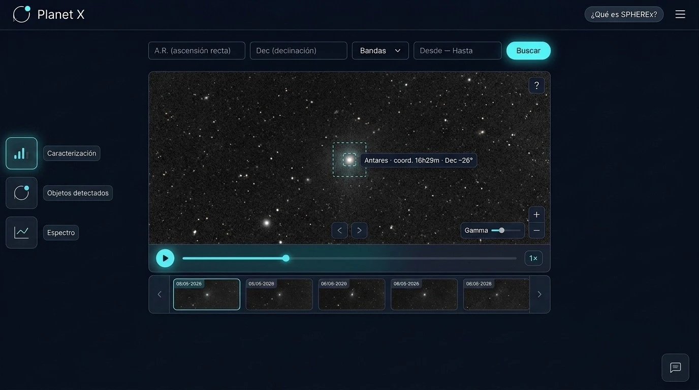

# Revisión de la maqueta del visor contra los datos reales (14-nov-2026)

Revisión de la maqueta del visor contra lo que mostró el EDA
([`../09_EDA_HALLAZGOS.md`](../09_EDA_HALLAZGOS.md)). No juzga el estilo: dice qué promete la
pantalla que los datos de SPHEREx no van a entregar así, y qué falta. Los dueños son los del plan
del equipo ([`../../README.md`](../../README.md) §3).

**Resumen:** la maqueta cubre casi todo lo que pide el desafío. Lo que más cambia con el EDA es que
**falta el botón de resta**, y que la imagen central y la tira de fotos prometen algo que los datos
reales no van a mostrar así.

---

## Cambios recomendados

| # | Qué cambiar | Por qué (dato del EDA) | Dueño |
|---|---|---|---|
| 1 | **Agregar el botón «Resta»** junto al ▶ (alterna parpadeo / resta) | El movimiento es de 1–2 px en todo el período: en el parpadeo casi no se nota; en la resta aparece como un par rojo/azul. Es la vista principal, no un extra. *(Estado 14-nov: `Visor.tsx` aún no tiene el botón de resta.)* | V1 Antonia (pantalla) · D2 Bryan (`diff_first`, `diff_prev`) |
| 2 | **La imagen central no va a ser así de nítida.** Usar el fondo como cielo de contexto (Aladin) y mostrar el recorte real de SPHEREx dentro del cuadro punteado, o asumir el pixelado con zoom sin suavizar | Un recorte de 0,1° mide 58×58 píxeles de 6,15″ | V2 Juan Pablo (Aladin) · V1 Antonia (recorte) |
| 3 | **Cambiar el ejemplo: Antares → Epsilon Indi B** | Antares es de las estrellas más brillantes del cielo: va a saturar. Las estrellas saturadas dejan un par rojo/azul en la resta aunque no se muevan (RW Aur). eps Ind B no satura y su movimiento medido coincide con el catálogo | V1 Antonia · N Javiera (demo) |
| 4 | **Corregir las fechas de la tira de fotos** y mostrar en cada miniatura **fecha y λ** | Las fechas de la maqueta incluyen 2020 y 2028; en los 5 campos de prueba hay datos del 24-abr-2025 al 2-oct-2026 (DR1 + QR3). Cada foto está en otra longitud de onda, y eso explica cambios de brillo | V1 Antonia |
| 5 | **La tira tiene 3–5 fotos, no decenas.** Una barra continua sugiere un video largo: mejor pasos discretos, uno por barrido | Por zona hay 3 o 4 barridos del cielo en 1–1,4 años (según `docs/09`; R Dra tiene observación casi continua y WISE 0855 termina en 2026,37) | V1 Antonia |
| 6 | **Estado de carga progresivo:** miniaturas vacías que se completan a medida que llega cada foto | Un recorte tarda 7,3 s de mediana y hasta 29 s; hubo errores 503 | V1 Antonia · D1 Vladimir (caché y precálculo) |
| 7 | **Avisos de calidad:** el recuadro «Contaminación» del plan y un aviso «objeto saturado: la resta puede engañar» | Los píxeles realmente malos son ~4 %; ojo: el bit SOURCE marca el 72 % y no es un error | D2 Bryan (`flagged_fraction`, saturación) · V1 Antonia · C Mauricio (qué se muestra) |
| 8 | **Panel lateral, «Espectro»:** se puede, pero no sale del cubo de IRSA | El cubo HiPS que carga Aladin son PNG para visualizar, sin flujos; la versión FITS no admite recortes. El espectro sale de las fotos de nivel 2, que ya tienen su λ calculada | V2 Juan Pablo · D2 Bryan |
| 9 | **Panel lateral, «Objetos detectados» → «Objetos conocidos»** (SIMBAD y Gaia sobre la imagen) | La detección automática quedó para «con 6 horas más» en el plan; el overlay de catálogos sí está | V2 Juan Pablo |

## Detalles rápidos

- **Buscar por nombre** («Barnard», «eps Ind B») además de A.R. y Dec: hace usable la herramienta para
  cualquiera, y `/api/resolve` ya está en el plan (D1 Vladimir). Ojo: «eps Ind B» con mayúscula es el
  par de enanas marrones; con minúscula es un planeta a 6,7′ (ver `data/campos_de_prueba.yml`).
- **Errata:** «deciinación» → «declinación».
- **Falta el pie con la atribución obligatoria de SPHEREx** (`docs/02_DATOS_SPHEREX.md` §8). *(Estado 14-nov: el pie existe en `App.tsx`, pero con un texto en español que no es el literal que exige IRSA; cambio de código pendiente de N/V1.)*
- **«Desde — Hasta»:** con 3–4 barridos filtra poco. Dejarlo prellenado con el rango real de datos.
- **Zoom + / −:** imprescindible para ver 1–2 px. Que el zoom no suavice los píxeles.

## Lo que la maqueta ya resuelve bien

- Coordenadas, bandas y búsqueda en una sola línea arriba.
- Controles de reproducción con velocidad, y gamma sobre la imagen.
- El botón «?» y «¿Qué es SPHEREx?» para quien llega sin saber astronomía.
- Panel lateral con espectro: es el «extra kudos» del desafío.

## Fuentes

Cifras de `eda/resultados/` (inventario, latencia, centroides, flags); detalle y método en
[`../09_EDA_HALLAZGOS.md`](../09_EDA_HALLAZGOS.md). Las tareas por rol están en
[`../10_REPARTO_DE_TRABAJO.md`](../10_REPARTO_DE_TRABAJO.md).
