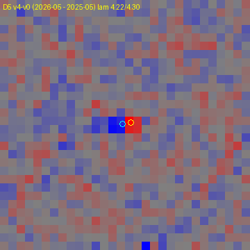

# Para Javiera: la presentación y la entrega

Sábado 14 de noviembre de 2026, noche. Desafío «Planet X and SPHEREx», NASA Space Apps 2026.

Todo lo que dice este documento sale de los documentos del equipo. Lo marcado **(revisar …)** hay que
confirmarlo con Juan Pablo antes de usarlo.

---

## 1. Lo que tienes que hacer tú y cuándo

| Cuándo | Qué |
|---|---|
| **Ahora, antes de la 01:00 del domingo** | Grabar el **video de respaldo de 2 minutos** con lo que ya funciona en la página. Juan Pablo solo lo revisa. No es opcional: si el internet falla durante la presentación, se pone el video sin pedir disculpas. |
| **Antes de las 05:00** | Ajustar el guion del pitch a lo que hay hoy (sección 3 y sección 6). El formato es **2 minutos de presentación y 2 preguntas** del jurado. |
| **Desde las 05:00 del domingo** | Llenar la **entrega en la plataforma** (unas 2 horas): nombre y resumen del proyecto, enlace a la demo, fuentes de datos (sección 4) y declaración de uso de inteligencia artificial (sección 5). Empieza a esa hora sí o sí. |
| **09:00** | **Entrega hecha.** Es la meta del equipo: deja dos horas de margen. Después se puede seguir corrigiendo. |
| **11:00** | **Cierre.** Después de esta hora no se recibe nada. |
| Antes del pitch | Ensayar 3 veces con cronómetro, incluidas las preguntas difíciles. |

Enlaces que van en el formulario:

- La herramienta: **https://spherex-planet-x-tau.vercel.app**
- El código: **https://github.com/mauriciovalenzuela742/SPHEREX** **(revisar que abra sin iniciar sesión)**

> [!TIP]
> Abre los dos enlaces y el video desde un celular **con datos móviles**, no con el wifi del evento.
> Así compruebas que el jurado los podrá abrir desde cualquier parte.

---

## 2. Qué hace nuestra herramienta, en simple

**SPHEREx** es un telescopio espacial de la NASA que, desde mayo de 2025, fotografía el cielo completo cada
seis meses en 102 «colores» de luz infrarroja (una luz que el ojo no ve).

Nuestra herramienta es una página web gratuita. Eliges un punto del cielo, con uno de los botones de los
cinco objetos o escribiendo su posición, y la página muestra todas las fotos de SPHEREx de ese pedazo de
cielo, una tras otra, **como un video corto**.

Además, puede **restar** dos fotos. Es como comparar dos fotos del mismo pedazo de cielo tomadas con un año
de diferencia: lo que se quedó quieto desaparece, y **lo que se movió aparece de dos colores**: azul donde
estaba y rojo donde está ahora.

Así se descubrió Plutón: un astrónomo comparó dos fotos del cielo y notó que un punto de luz se había
movido. Con esa misma técnica, cientos de miles de voluntarios han descubierto asteroides, cometas y
estrellas.

*Posición en el cielo:* se da con dos números, llamados A.R. y Dec. Funcionan como la longitud y la latitud
de un mapa, pero para el cielo.

---

## 3. Lo nuevo de hoy, para la presentación

Las frases entre comillas se pueden poner tal cual en una diapositiva.

### WISE 0855 se mueve, y se ve

*WISE 0855 es una enana marrón: una bola de gas demasiado grande para ser planeta, pero sin masa suficiente
para brillar como una estrella. Es uno de los objetos obligatorios del desafío.*

> «En un año, WISE 0855 se movió 1 píxel en las fotos de SPHEREx: unos 6 segundos de arco hacia el oeste,
> justo como se esperaba.»

- El *segundo de arco* mide qué tan grande se ve algo en el cielo. En estas fotos, un píxel equivale a unos 6.
- En la resta se ve como **una pareja azul y roja**, pegadas: azul donde estaba en mayo de 2025, rojo donde
  estaba en mayo de 2026.
- Solo se ve con una configuración especial, y esa consulta tarda alrededor de un minuto. En la presentación
  hay que usar la versión preparada de antemano o una captura, nunca esperarla en vivo.

*La imagen de arriba es la resta real de WISE 0855 (del documento de hallazgos del equipo). Los círculos
marcan dónde estaba en cada fecha.*

### El cielo abre limpio

> «El cielo abre limpio. Con un botón se encienden las marcas de otros catálogos del cielo, como Gaia,
> para comprobar que cada estrella está donde debe.»

El botón se llama **«Mostrar catálogos (Gaia, CatWISE, SIMBAD)»**. **(revisar con Juan Pablo: está
terminado, pero cuando se escribió esto aún no aparecía en la página publicada)**

### El parpadeo «hace 25 años contra hoy»

> «Comparamos las fotos de SPHEREx con fotos del mismo cielo de hace 25 años. La Estrella de Barnard se
> ve corrida unos 4 minutos de arco: el movimiento se ve a simple vista.»

- Las fotos antiguas **no son de SPHEREx**: son de otros dos telescopios, **2MASS** (fotos de 1997 a 2001,
  el botón dice «2MASS ~1999») y **AllWISE** (2010). Hay que decirlo así.
- Un minuto de arco son 60 segundos de arco. Barnard se corrió unos 265 segundos de arco, y WISE 0855,
  unos 122 desde 2010.
- **(revisar con Juan Pablo: está terminado, pero cuando se escribió esto aún no aparecía en la página
  publicada; si no entra antes de las 05:00, se apaga y no se menciona)**

### Los cinco objetos de prueba y qué muestra cada uno

| Objeto | Qué es | Qué se ve hoy |
|---|---|---|
| **Estrella de Barnard** | Una estrella cercana que se mueve rápido por el cielo | **El mejor ejemplo.** Pareja roja y azul clara, justo en el centro. Es tan brillante que «se quema» en la foto (como una foto con el sol de frente), así que la pareja son los bordes de la estrella. |
| **Epsilon Indi B** | Dos enanas marrones que giran alrededor de una estrella | La foto se ve bien, pero en la resta **no hay una pareja clara**. No usarla como ejemplo de movimiento. |
| **WISE 0855** | La enana marrón rápida del desafío | Con la configuración especial, la pareja azul y roja de 1 píxel. Con la normal, no se ve nada. |
| **RW Aurigae** | Una estrella variable: cambia de brillo | Se ve una estrella brillante. Se quema en la foto y no tenemos un gráfico de su brillo en el tiempo. **Se explica, no se exagera.** |
| **R Draconis** | Otra estrella variable | El centro sale como un agujero negro con un anillo, porque la estrella se quema en la foto. **Se explica, no se exagera.** |

---

## 4. Fuentes que hay que citar sí o sí

**Por qué:** las reglas del concurso exigen citar **todas** las fuentes de datos que usamos. Si falta una,
la NASA puede quitar el premio. Copia esta lista en el formulario.

1. **SPHEREx (NASA), datos servidos por IRSA** — https://irsa.ipac.caltech.edu/Missions/spherex.html.
   Texto obligatorio, copiado exacto (va en inglés):
   *This publication makes use of data products from the Spectro-Photometer for the History of the
   Universe, Epoch of Reionization and Ices Explorer (SPHEREx), which is a joint project of the Jet
   Propulsion Laboratory and the California Institute of Technology, and is funded by the National
   Aeronautics and Space Administration.*
2. **Gaia DR3 (ESA)**, consultado por VizieR (CDS) — https://archive.stsci.edu/missions-and-data/gaia
   **(revisar texto oficial)**
3. **CatWISE2020** (catálogo derivado de WISE/NEOWISE, NASA), consultado por VizieR (CDS)
   **(revisar texto oficial y enlace)**
4. **SIMBAD (CDS, Estrasburgo)** — https://simbad.cds.unistra.fr **(revisar texto oficial)**
5. **2MASS** — UMass/IPAC-Caltech, financiado por NASA/NSF. Imágenes servidas por IRSA.
   **(revisar texto oficial)**
6. **AllWISE** — NASA/JPL-Caltech/IPAC. Imágenes servidas por IRSA. **(revisar texto oficial)**
7. **Aladin Lite (CDS)**, el visor del cielo — https://aladin.cds.unistra.fr/AladinLite/
   **(revisar texto oficial)**
8. **Astropy**, herramientas de astronomía en Python — https://docs.astropy.org **(revisar texto oficial)**

> [!NOTE]
> Los puntos 5 y 6 solo van si el parpadeo «hace 25 años» llega a la versión final.

---

## 5. Uso de inteligencia artificial

> [!WARNING]
> **Esto es un borrador.** Revísalo con Juan Pablo antes de pegarlo: tiene que contar lo que de verdad
> pasó, ni más ni menos.

**Cómo usamos inteligencia artificial en este proyecto**

Usamos asistentes de programación basados en modelos de lenguaje como herramienta de trabajo durante el
evento **(revisar con Juan Pablo: nombrar los asistentes exactos que usó el equipo)**.

- **Qué les pedimos:** escribir código para conectarnos al archivo de datos de la NASA (IRSA), partes de la
  página, pruebas y documentación, siguiendo reglas que el equipo fijó al inicio y que están guardadas en el
  repositorio.
- **Cómo controlamos el resultado:** los cambios los revisó una persona antes de entrar al proyecto, y
  nada se dio por terminado porque un asistente lo dijera: se abrió y se comprobó contra datos reales
  **(revisar: confirmar que fue así en todos los casos)**.
- **Qué no hicimos:** no usamos inteligencia artificial para crear, inventar ni completar datos
  científicos. Todas las imágenes de SPHEREx que muestra la herramienta vienen de los archivos publicados
  por la misión a través de IRSA.
- **Por qué no la usamos para detectar objetos:** el desafío pide una herramienta para que las personas
  miren y descubran. Dejamos planteado, como paso siguiente, el uso de modelos pequeños para filtrar
  candidatos.

---

## 6. Qué NO decir

- **No digas que la herramienta muestra el espectro de un objeto** (de qué está hecho). Esa parte se
  recortó; solo hay una aproximación, rotulada como tal.
- **No digas que medimos el movimiento con precisión.** Decimos que «se ve que se movió, en la dirección
  esperada». La cifra exacta no es una medición científica.
- **No digas que funciona en celular.** No se probó.
- **No prometas lo que se apagó:** el sonido, el recuadro de «Contaminación», la traducción a otros idiomas,
  el chat de Spherix con inteligencia artificial y, si no llegan a las 05:00, el selector de colores nuevo o
  el parpadeo «hace 25 años». Si preguntan, se nombran como «lo que sigue». Tampoco digas que descubrimos
  algo nuevo.
