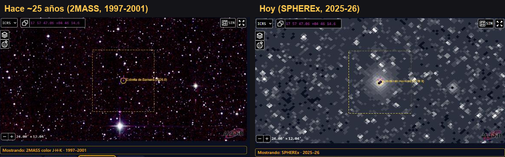
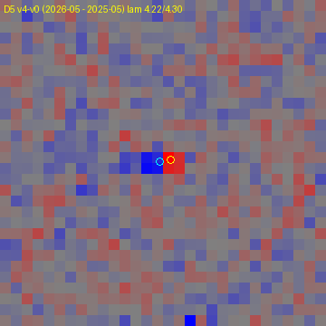
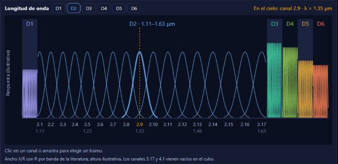

# Para Javiera: textos e imágenes para la presentación

Sábado 14 de noviembre de 2026. Todo lo que está entre comillas se puede copiar y pegar en Canva. Donde dice **[NOMBRE]**, va el nombre que elija el equipo (Astrotrack o Planet X).

---

## Diapositiva «Solución» (reemplaza el Lorem ipsum)

**Texto principal (copiar tal cual):**

> «[NOMBRE] es una página web gratuita para mirar el cielo con los ojos del telescopio SPHEREx de la NASA, que fotografía todo el cielo en 102 colores de luz infrarroja, una luz que el ojo no ve.»

> «Puedes pasar de un color a otro y ver cómo cambia el mismo pedazo de cielo.»

> «Puedes hacer parpadear una foto de hoy con una de hace 25 años y ver con tus propios ojos que algunas estrellas cercanas se movieron.»

> «Un Modo Misión te guía paso a paso para hacer lo mismo que hizo el astrónomo que descubrió Plutón: comparar fotos del cielo.»

**Si cabe un segundo bloque (en lugar de «About us»):**

> «Las fotos son reales: vienen del archivo público de la NASA. También puedes encender las marcas de otros catálogos del cielo (Gaia, CatWISE y SIMBAD) para saber qué es cada punto de luz.»

> [!TIP]
> En esa misma diapositiva quedan textos de la plantilla: «+611 Astronaut», «About us» y «Read More». Conviene cambiarlos o borrarlos. En la portada también queda «www.reallygreatsite.com»: ahí va el enlace de la herramienta, **spherex-planet-x-tau.vercel.app**.

---

## Imágenes para la presentación

Las tres son de la herramienta y de datos reales. Cada una lleva su pie de foto listo para copiar.

### 1. La estrella de Barnard, hace 25 años y hoy

**Pie de foto:** «El mismo pedazo de cielo con 25 años de diferencia. El círculo marca dónde está hoy la estrella de Barnard. A la izquierda (1997–2001) la estrella brillante aún está más abajo; a la derecha (hoy) ya llegó al círculo. Se movió unos 4 minutos de arco: más o menos la séptima parte del ancho de la Luna llena. Imágenes: 2MASS (UMass/IPAC-Caltech, NASA/NSF) y SPHEREx (NASA/JPL-Caltech/IRSA).»

*Ojo:* la foto de la izquierda **no es de SPHEREx**, es del telescopio 2MASS. Hay que decirlo así.

### 2. WISE 0855 se movió en un año

**Pie de foto:** «Restamos dos fotos de SPHEREx de la enana marrón WISE 0855, tomadas con un año de diferencia. Lo que no se movió desaparece. Azul: donde estaba en mayo de 2025. Rojo: donde estaba en mayo de 2026. Se movió un píxel hacia el oeste, como se esperaba. Imagen: SPHEREx (NASA/JPL-Caltech/IRSA).»

*Ojo:* esta resta la preparó el equipo con una configuración especial. No es una captura de la página en vivo.

### 3. El selector de colores infrarrojos

**Pie de foto:** «SPHEREx separa la luz infrarroja en 102 colores, agrupados en 6 bandas. Al abrir una banda se ven sus 17 colores; al elegir uno, el cielo cambia a ese color. La altura de las curvas es solo ilustrativa.»

---

## Diapositiva «Con [NOMBRE] podrías…» (propuesta de cambio)

**Por qué conviene cambiarla:** el jurado prueba la herramienta, y si una promesa no se cumple, resta puntos a todo el proyecto. Hoy la herramienta no detecta planetas nuevos, no muestra satélites en tiempo real, no identifica meteoritos y no descubre supernovas. Mejor prometer menos y que todo se cumpla.

| Hoy dice | Propuesta (todo esto la herramienta sí lo hace) |
|---|---|
| Detectar nuevos planetas y convertirte en un cazador de planetas | **Ver cómo se mueven estrellas cercanas comparando fotos de hace 25 años con las de hoy** |
| Ver satélites en tiempo real | **Ver el mismo cielo en 102 colores infrarrojos** |
| Descubrir supernovas | **Buscar estrellas que cambian de brillo** |
| Identificar un meteorito maligno | **Aprender a leer imágenes reales de la NASA** |
| Aprender sobre las estrellas | **Comparar fotos del cielo como lo hizo quien descubrió Plutón** |
| Jugar a ser un astrónomo desde tu hogar | **Se queda igual: esta sí vale** |

---

## Diapositiva «El desafío»: revisión de las cifras

Revisé la fuente original: *Minuta 24 OPPES-USACH, «Realidad del pregrado de la Educación Superior STEM en Chile»*, enero de 2024, https://fae.usach.cl/fae/docs/observatorioPP/Minuta24.pdf

| Cifra de la diapositiva | Qué dice la fuente | Resultado |
|---|---|---|
| 3 de cada 10 matrículas son STEM | Página 4: 28,36 % de la matrícula de pregrado (2023) | **Confirmada** (es «casi 3 de cada 10») |
| Solo 7,5 % de la matrícula STEM es de ciencias naturales o matemáticas | Página 6: 7,54 % en 2023 | **Confirmada** |
| Crecimiento promedio de 5,2 % al año | Página 4: 5,19 % promedio anual | **Está en la fuente**, ver nota |
| Barras de 176 a 327 mil | Página 4: la matrícula STEM total va de 193 mil (2007) a 354 mil (2023) | **Revisar el rótulo**, ver nota |

**Nota sobre las barras.** Los números 176, 231, 283, 304 y 327 están bien calculados, pero no son la matrícula STEM total: son la parte azul, es decir, STEM **sin** ciencias naturales y matemáticas. La parte naranja (20, 23, 24, 27) son ciencias naturales y matemáticas. La barra completa sí es el total (193 a 354 mil). Propuesta: poner una leyenda «Azul: ingeniería y tecnología · Naranja: ciencias naturales y matemáticas», o escribir el total arriba de cada barra. Al naranja de 2007 le falta su número (17).

**Nota sobre el 5,2 %.** La fuente lo calcula como el crecimiento total (83 %) dividido por 16 años. Si se calcula como crecimiento anual compuesto, que es lo habitual, da 3,9 % al año. Para evitar preguntas, la frase más segura es: **«La matrícula STEM casi se duplicó entre 2007 y 2023: de 193 mil a 354 mil (+83 %).»**

---

## Créditos de imágenes

- **Ilustración de SPHEREx (diapositiva «Contexto»):** es un concepto artístico de la NASA. Crédito: **«Ilustración: NASA/JPL-Caltech»**. No logré identificar el número exacto de esa imagen en el archivo de la NASA; si la bajaste de una página de la NASA o del JPL, usa el crédito que aparece ahí.
- **Imágenes de la herramienta:** «SPHEREx: NASA/JPL-Caltech/IRSA», «2MASS: UMass/IPAC-Caltech (NASA/NSF)» y, si se usa la de 2010, «AllWISE: NASA/JPL-Caltech/IPAC».
- Las fotos de fondo y los planetas de la portada vienen de la plantilla de Canva y no son fotos de la NASA: no conviene presentarlos como fotos reales del cielo.
- La lista completa de fuentes para el formulario de entrega está en el documento anterior («Para Javiera: la presentación y la entrega», sección 4).
