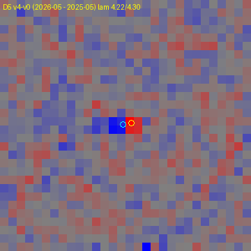
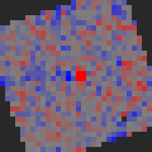
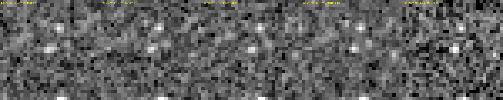

# WISE 0855: cómo se ve su movimiento en SPHEREx

14-nov-2026. Autor: Juan Pablo (V2). Medido con datos reales de SPHEREx DR1. Las imágenes se miraron una por una.

## Conclusión

**El movimiento de WISE 0855 sí se ve en SPHEREx, pero solo con la configuración correcta:** banda **D5**,
**10 exposiciones combinadas por visita**, y la **primera visita (6-may-2025) contra la última (13-may-2026)**.
La resta muestra una pareja limpia en el centro: **azul al este** (donde estaba) y **rojo al oeste** (donde
está), separados ~1 píxel.

Con **una sola exposición por visita**, que es lo que usa hoy el Modo Misión, **no se ve**: la resta muestra una
sola mancha roja entre ruido, que probablemente viene del cambio de longitud de onda y no del movimiento.

*Resta D5, mayo 2026 menos mayo 2025 (λ 4,30 y 4,22 µm), igualando el brillo con el propio objeto. Norte arriba,
este a la izquierda; los círculos marcan la posición ajustada en cada fecha.*

## Qué se midió

Ajuste gaussiano de la posición en cada una de las 5 visitas de D5 (recortes de 30×30 px a 6,15″/px):

| Visita | Fecha | λ (µm) | Exposiciones | Señal/ruido | x (px) | y (px) |
|---|---|---|---|---|---|---|
| 0 | 2025-05-06 | 4,221 | 8 | 10,9 | 14,17 ± 0,08 | 14,66 ± 0,08 |
| 1 | 2025-11-07 | 4,107 | 10 | 11,8 | 14,68 ± 0,07 | 14,81 ± 0,07 |
| 2 | 2025-12-12 | 4,136 | 6 | 12,3 | 14,64 ± 0,05 | 14,63 ± 0,05 |
| 3 | 2026-05-02 | 4,039 | 10 | 16,2 | 15,14 ± 0,05 | 14,87 ± 0,05 |
| 4 | 2026-05-13 | 4,295 | 5 | 17,0 | 15,21 ± 0,04 | 14,76 ± 0,04 |

(x crece hacia el oeste e y hacia el norte en estos recortes.)

| | Medido | Predicho (SIMBAD) |
|---|---|---|
| Primera → última (1,02 años), hacia el oeste | **1,04 px** (6,4″) | 1,35 px (8,3″) |
| Primera → última, hacia el norte | 0,10 px | 0,11 px |
| Recta sobre las 5 visitas, D5 | 1,05 px/año → pmra ≈ −6.440 mas/año | 1,32 px/año → −8.124 mas/año |
| Recta sobre las 5 visitas, D6 | 1,45 px/año → pmra ≈ −8.890 mas/año | igual |

- La **dirección es la correcta** (oeste y un poco al norte), y la dispersión alrededor de la recta es de solo
  0,06–0,07 px.
- La **magnitud en D5 sale ~20 % corta** y en D6 ~10 % larga. No se investigó por qué. Puede ser el sesgo del
  ajuste con una imagen tan poco muestreada (la estrella ocupa ~1 px) o el registro entre fotos: en D5 hay una
  sola estrella de referencia (quieta dentro de ±0,15 px) y en D6 ninguna.
- **Para el pitch:** decir «se movió 1 píxel (unos 6″) en un año, hacia el oeste, como se esperaba». No usar la
  cifra como medición de precisión del movimiento propio.

## Cómo pedirlo y qué cuidar

- URL que da las 5 visitas y la resta:
  `/proto-api/frames?ra=133.759765&dec=-7.242186&band=5&size=0.05&max_visits=20&per_visit=10`
  (`ra`/`dec` = posición propagada a 2026,0).
- **Tardó 61,8 s.** En las peticiones por visita hubo tiempos agotados (~49 s) que pasaron al reintentar, y un
  503 de IRSA. **Para la demo hay que dejarlo precalculado o en caché.**
- La resta tal como la entrega el servidor muestra la pareja, pero desequilibrada (rojo fuerte, azul débil),
  porque iguala el brillo con el 5 % de píxeles más brillantes del recorte (factor 1,58). Igualando con el
  propio objeto, el factor es 0,85 y la pareja queda simétrica. El ajuste se le pidió a Bryan
  (`docs/pedidos/`, punto 2e).

- **D6 no sirve para mostrarlo:** la pareja no se distingue bien del ruido. En D6, la combinación con λ más
  parecida (4,69 y 4,67 µm) tiene solo 0,44 años de base (0,54 px) y da una mancha alargada. Para mostrar el
  movimiento pesa más una base de tiempo larga con buena señal que una λ exactamente igual.
- WISE 0855 **no tiene datos en QR3**: todo lo que hay es DR1 (mayo 2025 a mayo 2026).

*Las 5 visitas de D5, de mayo de 2025 a mayo de 2026. El objeto se ve en las 5, cerca del centro.*

## Qué datos usamos: solo SPHEREx en las imágenes

- **Las imágenes y la resta son 100 % SPHEREx** (DR1, IRSA). Ni la medición ni las figuras de este documento
  usan otros telescopios.
- **La posición predicha** sale de la posición y el movimiento propio que publica SIMBAD (`src/content/campos.ts`).
- **En el visor del cielo**, encima del cubo de SPHEREx, se superponen **catálogos** de otras misiones: Gaia DR3
  (ESA; WISE 0855 no está en Gaia), **CatWISE2020** (derivado de WISE/NEOWISE, NASA; es el que marca a WISE
  0855) y SIMBAD. No se muestran **imágenes** de otros telescopios.

## Qué no se comprobó

- Por qué la magnitud medida en D5 sale ~20 % corta.
- Elegir exposiciones concretas dentro de una visita (el servidor siempre toma las del centro).
- Un recorte más grande con más estrellas de referencia; sumar D5 y D6; la banda D4.
- La paralaje (~0,44″, ~0,07 px), que no se modeló.

Respaldo y scripts: `eda/wise0855_movimiento/`.
