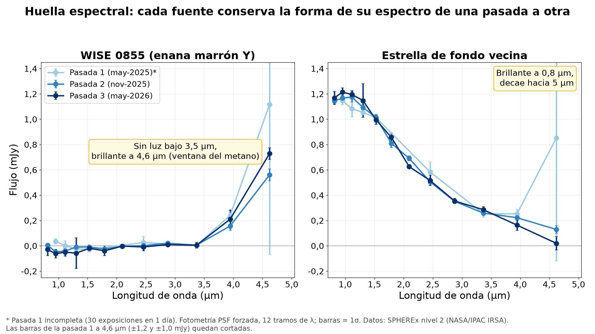
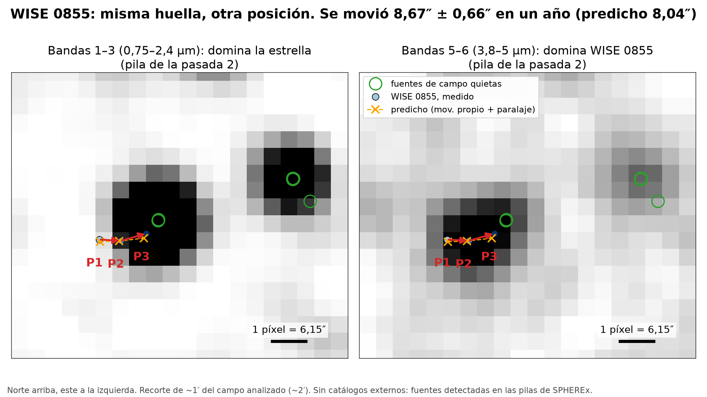
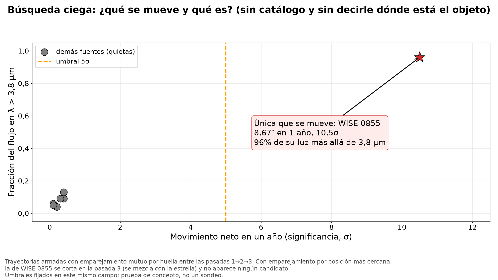
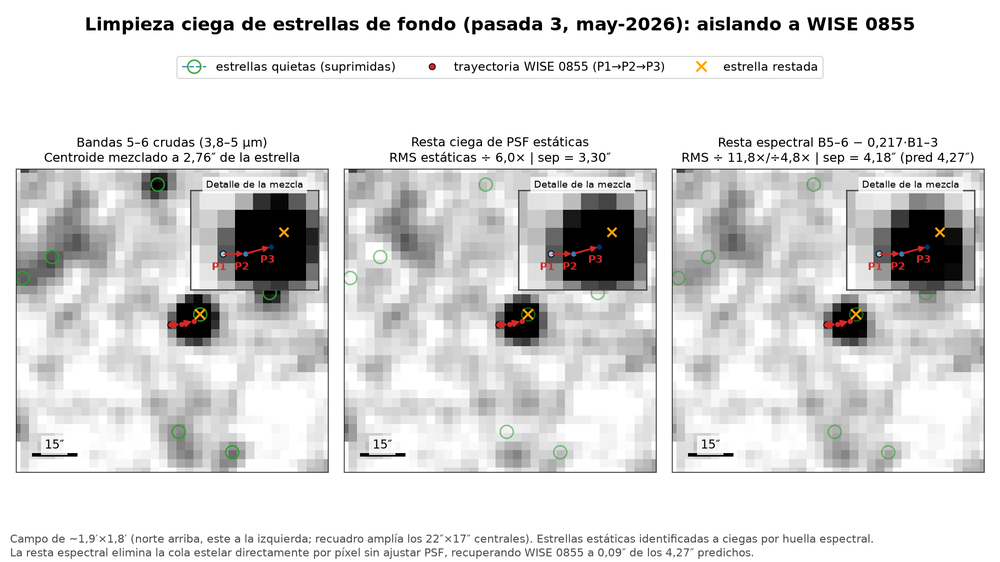

# Huella espectral en SPHEREx: seguimiento de WISE 0855, limpieza de fondo, análisis de los 5 objetivos y diagnóstico del cielo

**Conclusión directa:** usando exclusivamente imágenes reales de SPHEREx nivel 2 (NASA/IPAC IRSA) y **sin catálogos externos**, medimos el movimiento propio + paralaje de la enana marrón Y2 **WISE 0855−0714** (**8,67″ ± 0,66″** en un año vs **8,04″** predicho), lo separamos en plena mezcla a medio píxel de una estrella de fondo mediante su huella espectral de `0,75–5,0 µm`, limpiamos esa estrella de forma ciega por resta espectral directa $I_{\text{largo}} - 0{,}2169\,I_{\text{corto}}$ hasta recuperar la separación orbital verdadera a **0,09″** (**4,18″** vs **4,27″** predicho), extendimos la prueba a **todos los 5 objetivos oficiales** (`1.918` exposiciones) y medimos el espectro zodiacal/galáctico del **propio fondo del cielo sin restar mediana**.

---

## 1. Pregunta y relación con el desafío

El enunciado oficial del desafío [*Planet X and SPHEREx*](../00_DESAFIO.md) destaca dos pilares que rara vez se unen en un solo instrumento:

> *"Watching for these motions help us discover new astronomical objects and also help measure the distances to these objects."*
>
> *"It may help users discover moving objects if they have the options to add together or subtract..."*

WISE 0855 aparece como caso de referencia explícito porque combina flujo prácticamente nulo por debajo de `3,5 µm`, brillo concentrado en la ventana del metano (`4,6 µm`) y una estrella de fondo hacia la que cruza entre 2025 y 2026 a pocos segundos de arco (menos de un píxel nativo de `6,15″` de SPHEREx en la pasada 3). En un visor puramente acromático (como el parpadeo clásico), la enana marrón y la estrella se funden en una sola mancha. Aquí mostramos qué aporta la espectrofotometría nativa de SPHEREx cuando la tratamos como **identificador de objeto y herramienta de sustracción física**.

---

## 2. Principio físico e instrumento

A diferencia de los filtros de banda ancha convencionales, SPHEREx opera con **filtros lineales variables (LVF)**: a lo largo del eje del detector de `2040×2040` píxeles (`6,15″/px`) la longitud de onda cambia de forma continua en `6` detectores (`D1–D6`, `0,75–5,0 µm`). Conforme la órbita y el cabeceo del satélite barren una zona del cielo durante una pasada (`~9–17` días nominales según la cadencia analizada en `cobertura_espectral.md`), la suma de exposiciones cubre `98–102` de los `102` canales espectrales de forma simultánea.

Esto permite construir para cada fuente detectada una **huella espectral propia** en `12` tramos logarítmicos (`0,75–5,0 µm`) sin recurrir a catálogos externos.

---

## 3. Datos reales utilizados (NASA/IPAC IRSA)

Recortes calibrados nivel 2 (`23×23` píxeles nativos, `~2,36′×2,36′`) obtenidos del archivo oficial de IRSA para los **5 campos de ejemplo oficiales** del reto (`1.918` exposiciones totales, agrupadas en pasadas por cortes `> 30` días en MJD):

| Objetivo | Exposiciones | Pasadas | Ventana MJD | Naturaleza física |
|---|---:|---:|---|---|
| **WISE 0855−0714** | 258 | 3 | `60800,7 – 61174,3` | Enana marrón Y2 en mezcla con estrella de fondo (`P1`: 30 exp en `0,8 d` `2025-05-05`–`06`; `P2`: 128 exp `2025-10-31`–`2025-12-13`; `P3`: 100 exp `2026-04-21`–`2026-05-14`) |
| **ε Ind B (Ba+Bb)** | 454 | 4 | `60789,9 – 61315,5` | Binaria T1+T6 brillante; `P4` carece de `D1` y `D4` (solo bandas `[2, 3, 5, 6]`) |
| **Estrella de Barnard** | 356 | 3 | `60902,9 – 61305,6` | Enana M cercana de altísimo movimiento propio (`~K = 4,5`), núcleo parcialmente saturado/no gaussiano |
| **RW Aurigae** | 331 | 3 | `60919,4 – 61299,9` | Estrella joven T Tauri estacionaria con variabilidad espectral intrínseca y alas PSF extensas |
| **R Draconis** | 519 | 3 | `60812,0 – 61237,9` | Variable Mira (~2–3 Jy) que satura el centro en `518/519` exposiciones (`99,81 %`) |
| **Total** | **1.918** | **3–4** | — | Validación completa multi-régimen |

---

## 4. Método paso a paso

1. **Apilado por pasada y grupo de banda (`paso1_apilar.py`)**: reproyecta los recortes a una subrejilla común tangencial `41×41` de `3,075″/px` (medio píxel nativo) separando cada pasada en tres grupos: **corto** (`B1–3`, `0,75–2,42 µm`), **medio** (`B4`, `2,42–3,82 µm`) y **largo** (`B5–6`, `3,82–5,0 µm`), restando la mediana espacial por exposición en la rama fotométrica/astrométrica (y **preservando el nivel absoluto sin restar mediana** en `analisis_fondo.py`).
2. **Detección ciega y separación cromática conjunta (`paso2_detectar.py`)**: busca picos `> 5σ` por grupo espectral sin lista previa. Si en bandas largas queda residuo o un centroide desplazado cromáticamente respecto al de bandas cortas, ajusta conjuntamente dos PSF gaussianas para desmezclar la componente roja y la azul.
3. **Fotometría PSF forzada en 12 tramos (`paso3_huella.py`)**: usando las posiciones detectadas de cada pasada y el perfil PSF nominal por banda (`σ = 0,40; 0,40; 0,40; 0,45; 0,55; 0,60` px nativos en `D1–D6`), resuelve simultáneamente los flujos de todas las fuentes del campo en `12` bines logarítmicos (`0,81` a `4,62 µm`).
4. **Distancia espectral invariante a la escala ($D$)**: entre el espectro $A$ y el $B$ calcula el mínimo en el factor de escala $s > 0$ del $\chi^2_{\nu}$ reducido con piso sistemático de `5 %`:
   $$D(A, B) = \min_{s > 0} \frac{1}{N_{\text{ok}} - 1} \sum_k \frac{(A_k - s B_k)^2}{\sigma_{A,k}^2 + (s \sigma_{B,k})^2 + [0{,}05\,\max(|A_k|, |s B_k|)]^2}$$
5. **Emparejamiento mutuo y búsqueda ciega (`busqueda_ciega.py`)**: compara el emparejamiento mutuo recíproco (radio `3` px nativos = `18,45″`) usando distancia geométrica vs distancia espectral $D$, imponiendo umbral `5σ` en el desplazamiento neto (con piso astrométrico `0,25″` por eje y pasada).
6. **Limpieza ciega del fondo estelar (`limpieza_fondo.py`)**: elimina todas las fuentes estáticas identificadas a ciegas mediante dos vías: (i) ajuste y resta PSF conjunta en bandas largas dejando solo la candidata móvil, y (ii) resta espectral directa por píxel $I_{\text{largo}} - c_p - \alpha\,I_{\text{corto}}$, donde $\alpha$ se calibra exclusivamente sobre los píxeles de las estrellas estáticas ciegas.

---

## 5. Resultados en WISE 0855: huella, astrometría y búsqueda ciega

- **Separación espectral extrema:** WISE 0855 permanece compatible con cero bajo `3,5 µm` (`máx |flujo| = 0,036 / 0,048 / 0,062 mJy` en `P1/P2/P3`) y concentra el **`95,7 %`** de su flujo por encima de `3,8 µm` (`0,560 ± 0,047 mJy` en P2 y `0,728 ± 0,046 mJy` en P3 a `4,62 µm`; en P1 `1,12 ± 1,19 mJy`). La estrella de fondo vecina sigue el comportamiento inverso: `1,14–1,17 mJy` a `0,81 µm` cayendo hasta `0,129 mJy` (P2) y `0,019 mJy` (P3) a `4,62 µm` (`4 %` de flujo `> 3,8 µm`).
- **Distancia espectral $D$:** comparar WISE 0855 consigo mismo entre pasadas da $D = 2{,}16$ (`1–2`), **`0,12`** (`2–3`) y `1,52` (`1–3`); entre estrellas estáticas del campo `0,29–3,13` (`20` pares). En cambio, estrella $\rightarrow$ WISE 0855 da **`177,3–257,1`** (y WISE 0855 $\rightarrow$ estrella **`4,71–13,11`**).

- **Astrometría y desmezcla en P3:** WISE 0855 se mueve **`8,67″ ± 0,66″`** error formal (`10,5σ` incluyendo el piso sistemático de `0,25″/eje`; `13,19σ` formal) en `360,1` días, frente a **`8,04″`** predicho por movimiento propio + paralaje (diferencia vectorial de **`0,75″`**). Tramos parciales: `3,92″ ± 0,65″` vs `3,49″` (`1–2`) y `4,87″ ± 0,52″` vs `4,55″` (`2–3`).
- **Resolución cromática en mezcla cerrada:** las `6` fuentes estáticas del campo repiten su posición entre `P1` y `P3` con mediana **`0,121″`** (máx `0,320″`; `0,164″` mediana y `0,370″` máx entre los `18` pares mutuos). La separación medida WISE 0855–estrella baja de `11,36″` (pred `11,40″`) en `P1` a `7,75″` (`8,07″`) en `P2` y **`3,30″`** (`4,27″`) en `P3`, resuelta gracias al desplazamiento cromático de `~2,8″` (`14σ`) entre los centroides de bandas cortas y largas.

- **Por qué la huella salva la búsqueda ciega:** sin darle coordenadas previas ni catálogos (`busqueda_ciega.py`), el emparejamiento mutuo por **posición más cercana** entrega `6` trayectorias completas, `3` rotas desde `P1`, `3` huérfanas en `P3` y **`0` candidatas móviles**: la trayectoria de WISE 0855 se rompe al pasar de `P2` a `P3` porque en `P3` la posición de WISE 0855 queda más cerca de la estrella estática (`3,30″`) que de su propia posición en `P2` (`4,87″`), rompiendo la reciprocidad geométrica. El emparejamiento mutuo **por huella espectral** recupera **`7` trayectorias completas**, `2` rotas, `2` huérfanas y **`1` única candidata móvil**: WISE 0855 (`8,67″`, `10,5σ`, `96 %` de flujo `> 3,8 µm`). *Nota honesta:* en los `6` pares de estrellas quietas bien separadas dentro de este mismo campo, la huella no alteró ningún emparejamiento (`0` cambios), y una fuente de borde mostró falsos saltos de `1,57″`/`1,62″` en pasadas intermedias regresando a `0,16″` en `P1–P3`.

---

## 6. Extensión a los 5 objetivos oficiales del desafío (`cinco_objetos.py`)

Aplicamos exactamente la misma lógica multipasada y ciega a los **5 objetos oficiales** (`1.918` exposiciones reales):

| Objetivo | Resultado clave | Cifras verificadas | Régimen / límite observado |
|---|---|---|---|
| **wise_0855** | Desmezcla ciega y candidato único | `8,67″ ± 0,66″` (`10,5σ`) vs `8,04″`; `D = 0,12–2,16`; `1` candidata por huella vs `0` por posición | Caso óptimo: alto contraste espectral en `B5–6` |
| **eps_ind_b** | Rastreo ciego 4 pasadas y zigzag por paralaje | Net `6,62″` (`13,16σ`) vs `6,31″` (`6,52″` usando MJD de grupo `P1→P4`; dif vectorial `0,57″`/`0,48″` vs `0,97″` sin paralaje); zigzag `2,24″ / 2,90″ / 1,99″` vs `1,78″ / 2,82″ / 1,86″`; `D(1–4)=0,67`; estrella de campo a `58,56″` quieta (`0,36″`, `D=0,27`) | Tolerancia demostrada a pérdida de detectores (`P4` sin `D1/D4`) |
| **barnard** | Astrometría precisa, espectro central bloqueado | Net `10,26″` vs `10,31″` (`dif = 0,46″`); `1–2: 6,61″` (`5,94″`), `2–3: 4,10″` (`4,58″`); `1` fuente detectada/pasada | Núcleo brillante (`~K=4,5`) con saturación parcial / PSF no gaussiana |
| **rw_aur** | Variable espectral estacionaria vs móvil | Desplazamiento `0,28″` (`P1–P3`), pero **`D(2–3) = 17,31`** (`0` candidatas móviles); `8` estrellas exteriores aisladas quietas (`< 0,40″`, med `0,13″`) | Alas no gaussianas inducen `4 / 1 / 0` detecciones secundarias falsas a `<= 5,5 px` |
| **r_dra** | Frontera de saturación | `518 / 519` exp (`99,81 %`) con `3×3` central no finito (`20 / 461 / 47` NaNs en `corto/medio/largo` sobre `5.043` px); ala cae `-0,97 MJy/sr` en `B5–6` | Fuera del régimen lineal de fotometría PSF |

---

## 7. Limpieza ciega del fondo estelar (`limpieza_fondo.py`)

¿Se puede «borrar» el cielo de estrellas quietas para ver moverse el objeto con claridad total en un visor? Probamos dos métodos sobre las pilas `P1–P3` de WISE 0855 usando **únicamente las etiquetas estáticas devueltas por la búsqueda ciega**:

1. **Método 1 — Resta PSF ciega de estrellas estáticas (bandas largas `B5–6`):** ajusta simultáneamente $\sigma_{\text{PSF}}$, fondo y amplitud de las `9` fuentes y resta el modelo de fondo más las `8` estáticas. Reduce la RMS residual de las `7` estrellas estáticas aisladas en un factor **`5,20×` (`P1`), `4,96×` (`P2`) y `5,95×` (`P3`)**, dejando a WISE 0855 en `P3` con `SNR_int = 50,1`, separación `3,30″` y movimiento neto `8,46″ ± 0,43″`.
2. **Método 2 — Resta espectral directa por píxel ($I_{\text{largo}} - c_p - \alpha\,I_{\text{corto}}$, sin ajustar PSF):** calibrando únicamente la pendiente estelar global sobre los píxeles de las estrellas estáticas ciegas ($\alpha = 0{,}2169 \pm 0{,}0037$, con offsets `{1: 0,00522; 2: 0,00182; 3: 0,00548} MJy/sr`), la resta directa entre imágenes suprime la RMS estática **`7,03×` (`P1`), `9,02×` (`P2`) y `11,75×` (`P3`)** respecto a las bandas cortas (`2,96× / 3,32× / 4,76×` respecto a las largas crudas). Más notable aún: al eliminar sin modelo de PSF la cola infrarroja Rayleigh-Jeans de la estrella superpuesta en `P3` (donde la imagen larga cruda mezclaba el centroide a `2,76″`), **recupera a WISE 0855 a `4,18″` de la estrella vecina —a solo `0,09″` de los `4,27″` predichos orbitalmente** (`SNR_int = 41,8`, `P1→P3 = 7,80″ ± 0,44″`).

---

## 8. Análisis del propio fondo del cielo, nebulosas y taxonomía de eventos (`analisis_fondo.py`)

Procesamos **sin restar mediana por exposición** todos los **`1.918` recortes calibrados** (`584.924` píxeles válidos de fondo tras enmascarar `r < 8 px` nativos del centro y `r < 2,5 px` de cada fuente detectada, con proyección WCS+SIP verificada a `0,00e+00 px` frente al encabezado completo de Astropy):

### 8.1 Espectro del fondo real (`MJy/sr`) y gradiente zodiacal / galáctico

| Campo | $\beta_{\text{ecl}}$ (°) | $b_{\text{gal}}$ (°) | `D2` (`~1,3 µm`) `p25` / med | `D4` mín (`~3,0 µm`) `p25` | `D5` (`~4,1 µm`) `p25` / med | Régimen dominante |
|---|---:|---:|---:|---:|---:|---|
| **rw_aur** | `+7,47` | `-6,00` | `0,3963` / `0,4178` | `0,2336` | `0,3119` / `0,3720` | Baja latitud eclíptica: **máximo zodiacal** (`2,05×` sobre ε Ind B en `D5`) |
| **wise_0855** | `-23,62` | `+23,32` | `0,2253` / `0,2480` | `0,1224` | `0,1894` / `0,2396` | Fondo limpio; mínimo cósmico en `2,88 µm` (`0,115 MJy/sr`) y subida térmica a `4,62 µm` (`0,357`) |
| **barnard** | `+28,21` | `+14,10` | **`0,6571` / `0,8102`** | `0,3399` | `0,3113` / `0,3903` | Proximidad al plano galáctico interior (`l=31,1°`): exceso `~2,7×` en `D1–D3` por estrellas tenues no resueltas y luz difusa |
| **eps_ind_b** | `-41,49` | `-48,16` | `0,2402` / `0,2648` | `0,1161` | **`0,1521` / `0,1900`** | Cielo limpio de alta latitud: cae de `0,336` (`0,95 µm`) al mínimo de `0,108` (`3,37 µm`) y sube térmicamente a `0,279` (`4,62 µm`) |
| **r_dra** | `+81,39` | `+38,23` | `2,2420` / `3,4787` | `2,6009` | `2,9738` / `4,3744` | **Dominado por el halo PSF saturado de R Dra:** el «fondo» externo decae por pasada (`5,79 → 3,99 → 3,37 MJy/sr` en `D5`) siguiendo la pulsación de la estrella Mira |

En los 4 campos no saturados, la banda térmica `D5` sigue el gradiente esperado con la latitud eclíptica (`r_Pearson = -0,692` con $|\beta|$, `+0,605` con $\csc|\beta|$, siendo `rw_aur` **`2,05×`** más brillante que `eps_ind_b`), mientras en `D2` (`1,3 µm`) la luz estelar galáctica no resuelta en `barnard` rompe la correlación simple (`r = -0,176`).

### 8.2 ¿Qué podemos hacer en el fondo y se pueden detectar nebulosas u otros eventos?

Sí, con una condición diagnóstica clave demostrada en nuestras mediciones 2D de residuos normalizados $(S - M)/\sigma$ tras ajustar y restar todas las PSF gaussianas de las pilas (`pilas_wise_0855.npz` vs `pilas_rw_aur.npz`):

- **Separar ruido de fondo limpio frente a halos/alas PSF:** dentro de $r \le 5\text{ px}$ del objetivo, **WISE 0855** presenta desviación normalizada `std_norm = 0,592 – 1,439` (`0,0 %` de píxeles $> 3\sigma$ en `P1/P2/P3 largo` y `P1/P2 medio`), mientras que **RW Aur** explota a **`std_norm = 58,9 – 199,7`** con **`29,5 % – 71,8 %`** de píxeles $> +3\sigma$ **y simultáneamente `26,9 % – 69,2 %`** de píxeles $< -3\sigma$ (anillos simétricos positivos/negativos por alas PSF no gaussianas de una estrella brillante, visibles también fuera de `r > 5 px` con `std_norm = 12,4 – 27,2`). Un **gas difuso o nebulosa real** produciría residuos espacialmente coherentes **estrictamente positivos** ($> +3\sigma$ sin anillos negativos $-3\sigma$) y confinados en bandas espectrales diagnósticas.
- **Firmas espectrales difusas/nebulares accesibles en `0,75–5,0 µm` (bins logarítmicos 8–11):**
  - **Hielo $\text{H}_2\text{O}$ (`3,05 µm`, `D4`, bin 8: `2,657–3,112 µm`)** — absorción interestelar en nubes moleculares frías.
  - **Emisión PAH (`3,29 µm`, `D4`, bin 9: `3,112–3,645 µm`)** — bandas aromáticas en frentes de fotodisociación y bordes de nebulosas $\text{H II}$.
  - **$\text{H I}$ Brackett $\alpha$ (`4,051 µm`, `D5`, bin 10: `3,645–4,269 µm`)** — gas ionizado difuso (a resolución $R \approx 41{,}5$ en `D5`, las líneas estrechas se diluyen en regiones débiles pero destacan en nebulosas brillantes).
  - **Hielo $\text{CO}_2$ (`4,26 µm`, `D5/D6`, bins 10–11: `3,645–5,0 µm`, contiguo a hielo $\text{CO}$ a `4,67 µm`)** — absorbente clave en envolturas protoestelares y nubes oscuras.
- **Taxonomía observacional unificada $(\Delta\text{pos}, D)$:**

| Clase de evento | $\Delta\text{pos}$ entre pasadas | Distancia espectral $D$ | Ejemplo verificado aquí |
|---|---|---|---|
| **Estrella estática** | $< 3\sigma$ (`~0,1–0,4″`) | Bajo (`~0,1–2,8`) | Estáticas en `wise_0855` (`0,12″`, `D=0,3–2,2`) y `eps_ind_b` (`0,36″`, `D=0,27`) |
| **Objeto cercano móvil (Planeta X / enana marrón)** | $\ge 5\sigma$ | Bajo entre pasadas (`< 3`); alto frente a vecinas | `wise_0855` (`8,67″`, `10,5σ`), `eps_ind_b` (`6,62″`, `13,2σ`), `barnard` (`10,26″`) |
| **Variable espectral / YSO estacionaria** | $< 3\sigma$ (`<= 0,4″`) | Muy alto (`> 5`) | `rw_aur` (`0,28″` neto, **`D(2–3) = 17,31`**) |
| **Fuente brillante saturada** | Centro con NaNs | No lineal / halo domina | `r_dra` (`99,81 %` exp con `3×3` central no finito) |
| **Nebulosa / exceso difuso extendido** | Extendida (`> 20″`, multipíxel) | Exceso $> 3\sigma$ unilateral en bins específicos (`3,05; 3,29; 4,05; 4,26 µm`) tras restar PSF | `wise_0855` fondo limpio vs halo PSF simétrico de `rw_aur` |

---

## 9. Límites honestos (separación entre lo medido y lo supuesto)

1. **Prueba de concepto ajustada en un solo campo:** en los `6` pares de estrellas estáticas bien separadas de `wise_0855`, el emparejamiento por huella dio exactamente el mismo resultado que el posicional (`0` cambios), y los umbrales (`R = 18,45″`, `5σ`, `piso 0,25″`) se fijaron sobre este campo, no mediante un estudio ciego calibrado en cientos de campos con tasa conocida de falsos positivos.
2. **Aproximación de PSF y régimen lineal:** modelamos la PSF como gaussiana fija por banda (`0,40–0,60` px nativos) sin propagación completa de covarianzas entre los `12` bines ni alas difractivas extensas (`barnard`, `rw_aur`, `r_dra`).
3. **Incompletitud y falta de bandas:** `P1` de WISE 0855 tiene solo `30` exposiciones en `0,8` días (de ahí las barras de error de `±1,2` y `±1,0 mJy` a `4,62 µm`), y `P4` de `eps Ind B` carece de `D1` y `D4`, reduciendo bines válidos.
4. **Regla astrométrica de la resta espectral:** $\alpha = 0{,}2169$ asume pendiente uniforme `B5–6 / B1–3` representativa de las estrellas de fondo del campo; estrellas extremadamente enrojecidas o variables espectrales (`rw_aur`) dejan residuo positivo o negativo tras la resta.

---

## 10. Extensiones priorizadas

| Prioridad | Extensión propuesta | Esfuerzo | Qué demostraría | Riesgo principal |
|---|---|---|---|---|
| **1 (Hecha aquí)** | Evaluar los 5 objetivos del reto + limpieza por resta espectral + espectro del fondo | Ejecutada | Generalidad a 4 pasadas/bandas faltantes, recuperación a `0,09″` de mezcla y separación móvil vs variable/halo | Muestra limitada a 5 campos seleccionados |
| **2** | Sondeo ciego en ~20 campos aleatorios del plano y fuera del plano galáctico validando después contra Gaia/CatWISE | Medio (`~1 día`) | Tasa real de falsos positivos (bordes/variables/halos) y calibración automática de umbrales | Confusión en campos densos cerca de $\|b\| < 10^\circ$ |
| **3** | Integrar sustracción espectral `largo − α·corto` como capa conmutable del visor web AstroTRACK | Medio (`~0,5 días`) | Hacer visibles enanas T/Y ocultas bajo estrellas brillantes para inspectores humanos en tiempo real | Artefactos alrededor de estrellas rojas/M muy brillantes si $\alpha$ es global |
| **4** | Desmezcla cromática por exposición individual antes de apilar + *shift-and-stack* guiado por huella | Alto (`~2–3 días`) | Ganar sensibilidad para objetos más débiles y de mayor movimiento dentro de una misma pasada | Ruido por muestreo disperso de exposiciones únicas sin mediana previa |
| **5** | Clasificador automático móvil + firma de $\text{CH}_4$ (`> 3,8 µm`) vs variables y exceso difuso `3,05/3,3/4,05 µm` | Medio (`~1 día`) | Triaje directo entre candidatas a Planeta X/enanas marrones, YSOs y regiones nebulares | Degradación con pocos canales finitos si falla una banda |
| **6** | Escala a todo el cielo en los 2 años de misión (4 pasadas cada ~6 meses) vs WiseView y Gaia | Alto | Qué aporta SPHEREx único: astrometría + espectro continuo `0,75–5 µm` simultáneo donde Gaia no ve en el infrarrojo frío | Costo de cómputo y almacenamiento en cutouts IRSA masivos |

---

## 11. Reproducción y atribución

- Flujo completo de reproducción paso a paso, sin archivos pesados en git, documentado en [`eda/huella_espectral/README.md`](../../eda/huella_espectral/README.md).
- Datos públicos obtenidos de SPHEREx Level 2 a través de **NASA/IPAC Infrared Science Archive (IRSA)** (Bock et al. 2026; Akeson et al. 2026).

---

## 12. Material listo para pitch y diapositiva (en inglés)

### Pitch paragraph (ready for submission form / script)

> Ground and infrared surveys have revealed nearby brown dwarfs through proper-motion blinking, yet traditional broadband images struggle when a cold mover crosses in front of a background star—exactly what happens with SPHEREx's benchmark target **WISE 0855**, which blends within half a SPHEREx pixel (`3.30″` measured, `4.27″` predicted) in May 2026. Because SPHEREx uses Linear Variable Filters that collect a continuous `0.75–5.0 µm` spectrum during every sky pass, our method assigns each source a **scale-free spectral fingerprint** alongside its position, allowing blind multi-pass tracking with zero external catalogues (`8.67″ ± 0.66″` motion in one year at `10.5σ` vs `8.04″` predicted) where pure nearest-position matching breaks (`0` candidates found). Subtracting background stars directly in pixel space via `B5–6 − 0.217 × B1–3` suppresses static field stars by up to `11.8×` without fitting a PSF and recovers WISE 0855 within **`0.09″`** of its orbital prediction (`4.18″` vs `4.27″`), while validating across all five official targets naturally separates moving brown dwarfs (**WISE 0855**, **ε Ind B** parallax zigzag) from stationary spectral variables (**RW Aur**, `D = 17.31`) and extended PSF halos from real sky-background signals.

### Slide bullets (3 concise bullets)

- **Fingerprint breaks the blend:** Without external catalogues, SPHEREx's `0.75–5.0 µm` spectral fingerprint isolates WISE 0855 across `3` sky passes (`8.67″ ± 0.66″` / `10.5σ`, `96%` flux `> 3.8 µm`) through a `3.30″` blend where positional tracking fails (`0` blind candidates vs `1` with fingerprint).
- **Direct spectral background cleaning (`−0.217 × B1–3`):** Subtracting the short-band stellar template directly from long-band pixels suppresses static stars up to `11.8×` with no PSF fit, recovering WISE 0855 at `4.18″` (`0.09″` from the `4.27″` orbital prediction).
- **Validated across all 5 targets & raw sky background:** Tracks parallax zigzag in `eps Ind B` (`6.62″`, `13.2σ`, missing bands handled), distinguishes stationary spectral variables (`RW Aur`, `D=17.31`) and `R Dra` saturation (`99.8%`), and separates zodiacal/Galactic background from extended PSF wings.
