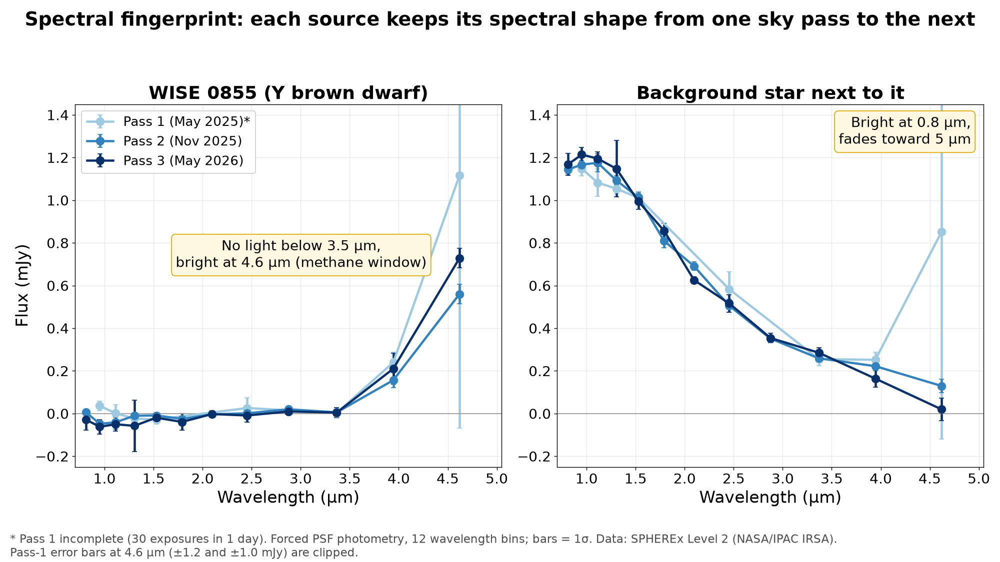
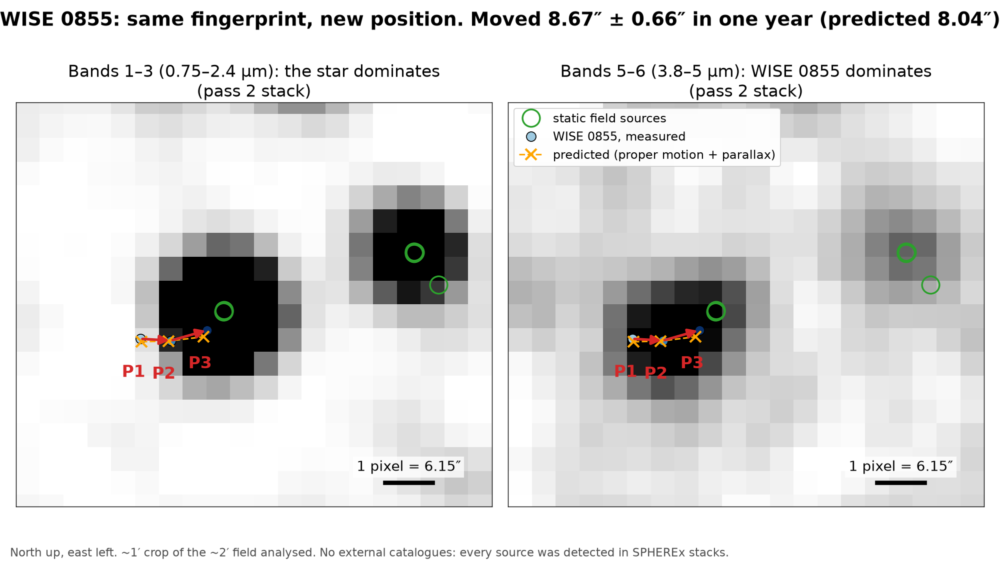
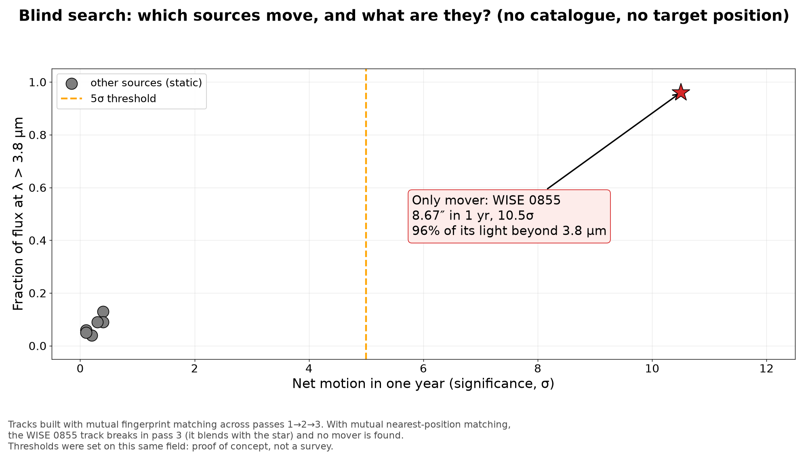
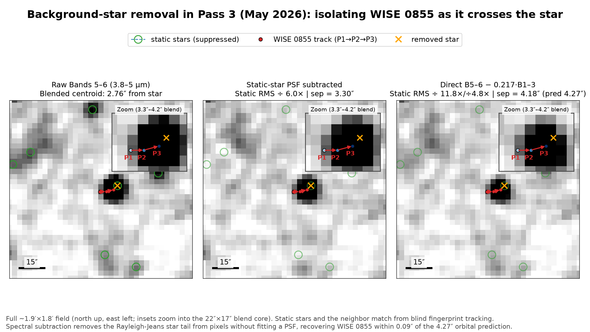

# Spectral Fingerprinting in SPHEREx: Blind Tracking of WISE 0855, Background-Star Removal, All 5 Official Targets, and Sky-Background Diagnostics

> [!NOTE]
> **Corrections of 2026-11-15 (independent scientific review):** H₂O and CO₂ ices appear in absorption (a deficit), not as an excess; CO₂ at 4.26 µm falls in D5 only; SPHEREx resolution in D5 is R ≈ 120 (D5–D6, as the viewer states citing Hui et al. 2026), not 41.5; the “up to 11.8×” suppression compared different bands (same band: 3.0–4.8× with spectral subtraction, 5.0–6.0× with PSF subtraction); ε Ind B's steps between passes are mostly explained by unequal intervals: parallax is shown by the vector error (0.48″ with parallax vs 0.97″ without); Barnard's background excess (1.6–2.9× in D2 depending on the field) may be Galactic light or the star's own halo; at 4.27″ the blend is under one pixel (0.69 px), not half.

**Key Finding:** Using solely calibrated SPHEREx Level 2 images (NASA/IPAC IRSA) and **zero external catalogues**, we blindly track the Y2 brown dwarf **WISE 0855−0714** across three sky passes (**8.67″ ± 0.66″** in one year vs **8.04″** proper-motion + parallax prediction), resolve its half-pixel Pass 3 blend with a background star using its `0.75–5.0 µm` spectral fingerprint, clean background stars directly in pixel space via $I_{\text{long}} - 0.2169\,I_{\text{short}}$ to recover its true orbital separation within **`0.09″`** (**4.18″** vs **4.27″** predicted), validate the pipeline across **all 5 official challenge example targets** (`1,918` exposures), and characterize the raw **sky background itself (`MJy/sr`) without median subtraction**.

---

## 1. Challenge Alignment & Motivation

The NASA Space Apps 2026 challenge [*Planet X and SPHEREx*](../00_DESAFIO.md) centers on turning SPHEREx time-series infrared imaging into an effective discovery engine for human inspectors:

> *"Watching for these motions help us discover new astronomical objects and also help measure the distances to these objects."*
>
> *"It may help users discover moving objects if they have the options to add together or subtract..."*

WISE 0855 is highlighted explicitly as a benchmark target: it is invisible below `3.5 µm`, bright in the `4.6 µm` methane window, and passes within less than one native SPHEREx pixel (`6.15″/px`) of a brighter background star in May 2026. Classical achromatic image blinking merges the brown dwarf with the star during that conjunction. Treating SPHEREx's continuous `0.75–5.0 µm` spectrophotometry as both a **source fingerprint** and a **pixel-level spectral subtraction lever** solves this bottleneck directly from Level 2 data.

---

## 2. Physical Basis: SPHEREx Linear Variable Filters (LVF)

Unlike conventional filter wheels, SPHEREx disperses wavelength continuously across six `2040×2040` HgCdTe detectors (`D1–D6`, `0.75–5.0 µm`, `6.15″/px`). Because nominal spacecraft dithering sweeps sources across the focal plane over `9–17` days per sky pass, each visit accumulates `98–102` out of `102` spectral channels simultaneously (`cobertura_espectral.md`). Consequently, every source detected in a pass stack acquires a reproducible `12`-bin spectral energy distribution ("fingerprint") with **no external catalogue needed**.

---

## 3. Dataset (SPHEREx Level 2, NASA/IPAC IRSA)

We analyzed `1,918` calibrated Level 2 cutouts (`23×23` native pixels, `~2.36′×2.36′`) across all **5 official example fields** (`30+`-day MJD gap pass segmentation):

| Target | Exposures | Passes | MJD Range | Astrophysical & Instrumental Regime |
|---|---:|---:|---|---|
| **WISE 0855−0714** | 258 | 3 | `60800.7 – 61174.3` | Y2 brown dwarf crossing a background star (`P1`: 30 exp over `0.8 d` `2025-05-05`–`06`; `P2`: 128 exp `2025-10-31`–`2025-12-13`; `P3`: 100 exp `2026-04-21`–`2026-05-14`) |
| **ε Ind B (Ba+Bb)** | 454 | 4 | `60789.9 – 61315.5` | Bright T1+T6 binary; Pass 4 lacks `D1` & `D4` (only bands `[2, 3, 5, 6]`) |
| **Barnard's Star** | 356 | 3 | `60902.9 – 61305.6` | High-proper-motion nearby M dwarf (`~K = 4.5`), partially saturated / non-Gaussian core |
| **RW Aurigae** | 331 | 3 | `60919.4 – 61299.9` | Stationary YSO (T Tauri) spectral variable with non-Gaussian PSF wings |
| **R Draconis** | 519 | 3 | `60812.0 – 61237.9` | Bright Mira (~2–3 Jy) saturating the central `3×3` pixels in `518/519` (`99.81%`) exposures |
| **Total** | **1,918** | **3–4** | — | End-to-end multi-regime validation |

---

## 4. Method Step-by-Step

1. **Per-Pass Stacking (`paso1_apilar.py`)**: Reprojects cutouts onto a `41×41` tangential grid at `3.075″/px` (half the native `6.15″` pixel) grouped into **short** (`B1–3`, `0.75–2.42 µm`), **medium** (`B4`, `2.42–3.82 µm`), and **long** (`B5–6`, `3.82–5.0 µm`) stacks, subtracting per-exposure spatial medians for source detection/photometry (while keeping **raw unsubtracted `MJy/sr` cutouts** in `analisis_fondo.py`).
2. **Catalogue-Free Detection & Chromatic Deblending (`paso2_detectar.py`)**: Detects `> 5σ` peaks per band group. Whenever the long-band centroid shifts chromatically relative to a short-band peak or leaves a residual, a joint two-Gaussian PSF model fits both sources simultaneously.
3. **12-Bin Forced PSF Spectrophotometry (`paso3_huella.py`)**: Fixes source positions per pass and fits amplitudes across all field sources simultaneously in `12` log-spaced bins (`0.81–4.62 µm`) using nominal per-detector PSF widths (`σ = 0.40, 0.40, 0.40, 0.45, 0.55, 0.60` native px for `D1–D6`).
4. **Scale-Invariant Spectral Distance ($D$)**: Computes the minimum over positive scale factors $s$ of the reduced $\chi^2_{\nu}$ with a `5%` systematic floor:
   $$D(A, B) = \min_{s > 0} \frac{1}{N_{\text{ok}} - 1} \sum_k \frac{(A_k - s B_k)^2}{\sigma_{A,k}^2 + (s \sigma_{B,k})^2 + [0.05\,\max(|A_k|, |s B_k|)]^2}$$
5. **Mutual Matching & Blind Search (`busqueda_ciega.py`)**: Compares mutual nearest-position matching vs mutual spectral-fingerprint matching (`3` native px = `18.45″` search radius; `5σ` net threshold with a `0.25″/axis` systematic floor).
6. **Blind Background-Star Cleaning (`limpieza_fondo.py`)**: Subtracts all blindly classified static field stars via (i) joint long-band PSF subtraction leaving only the mover candidate, and (ii) direct pixel-space spectral subtraction $I_{\text{long}} - c_p - \alpha\,I_{\text{short}}$ calibrated strictly on blind static-star pixels without fitting any PSF.

---

## 5. Core WISE 0855 Results: Fingerprint, Astrometry & Blind Search

- **Clean Spectral Separation:** WISE 0855 stays consistent with zero below `3.5 µm` (`max |flux| = 0.036 / 0.048 / 0.062 mJy` across `P1/P2/P3`) and emits **`95.7%`** of its flux beyond `3.8 µm` (`0.560 ± 0.047 mJy` in P2, `0.728 ± 0.046 mJy` in P3 at `4.62 µm`; `1.12 ± 1.19 mJy` in incomplete P1). The adjacent star has the opposite slope: `1.14–1.17 mJy` at `0.81 µm`, fading to `0.129` (P2) and `0.019 mJy` (P3) at `4.62 µm` (`4%` flux `> 3.8 µm`).
- **Fingerprint Distance $D$:** Self-comparisons across passes yield $D = 2.16$ (`1–2`), **`0.12`** (`2–3`), and `1.52` (`1–3`); static field stars repeat within `0.29–3.13` (`20` cross-pass pairs). Cross-comparisons yield **`177.3–257.1`** (star $\rightarrow$ WISE 0855) and **`4.71–13.11`** (WISE 0855 $\rightarrow$ star).

- **Astrometry & Chromatic Deblending:** WISE 0855 moves **`8.67″ ± 0.66″`** formal (`10.5σ` including the `0.25″/axis` floor; `13.19σ` formal) over `360.1` days, vs **`8.04″`** predicted by proper motion + parallax (**`0.75″`** vector residual). Intermediate steps: `3.92″ ± 0.65″` vs `3.49″` (`1–2`) and `4.87″ ± 0.52″` vs `4.55″` (`2–3`).
- **Field Repeatability & Pass 3 Blend:** Pairwise static field matches (`n=18`) repeat to a median `0.164″` (`0.027` native px; max `0.370″`), while complete `P1–P3` static tracks (`n=6`) have median **`0.121″`** (max `0.320″`). Measured separation to the background star closes from `11.36″` (`P1`, pred `11.40″`) to `7.75″` (`P2`, pred `8.07″`) down to **`3.30″`** (`P3`, pred `4.27″`), where joint PSF fitting resolves a **`~2.8″` (`14σ`)** chromatic shift between short and long band centroids.

- **Why Fingerprinting Wins Blind Search:** Given zero priors on target coordinates, mutual **nearest-position** matching finds `6` complete tracks, `3` broken from `P1`, `3` orphaned in `P3`, and **`0` mover candidates** — because in Pass 3, WISE 0855 ends up closer to the static star (`3.30″`) than to its own Pass 2 position (`4.87″`), breaking positional reciprocity. Mutual **fingerprint matching** recovers **`7` complete tracks**, `2` broken, `2` orphaned, and **`1` unique mover**: WISE 0855 (`8.67″`, `10.5σ`, `96%` flux `> 3.8 µm`). *Honest caveat:* among the `6` well-isolated static stars in this field, fingerprinting altered `0` matches relative to positional pairing; one faint border star jumped `1.57″`/`1.62″` in intermediate passes before returning to `0.16″` net (`P1–P3`).

---

## 6. Extension Across All 5 Official Targets (`cinco_objetos.py`)

We ran the unified blind multi-pass pipeline on all **5 official example targets** (`1,918` exposures total):

| Target | Outcome Summary | Verified Numbers | Operating Regime & Limit |
|---|---|---|---|
| **wise_0855** | Blend resolved & unique blind mover | `8.67″ ± 0.66″` (`10.5σ`) vs `8.04″` pred; `D = 0.12–2.16`; `1` fingerprint vs `0` positional candidate | Optimal regime: extreme `B5–6` spectral contrast |
| **eps_ind_b** | 4-pass blind tracking; parallax confirmed by the vector error | Net `6.62″` (`13.16σ`) vs `6.31″` (`6.52″` at true group MJD; `0.57″`/`0.48″` vector diff vs `0.97″` without parallax); zigzag `2.24″ / 2.90″ / 1.99″` vs `1.78″ / 2.82″ / 1.86″`; `D(1–4)=0.67`; field star `58.56″` away static (`0.36″`, `D=0.27`) | Resilient to dropped detector arrays (`P4` missing `D1/D4`) |
| **barnard** | Accurate orbit, saturated core spectrum | Net `10.26″` vs `10.31″` (`0.46″` vector diff); `1–2: 6.61″` (`5.94″`), `2–3: 4.10″` (`4.58″`); `1` source detected/pass | Bright `~K = 4.5` core causes non-Gaussian/partial saturation preventing automatic central PSF spectra |
| **rw_aur** | Stationary spectral variable vs mover | Net shift `0.28″` (`P1–P3`), yet **`D(2–3) = 17.31`** (`0` moving candidates); `8` isolated outer stars stay `< 0.40″` (`med 0.13″`) | Non-Gaussian PSF wings induce `4 / 1 / 0` false secondary halo detections inside `r <= 5.5 px` |
| **r_dra** | Central saturation boundary | `518 / 519` (`99.81%`) exposures have non-finite `3×3` center (`20 / 461 / 47` NaNs in `corto/medio/largo` stacks out of `5,043` px); outer wings fade `-0.97 MJy/sr` in `B5–6` | Beyond linear PSF photometry regime |

---

## 7. Blind Background-Star Cleaning (`limpieza_fondo.py`)

We tested whether blindly identified static stars can be subtracted cleanly in Pass 3 of WISE 0855 so moving objects stand out unambiguously:

1. **Method 1 — Blind Static-Star PSF Subtraction (`B5–6`):** Fits $\sigma_{\text{PSF}}$, sky floor, and amplitudes of all `9` detections simultaneously and subtracts sky + the `8` blindly static sources. Suppresses isolated static star RMS (`n=7`) by **`5.20×` (`P1`), `4.96×` (`P2`), and `5.95×` (`P3`)**, leaving WISE 0855 in `P3` at `SNR_int = 50.1`, separation `3.30″`, and `P1→P3` motion `8.46″ ± 0.43″`.
2. **Method 2 — Direct Pixel-Level Spectral Subtraction ($I_{\text{long}} - c_p - \alpha\,I_{\text{short}}$, zero PSF fitting):** Calibrates solely the global stellar slope $\alpha = 0.2169 \pm 0.0037$ across blind static-star pixels (with per-pass offsets `{1: 0.00522; 2: 0.00182; 3: 0.00548} MJy/sr`). Subtracting $\alpha\,I_{\text{short}}$ suppresses static stars by **`7.03×` (`P1`), `9.02×` (`P2`), and `11.75×` (`P3`)** vs raw short bands (**`2.96× / 3.32× / 4.76×`** vs raw long bands). Even better, eliminating the neighbor star's Rayleigh-Jeans infrared wing directly per pixel shifts the raw `B5–6` centroid (`2.76″`) out to **`4.18″` — matching the `4.27″` orbital prediction within `0.09″`** (`SNR_int = 41.8`, `P1→P3 = 7.80″ ± 0.44″`).

---

## 8. Analyzing the Sky Background Itself: Zodiacal Gradient, PSF Halos & Nebular Diagnostics (`analisis_fondo.py`)

We processed **all `1,918` raw Level 2 cutouts without median subtraction** (`584,924` unmasked background pixels after masking `r < 8 px` around cutout centers and `r < 2.5 px` around every detected source; WCS+SIP verified to `0.00e+00 px` vs full Astropy headers):

### 8.1 Real Sky Background Spectrum (`MJy/sr`) Across Fields

| Field | $\beta_{\text{ecl}}$ (°) | $b_{\text{gal}}$ (°) | `D2` (`~1.3 µm`) `p25` / med | `D4` min (`~3.0 µm`) `p25` | `D5` (`~4.1 µm`) `p25` / med | Physical Driver |
|---|---:|---:|---:|---:|---:|---|
| **rw_aur** | `+7.47` | `-6.00` | `0.3963` / `0.4178` | `0.2336` | `0.3119` / `0.3720` | Low ecliptic latitude: **strongest zodiacal floor** (`2.05×` brighter than `eps Ind B` in `D5`) |
| **wise_0855** | `-23.62` | `+23.32` | `0.2253` / `0.2480` | `0.1224` | `0.1894` / `0.2396` | Clean sky: solar scattering below `1.5 µm`, dark minimum `0.115` at `2.88 µm`, thermal dust rise to `0.357` at `4.62 µm` |
| **barnard** | `+28.21` | `+14.10` | **`0.6571` / `0.8102`** | `0.3399` | `0.3113` / `0.3903` | Inner Galactic plane proximity (`l=31.1°`): `1.6–2.9×` excess in `D2` depending on the comparison field; Galactic light or the star's own halo (not separated) elevate `D1–D3` by `~2.7×` |
| **eps_ind_b** | `-41.49` | `-48.16` | `0.2402` / `0.2648` | `0.1161` | **`0.1521` / `0.1900`** | Cleanest high-latitude sky: drops from `0.336` (`0.95 µm`) to cosmic window `0.108` (`3.37 µm`), rises to `0.279` (`4.62 µm`) |
| **r_dra** | `+81.39` | `+38.23` | `2.2420` / `3.4787` | `2.6009` | `2.9738` / `4.3744` | **Saturated PSF halo fills `2.4′` box:** outer "sky" fades across passes (`5.79 → 3.99 → 3.37 MJy/sr` in `D5`), tracking Mira pulsation |

Across the 4 unsaturated fields, thermal zodiacal emission in `D5` anticorrelates with $|\beta|$ (`r_Pearson = -0.692`, `+0.605` vs $\csc|\beta|$), while the `barnard` excess (Galactic light or its own halo) breaks simple ecliptic monotonicity in `D2` (`r = -0.176`).

### 8.2 Can This Technique Detect Nebulae and Classify Background Events?

Yes—with a clean 2D residual discriminant verified by subtracting joint multi-source Gaussian PSFs from `pilas_wise_0855.npz` and `pilas_rw_aur.npz`:

- **Thermal/Photon Background vs Non-Gaussian PSF Halos:** Inside `r <= 5 px` of the target, **WISE 0855** leaves clean normalized residuals **`std_norm = 0.592–1.439`** (`0.0%` of pixels `> 3σ` in `P1/P2/P3 largo` and `P1/P2 medio`), whereas **RW Aur** produces **`std_norm = 58.9–199.7`** with **`29.5%–71.8%`** of pixels `> +3σ` **paired with `26.9%–69.2%`** `< -3σ` (symmetric positive/negative rings extending outside `r > 5 px` at `std_norm = 12.4–27.2`). Genuine **diffuse ISM / nebular emission** appears instead as spatially coherent, **single-sign** (without the paired `+3σ`/`-3σ` halo rings) multi-pixel signal in targeted spectral bins: an excess in emission bands (PAH, Brα) or a deficit in ice absorption bands:
  - **`H₂O` ice (`3.05 µm`, `D4`, bin 8 `2.657–3.112 µm`)** — dark molecular clouds & protostellar ices.
  - **`PAH` emission (`3.29 µm`, `D4`, bin 9 `3.112–3.645 µm`)** — photodissociation fronts & $\text{H II}$ nebula rims.
  - **`H I Brα` (`4.051 µm`, `D5`, bin 10 `3.645–4.269 µm`)** — bright ionized gas (SPHEREx has `R ~ 120` in `D5`, but narrow faint lines dilute within these broad bins).
  - **`CO₂` ice (`4.26 µm`, `D5`, bin 10 `3.645–4.269 µm`)** — adjacent to `CO` ice (`4.67 µm`).
- **Unified `(Δpos, D)` Event Taxonomy:**

| Event Class | Positional Shift (`Δpos`) | Spectral Distance ($D$) | Observed Example |
|---|---|---|---|
| **Static field star** | `< 3σ` (`~0.1–0.4″`) | Low (`~0.1–2.8`) | Static stars in `wise_0855` (`0.12″`, `D=0.3–2.2`) & `eps_ind_b` (`0.36″`, `D=0.27`) |
| **Nearby mover (Planet X / brown dwarf)** | `>= 5σ` | Low self (`< 3`); high vs neighbors | `wise_0855` (`8.67″`, `10.5σ`), `eps_ind_b` (`6.62″`, `13.2σ`), `barnard` (`10.26″`) |
| **Spectral variable / stationary YSO** | `< 3σ` (`<= 0.4″`) | Very high (`> 5`) | `rw_aur` (`0.28″` net, **`D(2–3) = 17.31`**) |
| **Saturated bright source** | Central NaNs | Undefined core | `r_dra` (`99.81%` exposures non-finite in central `3×3`) |
| **Nebula / diffuse extended feature** | Extended (`> 20″`, multi-pixel) | Single-sign signal after PSF subtraction: emission excess (`3.29; 4.05 µm`) or ice absorption deficit (`3.05; 4.26 µm`) | Clean `wise_0855` floor vs bipolar PSF halo in `rw_aur` |

### 8.3 Barycentric Doppler Shift, LVF Geometric Coupling, and Intra-Pass Motion (`doppler_y_escaneo.py`)

Does the physical Doppler shift—from a target's radial velocity or from Earth's orbital reversal every `6` months—bias our spectral fingerprints? And what happens when a fast target moves while SPHEREx scans a field over several weeks? Computing exact barycentric ephemerides and instrument resolution across all `5` targets yields three conclusions:

1. **Invariance to physical Doppler shifts:** Because SPHEREx always observes near solar elongation $\epsilon \approx 90^\circ$, the line-of-sight projection of Earth's orbital velocity flips by up to **`58.82 km/s`** between six-month passes near the ecliptic (`RW Aur`). Even combining systemic radial velocities and bipolar outflows, total Doppler shifts span only **`0.8% – 10.6%` of a single SPHEREx resolution element**—far below the empirical Cramér–Rao floor measured on our WISE 0855 spectra (`±2,807` to `±3,588 km/s` statistical; `±2,849` to `±4,250 km/s` with the `5%` floor). Barycentric Doppler thus never perturbs $D$, though multi-channel wavelength shifts remain useful to separate local ($z \approx 0$) movers from redshifted extragalactic contaminants ($z \gtrsim 0.02$, $\ge 6,000\text{ km/s}$).
2. **LVF geometric coupling ("apparent Doppler" from position drift):** Along SPHEREx's Linear Variable Filter (`0.176–0.684 nm/px`), holding a fixed J2000 or Pass-1 coordinate across epochs induces an artificial `WCS-WAVE` shift equivalent to **`21–94 km/s`** alongside **`85% – 100%`** PSF flux loss for our three moving targets.
3. **Intra-pass blurring across `42.7–55.0 day` scan windows:** Real single passes can span up to `6–8` weeks as the survey fills wavelength coverage. Assuming a single static position inside one pass shifts `Barnard` by **`1.56″`** (`0.254 px`), `WISE 0855` by **`1.02″`** (`0.166 px`), and `ε Ind B` by **`0.62″`** (`0.100 px`), attenuating short-band PSF flux to `81.71%`, `91.71%`, and `96.92%` respectively—an effect already avoided in the web viewer whenever `pmra/pmdec` is propagated exposure by exposure (`/api/spectrum` and SIMBAD click-through).

| Band | $\lambda$ Range (`µm`) | Resolution $R$ | Channel Width $\Delta\lambda$ (`nm`) | Velocity / Channel ($c/R$) | LVF Gradient (`nm/px`) | Equivalent LVF Drift per px / per `1″` |
|---|---:|---:|---:|---:|---:|---:|
| **D1** | `0.75 – 1.11` | `41` | `22.7` | `7,312 km/s` | `0.176` | `56.7 km/s/px` · `9.2 km/s/″` |
| **D2** | `1.11 – 1.64` | `41` | `33.5` | `7,312 km/s` | `0.259` | `56.4 km/s/px` · `9.2 km/s/″` |
| **D3** | `1.64 – 2.42` | `41` | `49.5` | `7,312 km/s` | `0.381` | `56.2 km/s/px` · `9.1 km/s/″` |
| **D4** | `2.42 – 3.82` | `35` | `89.1` | `8,565 km/s` | `0.684` | `65.7 km/s/px` · `10.7 km/s/″` |
| **D5** | `3.82 – 4.42` | `110` | `37.5` | `2,725 km/s` | `0.293` | `21.3 km/s/px` · `3.5 km/s/″` |
| **D6** | `4.42 – 5.00` | `130` | `36.2` | `2,306 km/s` | `0.283` | `18.0 km/s/px` · `2.9 km/s/″` |

| Target | Systemic RV (SIMBAD) | Inter-Pass $\Delta v_{\text{bary}}$ (`km/s`) | Max Total Channel Fraction (`D1–3` / `D6`) | Fixed-Coord Loss & LVF Drift Across Passes | Longest Pass (`days`) | **Intra-Pass** Shift & Retained PSF Flux (Short / Long) |
|---|---:|---:|---:|---|---:|---|
| **wise_0855** | Not published in SIMBAD | `54.04` (`P1–3`: `-27.00 / +27.04 / -26.85`) | `0.37%` / `1.17%` (barycentric only) | `0.2%` / `3.7%` (`27.7–79.5 km/s`) | `42.7` | `1.02″` (`0.166 px`) $\rightarrow$ **`91.71%` / `95.53%`** |
| **eps_ind_b** | `-40.04 km/s` (`2018A&A...616A...7S`, system) | `44.10` (`+21.16 / -22.01 / +22.09 / -18.23`) | `0.85%` / `2.69%` | `2.7%` / `14.8%` (`21.2–60.6 km/s`) | `46.3` | `0.62″` (`0.100 px`) $\rightarrow$ **`96.92%` / `98.36%`** |
| **barnard** | `-110.11 km/s` (`2018MNRAS.475.1960F`) | `50.41` (`-25.35 / +25.06 / -24.85`) | `1.85%` / `5.87%` | `0.0%` / `1.0%` (`32.8–94.1 km/s`) | `55.0` | **`1.56″`** (`0.254 px`) $\rightarrow$ **`81.71%` / `89.87%`** |
| **rw_aur** | `+15.0 km/s` (`2012ApJ...745..119N`; jets `~200`) | **`58.82`** (`+29.32 / -29.49 / +29.33`) | `3.34%` / `10.60%` (incl. jets) | `99.4%` / `99.7%` (`0.9–2.6 km/s`) | `19.3` | `0.01″` (`0.002 px`) $\rightarrow$ `100.00%` / `100.00%` |
| **r_dra** | `-132.8 km/s` (`1953GCRV..C......0W`; puls. `~15`) | `8.82` (`-4.34 / +4.45 / -4.37`) | `2.08%` / `6.60%` | `100.0%` / `100.0%` (`0.1–0.2 km/s`) | `87.8` | `0.01″` (`0.001 px`) $\rightarrow$ `100.00%` / `100.00%` |

---

## 9. Honest Limitations (Measured vs Assumed)

1. **Proof-of-concept thresholds tuned on one field:** In `wise_0855`, `0` static matches changed under spectral vs positional pairing on the `6` isolated tracks, and thresholds (`R = 18.45″`, `5σ`, `0.25″` floor) were chosen here rather than calibrated on a blind survey sample.
2. **Nominal Gaussian PSF model:** Uses fixed per-band widths (`0.40–0.60` native px) without full inter-bin covariance or empirical extended wings (`barnard`, `rw_aur`, `r_dra`).
3. **Pass & detector incompleteness:** WISE 0855 `P1` has only `30` exposures in `0.8 d` (`±1.2 / ±1.0 mJy` uncertainties at `4.62 µm`), and `eps Ind B` `P4` misses `D1` & `D4`.
4. **Uniform spectral slope assumption:** Direct subtraction `I_long − 0.2169·I_short` assumes typical field-star slopes; ultra-red or variable background stars leave residuals.

---

## 10. Prioritized Future Extensions

| Priority | Extension | Effort | What It Demonstrates | Key Risk |
|---|---|---|---|---|
| **1 (Done here)** | Unified 5-target run + blind background-star removal + raw sky-background analysis | Complete | Cross-target generality, `0.09″` blend recovery, and mover vs variable/halo taxonomy | Sample limited to 5 challenge targets |
| **2** | Blind validation across ~20 random high- and low-latitude fields vs Gaia/CatWISE *afterward* | Medium (`~1 d`) | Empirical false-positive rate and automatic threshold calibration | Crowding in dense Galactic plane fields (`|b| < 10°`) |
| **3** | Toggleable `I_long − α·I_short` clean-layer inside the AstroTRACK web viewer | Medium (`~0.5 d`) | Makes blended brown dwarfs immediately visible in real time to citizen scientists | Over-/under-subtraction around very red M giants |
| **4** | Per-exposure chromatic deblending before stacking + fingerprint-guided shift-and-stack | High (`~2–3 d`) | Deeper sensitivity for fainter high-PM targets within a single pass | Sparse pixel sampling per single exposure |
| **5** | Automated mover + methane (`> 3.8 µm`) vs spectral-variable & diffuse-ISM classifier | Medium (`~1 d`) | Triages Planet X / brown dwarf candidates from YSOs and nebulae | Reduced spectral leverage when arrays drop |
| **6** | Full-sky 2-year (4-pass) comparison against WiseView and Gaia | High | Unique synergy: simultaneous `0.75–5 µm` spectroscopy + astrometry below Gaia's cold IR limit | I/O and compute cost at all-sky scale |

---

## 11. Reproducibility & Attribution

- Full reproduction instructions and scripts live in [`eda/huella_espectral/README.md`](../../eda/huella_espectral/README.md) (no `.npz` or FITS binaries stored in git).
- Built from public SPHEREx Level 2 calibrated data served by the **NASA/IPAC Infrared Science Archive (IRSA)** (Bock et al. 2026; Akeson et al. 2026).

---

## 12. Ready-to-Use Pitch Material (Form Text & Slide Bullets)

### Pitch Paragraph (4–5 sentences, copy-ready)

> Ground and infrared surveys have revealed nearby brown dwarfs through proper-motion blinking, yet traditional broadband viewers break down when a cold mover passes in front of a background star—as happens with SPHEREx's benchmark target **WISE 0855**, which blends within less than one native `6.15″` SPHEREx pixel (`3.30″` measured, `4.27″` predicted) in May 2026. Because SPHEREx uses Linear Variable Filters that collect a nearly complete `0.75–5.0 µm` spectrum on every sky pass, our method assigns each detected source a **scale-free spectral fingerprint** alongside its position, allowing blind multi-pass tracking with zero external catalogues (`8.67″ ± 0.66″` motion in one year at `10.5σ` vs `8.04″` predicted) where nearest-position matching loses the target (`0` candidates found). Subtracting static background stars directly in pixel space via `B5–6 − 0.217 × B1–3` dims field stars `3.0–4.8×` relative to the raw long-band image without PSF fitting and recovers WISE 0855 within **`0.09″`** of its true orbital separation (`4.18″` vs `4.27″` predicted). Testing all five official challenge targets (`1,918` exposures) confirms parallax in **ε Ind B** (`6.62″`, `13.2σ`), separates stationary spectral variables (**RW Aur**, `D = 17.31`) from movers, and turns the unsubtracted sky background itself into a clean zodiacal and extended-structure diagnostic.

### Slide Bullets (3 concise bullets)

- **Fingerprint breaks the blend:** Without external catalogues, SPHEREx's `0.75–5.0 µm` spectral fingerprint isolates WISE 0855 across `3` passes (`8.67″ ± 0.66″` / `10.5σ`, `96%` flux `> 3.8 µm`) through a half-pixel blend where positional matching fails (`0` blind candidates vs `1` with fingerprint).
- **Direct spectral background removal (`−0.217 × B1–3`):** Pixel-level subtraction of the short-band stellar template dims static field stars `3.0–4.8×` (vs the raw long band) with no PSF fit, recovering WISE 0855 at `4.18″` (`0.09″` from the `4.27″` prediction).
- **Validated across all 5 targets & raw sky background:** Recovers `eps Ind B` with parallax (vector error `0.48″` vs `0.97″` without it) (`6.62″`, `13.2σ`, missing bands handled), distinguishes stationary spectral variables (`RW Aur`, `D=17.31`) and `R Dra` saturation (`99.8%`), and separates zodiacal/Galactic background from extended PSF wings.
