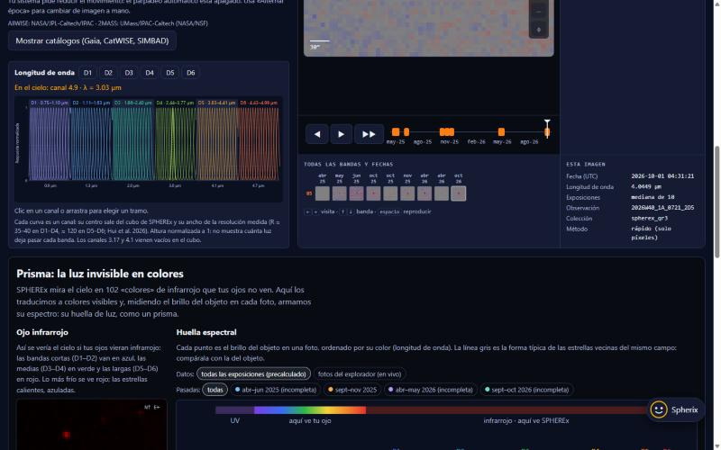
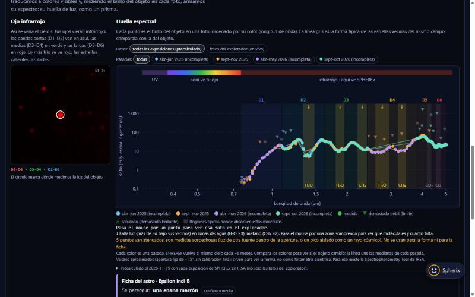
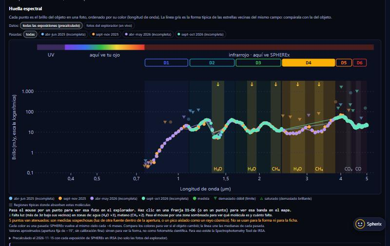
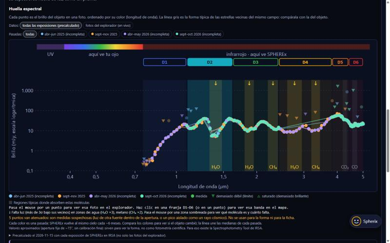
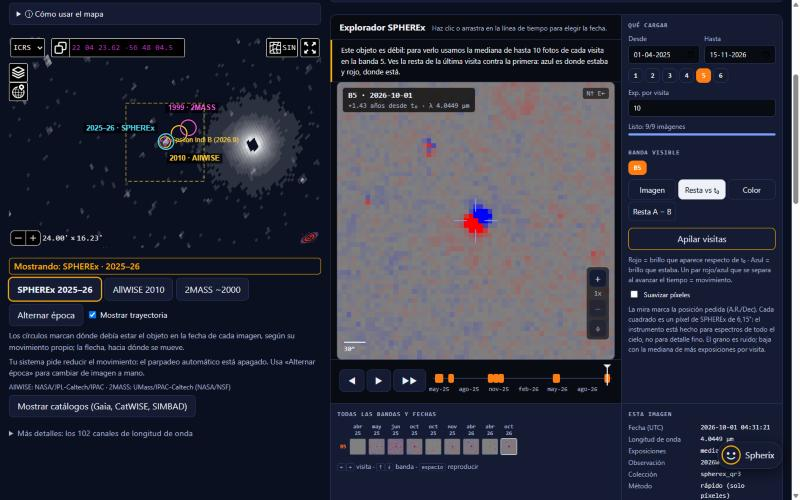
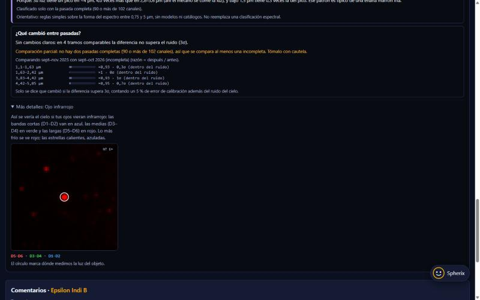
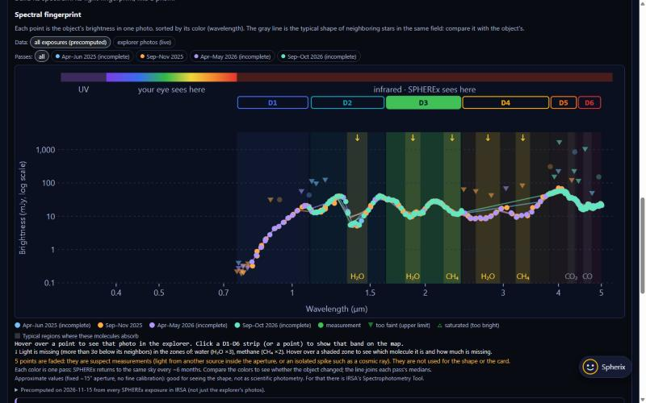

# Propuesta: un solo gráfico de longitud de onda

*Idea de Juan Pablo, 15-nov-2026. Rama `claude/espectro-unico-7ecf42`. Todavía no se habla con el equipo: no tiene PR
ni toca `main`. Si les gusta, Mauricio decide si se fusiona.*

## En una frase

En el Modo ciencia había tres gráficos de longitud de onda que se pisaban. Ahora manda uno: la **Huella espectral**.
Desde ella se elige la banda del mapa (clic en una franja D1–D6 o en un punto), y los otros dos quedan plegados
detrás de «Más detalles».

## Qué había antes

| Gráfico | Dónde | Qué hacía | Se solapaba con |
|---|---|---|---|
| **Longitud de onda** (102 canales D1–D6) | Bajo el mapa | Curvas de respuesta de cada canal; clic = canal del mapa | El menú «Banda del mapa» y los botones D1–D6 del Explorador |
| **Ojo infrarrojo** | Prisma, columna izquierda | El campo en color «traducido» (D1–D2 azul, D3–D4 verde, D5–D6 rojo) | La imagen del Explorador y el mapa |
| **Huella espectral** | Prisma, columna derecha | El brillo del objeto en cada foto, por λ, con franjas D1–D6 | Usa el mismo eje λ y las mismas franjas que «Longitud de onda» |
| Botones de banda | Explorador («Qué cargar», «Banda visible») | Qué bandas bajar y cuál ver | El menú «Banda del mapa» |

Las franjas D1–D6 y el eje λ aparecían dos veces, y la banda se podía elegir en tres lugares distintos.

## Qué cambia

1. **La Huella espectral elige la banda.** Arriba del gráfico hay seis pestañas D1–D6; la banda del mapa queda
   pintada. Clic en una pestaña, en el fondo de una franja o en un punto → el mapa pasa a esa banda (la URL y el
   menú «Banda del mapa» también) y el Explorador la sigue si tiene esa banda cargada. También funciona con teclado
   (Tab + Enter). Pasar el mouse por un punto sigue llevando el Explorador a esa foto, como antes.
2. **La Huella va a lo ancho** de la sección Prisma: se lee mejor.
3. **«Ojo infrarrojo» queda plegado** debajo de la huella («Más detalles: Ojo infrarrojo»).
4. **El selector de 102 canales queda plegado** bajo el mapa («Más detalles: los 102 canales de longitud de onda»).
   Sigue funcionando igual al abrirlo: es para quien quiera un canal fino.

No se borró nada: todo sigue a un clic.

## Por qué

- El jurado ve un gráfico y entiende uno: el espectro del objeto. Antes tenía que adivinar cuál de los tres mirar.
- La Huella es el gráfico con ciencia propia (el espectro real, las moléculas, las pasadas). Los otros dos explican
  el instrumento, que es contexto, no el resultado.
- Elegir la banda donde se ve el espectro conecta las dos preguntas: «¿cómo es su luz?» y «¿cómo se ve en esa luz?».

## Archivos tocados

`src/prisma/HuellaEspectral.tsx`, `src/prisma/Prisma.tsx`, `src/prisma/prisma.css`, `src/sky/AladinView.tsx`,
`src/pages/Visor.tsx`, `src/pages/visor.css`, `src/content/prisma.ts` (solo la pista bajo el gráfico, ES y EN).
No se tocó `src/explorador/render.ts` ni el backend. Sin dependencias nuevas. `npx tsc -b` y `npm run build` pasan.

## Lo que queda abierto

- **El Explorador solo sigue la banda si la tiene cargada.** Con Epsilon Indi B se carga solo D5 por defecto, así
  que un clic en D2 cambia el mapa pero el Explorador se queda en D5 (es el mismo comportamiento que el menú
  «Banda del mapa»). No lo pude probar con más bandas: IRSA estaba caído esta mañana.
- **El tutorial** sigue apuntando a «Longitud de onda» y a «Ojo infrarrojo», que ahora están plegados: el paso los
  resalta cerrados. Si se aprueba, conviene cambiar esos dos textos (y quizá abrirlos solos en ese paso).
- No se probó en celular.
