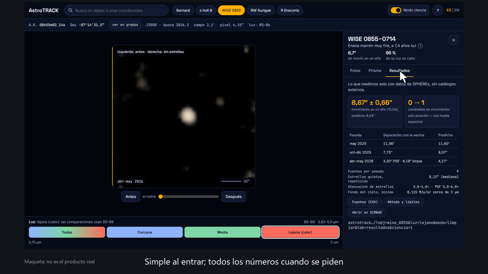

# Propuesta de interfaz: AstroTRACK en tres niveles

**Para Bryan y el equipo (15-nov-2026).** Propuesta de Juan Pablo para ordenar el visor como Google Maps: simple al
entrar, y cada nivel de detalle aparece solo cuando el usuario lo pide. Es una **maqueta**, no el visor: sirve para
decidir qué mezclar con el rediseño de Bryan y repartir tareas.

## Qué abrir

| Archivo | Qué es |
|---|---|
| `demo_tres_niveles.es.mp4` | Video de 58 s: una persona pasa de curiosa a experta con WISE 0855. Cada cuadro dice «Maqueta». |
| `presentacion_tres_niveles.es.html` | Presentación corta con el video, los tres niveles, las herramientas que lo hacen así y las decisiones pendientes. Un solo archivo, funciona sin internet (V pausa el video). |
| `maqueta/index.html` | La maqueta para usarla a mano (doble clic). Funcionan fechas, luz, Resta, Color, Limpiar estrellas, pestañas, coordenadas y el espectro. Solo WISE 0855; las descargas muestran un aviso. |

## Los tres niveles

1. **Al entrar:** el cielo ocupa la pantalla, con un buscador, los 5 objetos, las fechas y la luz. La ayuda va en «?»,
   no en recuadros de texto arriba.
2. **Curioso:** al tocar el objeto se abre su panel. «Fotos» (Parpadeo, Resta, Color) manda sobre lo que muestra el
   cielo; «Prisma» muestra su luz.
3. **Experto** (interruptor «Modo ciencia»): coordenadas exactas, Limpiar estrellas, parámetros, pestaña Resultados,
   descargas y enlaces. Los resultados no cambian entre niveles; solo se ve más.

Se basa en cómo lo hacen ESASky (modos Explorer y Science), ALeRCE (pestañas por objeto, todo descargable), WiseView
(valores por defecto buenos y ajustes en el enlace) y Google Maps. Fuentes en la presentación.

## Qué falta y se propone sumar

- **ε Indi B como segundo objeto, para el experto:** su espectro muestra caídas de agua (1,4 µm ×0,34; 1,9 µm ×0,42)
  y metano (2,3 µm ×0,52; 3,3 µm ~×0,2, pocas medidas), la firma de una enana marrón tipo T. Medido sobre
  `scaffold/frontend/public/precalc/espectro/eps_ind_b.json`, pasada de sep-2025 (valores indicativos).
- Del trabajo ya en main: «Recorrer» de Antonia en la barra de luz; «Explorar una zona al azar» y «¿Encontraste
  algo?» junto al buscador; comentarios por objeto (Bryan) como pestaña del panel; candidatos de CatWISE con su
  espectro en el nivel experto.

## Decisiones del equipo

- ¿Reemplaza la página actual o va como vista nueva?
- ¿El cielo de entrada es Aladin, como hoy, o la foto de SPHEREx en falso color?
- ¿Qué entra en la primera versión y qué queda para después?
- ¿Quién implementa cada parte?

## Datos y cómo se rehace

Imágenes y cifras reales de SPHEREx del campo de WISE 0855 (pilas por pasada de `eda/huella_espectral`, PR #58).
Falso color: azul 0,75–2,4 µm, verde 2,4–3,8 µm, rojo 3,8–5 µm, escalado para que una estrella típica salga blanca.
`fuente/` tiene la plantilla de la maqueta, los scripts que generan las imágenes (necesitan las pilas `.npz`, que no
van en git), el guion de la presentación y `demo.es.yml`, que el kit de presentaciones graba con `kit.py demo`.
