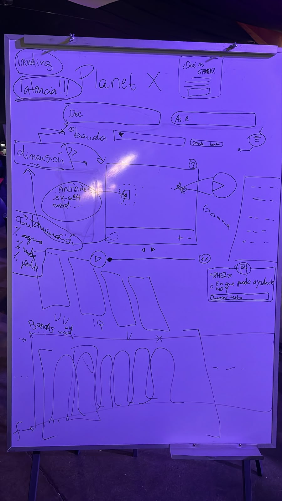
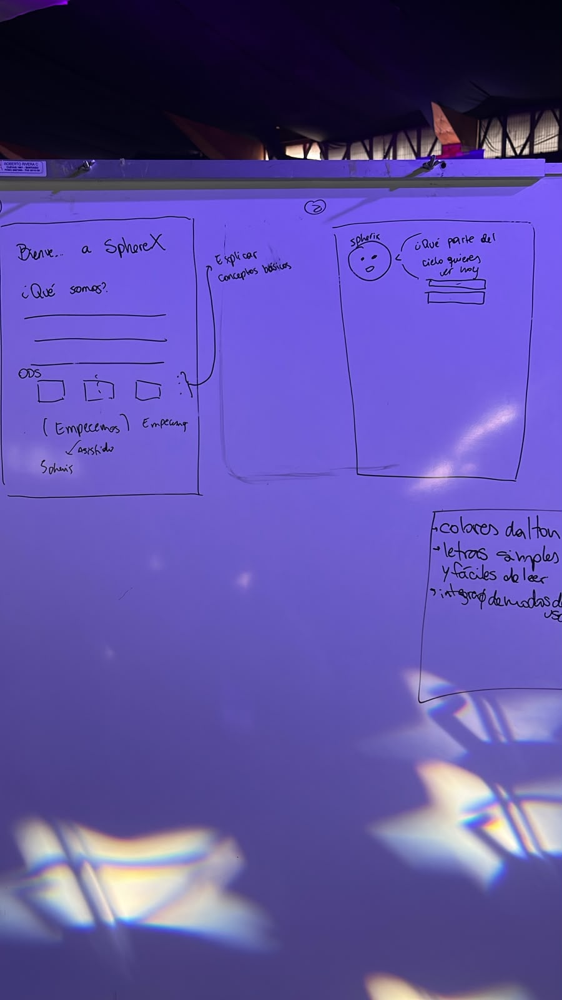

<!-- i18n-header -->
> 🌐 **Sprache:** [English](../en/README.md) · [Español](../es/README.md) · [中文](../zh/README.md) · **Deutsch** · [Italiano](../it/README.md)
> 🕒 **Dokumentationsdatum:** 2026-11-14 15:35 · **Quelle:** `README.md`
> ⚠️ Maschinell übersetzter Entwurf, Prüfung durch Muttersprachler ausstehend.
<!-- /i18n-header -->

# SPHEREX — NASA Space Apps Challenge 2026 · *Planet X and SPHEREx*

**Ein öffentliches Web-Tool, in dem jede Person Himmelskoordinaten eingibt und diese Region als kleines
Video sieht: die Bildfolge von SPHEREx über die Zeit, um mit bloßem Auge zu erkennen, was sich bewegt
oder seine Helligkeit ändert, und außerdem woraus es besteht (die 102 Bänder).**

## 🔭 Live-Viewer: **https://spherex-planet-x-tau.vercel.app**

Direktes Beispiel: [Barnards Stern im Band D1](https://spherex-planet-x-tau.vercel.app/?ra=269.4520769586187&dec=4.693364966576667&size=0.1&band=1).
Heute ist es das visuelle Grundgerüst des Whiteboards: Landingpage, Viewer mit dem echten Himmel von SPHEREx DR1 (IRSA-Cube, pro
Band), an die URL gebundene Steuerelemente und gepunktete Platzhalter mit dem Namen der Person, die sie ausfüllt.
**Jeder Merge nach `main` wird automatisch** unter dieser URL veröffentlicht, innerhalb von ein bis zwei Minuten. Wie man vor dem Merge testet: siehe §2.

Dieses README ist **der Hauptplan des Teams**. Die Details stehen in `docs/` (maßgebliche Quelle),
und die Anleitung zum Arbeitskit steht in [`docs/KIT.md`](docs/KIT.md).

> Bis zum 13. Nov. gab es hier keinen Code, der die Challenge löst; seit dem offiziellen Start (14. Nov.) schon
> (`eda/` und der Viewer in `scaffold/frontend/`). Siehe [`docs/08_REGLAS_DEL_EVENTO.md`](docs/08_REGLAS_DEL_EVENTO.md).

---

## 1. Kontext

- **Challenge:** [Planet X and SPHEREx](https://www.spaceappschallenge.org/2026/challenges/planet-x-and-spherex/)
  (Advanced). Vollständiger offizieller Text in [`docs/00_DESAFIO.md`](docs/00_DESAFIO.md).
- **Was verlangt wird:** Die Nutzerin bzw. der Nutzer gibt RA/Dec ein; das Tool zeigt eine Serie von SPHEREx-Bildern dieses
  Ausschnitts «like a little video». Testen mit **Barnard's Star, Epsilon Indi B, WISE 0855** (bewegen sich) und
  **RW Aurigae, R Draconis** (ändern die Helligkeit).
- **De-facto-Bewertungsraster (die 8 *Potential Considerations*):** einfach mit neuen Releases zu aktualisieren ·
  alle 102 Bänder zeigen (Co-add pro Detektor; **Extra-Kudos: Spektrum on the fly**) · Epochen addieren/subtrahieren ·
  wählbares Gesichtsfeld · Overlays von Gaia/WISE · Koordinaten in der URL · Kontaminations-Flags ·
  Astropy und Aladin verwenden. Vorbild: [WiseView](http://byw.tools/wiseview).
- **Event (Santiago):** Arbeit Sa 14. 10:00 → **Abgabeschluss So 15. 11:00** (von JP am 14. Nov. bestätigt; live
  von der Organisation mitgeteilt; siehe [`docs/08`](docs/08_REGLAS_DEL_EVENTO.md)),
  Pitch von **2 Min. + 2 Fragen**. KI-Nutzung ist erlaubt **und ihre Angabe ist bei der Abgabe verpflichtend**.
- **Einzureichen:** Name und Zusammenfassung, Link zur finalen Demo, NASA-Daten und andere Quellen, und wie KI eingesetzt wurde.
- **Jury:** Wirkung, Kreativität, Gültigkeit, Relevanz und Präsentation.
- **Deployment:** Vercel für das Frontend (von der Organisation vorgegeben); wie das Backend läuft, ist noch im
  ADR-001 zu entscheiden. Nichts wird ohne Freigabe einer Person aus dem Team deployt.
- **Was es NICHT ist:** kein automatischer Detektor und kein Videomodell. Es ist ein **Viewer**; der Mensch detektiert.
  Jede ML-Schicht kommt obendrauf, niemals anstelle des Viewers ([`docs/01_ESTADO_DEL_ARTE.md`](docs/01_ESTADO_DEL_ARTE.md)).

### Bereits erkannte Fallstricke

1. **Die Koordinate aus der Aufgabenstellung für WISE 0855 stammt aus der Epoche ~2010,4.** Das Objekt bewegt sich mit 8,15″/Jahr:
   heute steht es ~130″ entfernt. Immer die propagierten Positionen aus [`data/campos_de_prueba.yml`](../../data/campos_de_prueba.yml) verwenden.
2. **Aufeinanderfolgende Belichtungen = unterschiedliche Wellenlängen** (linear variabler Filter). Blinken ohne
   Gruppierung nach Band/λ (`WCS-WAVE`) ergibt eine Sequenz, die Farbe zeigt, nicht Zeit.
3. **DR1 + QR3 verwenden.** QR2 ist per SIA2 nicht mehr durchsuchbar.
4. **WISE 0855 ist nicht in Gaia:** sein Overlay nutzt CatWISE2020.
5. **WISE 0855 ist ein Pflichtfall und wirkt in einer einzelnen Belichtung schwach.** Er wird immer gezeigt, und das wird ehrlich gesagt: seine Bewegung (~1,3 px über den gesamten Zeitraum) sieht man mit der Differenz erstes − letztes und, sobald vorhanden, mit der Summe pro Durchgang (CatWISE2020-Overlay von V2: fertig im Branch `v/v2-catwise`, PR ausstehend; Summe mit 1/VARIANCE-Gewichten von D2: ausstehend). eps Ind B ist der Fall, in dem die Bewegung am deutlichsten zu sehen ist (`docs/09` §4).

---

## 2. Architektur (Zusammenfassung von [`docs/03_ARQUITECTURA.md`](docs/03_ARQUITECTURA.md))

Zwei Wege auf demselben Bildschirm:

- **Weg A — «der Himmel in 102 Farben», ohne Backend:** Aladin Lite v3 + HiPS-Cube von DR1 von IRSA mit
  λ-Schieberegler, Gaia-Overlay. Das ist die Absicherung, falls das Backend ausfällt. (Plan B: HiPS von SPHEREx vom CDS.)
- **Weg B — der zeitliche Blink, mit Backend:** FastAPI fragt SIA2 nach Position ab, fordert Cutouts
  pro Epoche an, gruppiert nach Band, zieht ZODI ab, normalisiert und liefert zeitlich geordnete PNGs.

**API-Vertrag** (das Einzige, was Front- und Backend als gegeben annehmen; er wird zuerst in `docs/03` geändert):
`GET /api/health` · `/api/resolve?q=` · `/api/epochs?ra=&dec=&size=` ·
`/api/frames?ra=&dec=&size=&band=&stretch=&cmap=&mode=` (`raw|zodi_subtracted|diff_first|diff_prev`,
mit `wavelength_um` und `flagged_fraction` pro Einzelbild) · `/api/spectrum?ra=&dec=&aperture=` (mit obligatorischem `caveat`).

**Teilbare URL:** `/?ra=…&dec=…&size=…&band=…&fps=…&stretch=…&mode=…` oder `/?target=WISE+0855`.
Cache auf Platte mit **allen fünf vorgewärmten Feldern**; Offline-Notbetrieb für die Demo.

Stack ([`docs/adr/ADR-001-stack.md`](docs/adr/ADR-001-stack.md)): Python 3.11 + FastAPI + astropy/astroquery/pyvo ·
React + Vite + TypeScript + Aladin Lite v3.

**Deployment (entschieden am 14. Nov.): Der Viewer läuft auf Vercel.** Projekt `spherex-planet-x` im
Vercel-Team eMind (kostenloser Hobby-Plan, nur ein Mitglied: Mauricio), mit diesem Repository verbunden.
Produktion: **https://spherex-planet-x-tau.vercel.app**. Die Konfiguration steht in
[`vercel.json`](../../vercel.json) (baut `scaffold/frontend`), und [`.vercelignore`](../../.vercelignore) schließt
`docs/`, `data/` und alles aus, was kein Frontend ist.

**Wie mit dem kostenlosen Plan deployt wird** (Mitglieder zu Vercel hinzuzufügen kostet Geld):
- **Produktion:** Jeder Merge nach `main` wird automatisch veröffentlicht, weil Mauricio den Merge auf GitHub durchführt.
- **Vorschauen der PRs:** Vercel **baut nur Commits von Mauricio**. Die PRs der anderen erscheinen
  in Vercel als *Blocked*: das ist erwartet und kein Codefehler.
- **Bevor man den Merge anfragt, testet jede Person lokal:** `cd scaffold/frontend && npm ci && npm run build && npm run preview`
  (oder `npm run dev` während der Arbeit). Die GitHub-CI führt den Build ebenfalls bei jedem PR aus.
- Sieht etwas in der Produktion falsch aus, wird Mauricio informiert, der die Vercel-Logs sieht.

Für das Backend lautet die Empfehlung:
- **Die 5 Testfelder vorberechnet als statische Dateien** (PNG + JSON in der Form des Vertrags),
  vom selben Vercel ausgeliefert. Das löst die «Latenz!» des Whiteboards und ist der Offline-Modus der Demo.
- **Beliebige Koordinaten:** FastAPI in Vercel Python Functions, wenn die Cutouts in das Zeitlimit
  der Funktion passen; wenn nicht, dasselbe FastAPI in einem Container (Render/Fly) hinter `/api`.
  Das wird in Block 1 mit der gemessenen Zeit eines Cutouts entschieden.

---

## 2b. Gestaltung der Oberfläche (Whiteboard vom 14. Nov.)

| Hauptbildschirm (Viewer) | Landingpage und assistierter Modus |
|---|---|
|  |  |

**Ablauf:** Landingpage → (*Empecemos* direkt **oder** *Empecemos asistido* mit Spherix) → Viewer.
Von der Landingpage aus ein Link zu *Conceptos básicos*. Hamburger-Menü auf allen Bildschirmen.

### Bildschirm 1 · Landingpage «Bienvenido a SPHEREx»
- «¿Qué somos?»: zwei oder drei Zeilen über das Projekt und die Mission.
- **SDGs**: Karten mit den Zielen für nachhaltige Entwicklung, zu denen es beiträgt.
- Buttons **Empecemos** (direkt zum Viewer) und **Empecemos asistido** (öffnet Spherix).
- Link zu **Conceptos básicos**: was RA/Dec ist, ein Band, das Infrarot, warum sich Sterne bewegen.

### Bildschirm 2 · Assistierter Modus mit **Spherix** (Maskottchen)
- Spherix fragt «¿Qué parte del cielo quieres ver hoy?» mit Eingabefeldern und Vorschlägen
  (die 5 Testobjekte als Buttons). Führt mit bereits zusammengebauter URL (`?target=…`) zum Viewer.
- Im Viewer bleibt Spherix als **schwebender Chat** unten rechts: «¿En qué puedo ayudarte hoy?».
- **Minimum:** geführter Ablauf mit von Javiera geschriebenen Antworten, ohne LLM.
  **Extra:** Chat mit Claude über eine Vercel-Funktion; der API-Schlüssel liegt nur in den
  Umgebungsvariablen von Vercel, niemals im Frontend. Falls umgesetzt, wird es bei der Abgabe angegeben.

### Bildschirm 3 · Viewer «Planet X»
| Element des Whiteboards | Was es tut | Datum / Endpoint |
|---|---|---|
| Felder **Dec** und **A.R.** | Koordinate des Zentrums (akzeptiert auch einen Namen) | `/api/resolve` |
| **Bandas** (Dropdown) | Wählt Detektor D1–D6 oder alle | `band` |
| **Desde – hasta** | Datumsbereich der Epochen | `from`, `to` (neu, siehe `docs/03`) |
| **Dimensión ??** | Gesichtsfeld des Ausschnitts | `size` |
| Karte **¿Qué es SPHEREx?** | Kurze Erklärung, mit Link zu Conceptos básicos | statisch |
| Zentrales Bild mit **?**, **+ / −** und Minikarte | Das aktuelle Einzelbild mit Zoom; kontextuelle Hilfe | `/api/frames` + Aladin |
| **Blase beim Überfahren eines Sterns** («ANTARES, XV-644, coord…») | Name, Katalogkennung und Koordinaten | SIMBAD / Gaia (Overlay) |
| **Klick auf einen Stern → ▶** | Animation, auf diesen Stern zugeschnitten und zentriert | `/api/frames` mit kleinem, auf ihn zentriertem `size` |
| **Gamma** | Steuerung von Stretch/Gamma des Bildes | `stretch` + Gamma im Client |
| **◁ ▷**, **▶**, Zeitleiste und **1x** | Vorheriges/nächstes Einzelbild, Play, Position und Geschwindigkeit | `fps` |
| **Einzelbildleiste** | Vorschaubilder jeder Epoche; Klick zum Springen | `frames[]` |
| **Seitenleiste** | Liste der Epochen mit Datum, λ und `flagged_fraction` (Metadaten) | `/api/epochs` |
| Kasten **«Contaminación: % agua, % nube, % polvo»** | **Im Standup zu klären:** entweder Prozentsatz der Pixel mit Kontaminations-Flags nach Typ, oder Zusammensetzungsindikatoren aus dem Spektrum (Wassereis, Staub). Bei Zusammensetzung nur qualitativ und mit `caveat` | `flagged_fraction` / `/api/spectrum` |
| **Bänder-Diagramm** unten (Fluss *f* gegen Band, Kurven pro Band) | Das Spektrum des Objekts in den 102 Bändern | `/api/spectrum` |
| **Visuelle Hilfe UV · V · IR · X** über dem Diagramm | Leiste des elektromagnetischen Spektrums, die zeigt, wo SPHEREx liegt (0,75–5 µm, nahes Infrarot) | statisch |
| **Spherix** (schwebender Chat) | Kontextuelle Hilfe | siehe Bildschirm 2 |
| **«¡Latencia!»** | Die Demo darf nicht auf IRSA warten | 5 vorberechnete Felder + Ladezustände |

### Barrierefreiheit (Whiteboard 2) — Anforderung, kein Extra
- **Farben für Farbsehschwäche:** Karten `viridis`/`cividis` als Standard; niemals Rot/Grün allein zur Unterscheidung.
- **Einfache, gut lesbare Schrift:** Sans-Serif-Schrift, guter Kontrast, Basisgröße ≥ 16 px.
- **Integration von Nutzungsmodi:** assistierter Modus (Spherix, Erklärungen) und direkter Modus (alle Steuerelemente).

---

## 3. Die 6 Branches (auf den Rollen D/V/C/N aus [`docs/04_METODOLOGIA.md`](docs/04_METODOLOGIA.md))

| # | Bereich · Branch-Präfix | Verantwortlich | Eigener Ordner | Liefergegenstände, in Prioritätsreihenfolge |
|---|---|---|---|---|
| 1 | **D1 Daten-Zugriff** · `d/…` (`d/sia2-epochs`, `d/cache`, `d/precalculo`) | Vladimir (Programmierer) | `scaffold/backend/app/irsa/`, `app/cache/`, `scripts/precalcular/`; Routen `resolve`, `epochs`, `health` | Checkliste der Stunde 1 ([`docs/02`](docs/02_DATOS_SPHEREX.md) §9) mit C, **mit Messung der Zeit eines Cutouts** (entscheidet Vercel Functions vs. Container); SIA2 auf `spherex_dr1`+`spherex_qr3`; Filter **`from`/`to`** (Datumsbereich des Whiteboards); parallele Cutouts mit Wiederholungsversuch; Cache; **Skript, das die 5 Felder zu statischem JSON+PNG für Vercel vorberechnet** («¡Latencia!»); `/api/resolve` auch für die **Namensblase beim Überfahren eines Sterns**; erneute Abfrage neuer Releases |
| 2 | **D2 Daten-Einzelbilder** · `d/…` (`d/frames-banda`, `d/diff`, `d/spectrum`) | Bryan | `scaffold/backend/app/frames/`, `app/spectrum/`; Routen `frames`, `spectrum` | Nach Band und λ gruppieren (`WCS-WAVE`); ZODI abziehen; auf gemeinsames Gitter reprojizieren; Stretch → PNG; `wavelength_um` + `flagged_fraction` (speist die **Seitenleiste** und den Kasten **«Contaminación»**); `diff_first`/`diff_prev`; Co-add pro Detektor; **kleiner, auf den angeklickten Stern zentrierter Ausschnitt** (dasselbe `/api/frames` mit kleinem `size`); `/api/spectrum` für das **Bänder-Diagramm** |
| 3 | **V1 Viewer-Blink** · `v/…` (`v/panel-blink`, `v/controles`, `v/url`, `v/landing`) | Antonia | `scaffold/frontend/src/blink/`, `src/controls/`, `src/state/`, `src/pages/` | Mock des Vertrags ab Stunde 1; **Viewer-Bildschirm** des Whiteboards: Felder Dec/A.R., Band-Dropdown, **desde–hasta**, **dimensión**, zentrales Bild mit **?**, **◁ ▷ / ▶ / Zeitleiste / 1x**, **Einzelbildleiste**, **Gamma**; **Landingpage** und Navigation mit **Hamburger-Menü**; URL ↔ Zustand; Zustände leer/Fehler/Laden; mobil; **Barrierefreiheit** (Palette für Farbsehschwäche, lesbare Schrift); Fußzeile mit Quellenangabe |
| 4 | **V2 Viewer-Himmel** · `v/…` (`v/aladin-hips`, `v/overlay-gaia`, `v/espectro`, `v/spherix`) | Juan Pablo | `scaffold/frontend/src/sky/`, `src/spectrum/`, `src/spherix/` | **Weg A**: Aladin Lite + HiPS-Cube DR1 (CORS in Stunde 1) mit **Zoom + / − und Minikarte**; Gaia-DR3-Overlay **auf die Epoche propagiert**; WISE/CatWISE-Overlay; **Blase beim Überfahren eines Sterns** (Name, ID, Koordinaten) und **Klick → zugeschnittene Animation**; **Bänder-Diagramm** (Fluss vs. λ) mit der **Leiste UV · V · IR · X**; Komponente **Spherix** (schwebender Chat + assistierter Ablauf) mit den Texten von Javiera |
| 5 | **C Wissenschaft, Verifikation und Deployment** · `c/…` | Mauricio | `data/campos_de_prueba.yml`, `docs/02`, `docs/07`, `vercel.json`, Deployment-Konfiguration | **Projekt in Vercel** mit dem Repo verbunden (Produktion von `main`, Preview pro PR); entscheiden, wo `/api` läuft, anhand der von D1 gemessenen Zeit; Checkliste der Stunde 1; jede Funktion in den 5 Feldern + Kontrollen prüfen (`campo_vacio`, `plano_galactico`); **klären, was «Contaminación: % agua, % nube, % polvo» bedeutet** und dass das Angezeigte korrekt ist; `revisor-cientifico` vor jedem sichtbaren Merge; Offline-Modus; PRs prüfen |
| 6 | **N Narrativ, Inhalt und Abgabe** · `n/…` | Javiera (Wissenschaftskommunikatorin) | `README.md`, `docs/06`, `src/content/` (Texte), Demo-Video, Formular | **Texte der Oberfläche**: «¿Qué somos?», **SDG**-Karten (auswählen, welche und warum), Seite **Conceptos básicos**, Karte **¿Qué es SPHEREx?**, **?**-Hilfen; **Persönlichkeit und Skript von Spherix** (Fragen, Vorschläge, Antworten des assistierten Modus); prüfen, dass alles ohne Astronomiekenntnisse verständlich ist; Ein-Zeilen-Satz; Demo-Video; Abgabe + **KI-Nutzungserklärung**; den Pitch 3-mal proben |

> Vladimir (Programmierer) übernimmt D1; Javiera (Wissenschaftskommunikatorin) übernimmt N: den Pitch, das Demo-Skript, die Texte
> und Spherix, damit das Tool ohne Astronomiekenntnisse verständlich ist. Komplettes Team: 6 Personen.
>
> **Prioritätsreihenfolge des Designs** (bei Zeitmangel wird von unten gekürzt): 1) Viewer mit Blink, Dec/A.R.,
> Bändern, Dimension, Play und Einzelbildleiste · 2) Landingpage mit *Empecemos* · 3) Overlay und Blase beim Überfahren
> eines Sterns · 4) Bänder-Diagramm · 5) assistiertes Spherix (festes Skript) · 6) Klick → zugeschnittene
> Animation · 7) Kasten «Contaminación» · 8) Spherix-Chat mit LLM.
>
> Die Rollen sind keine Käfige: ab Stunde 12 verteilen D1/D2/V1/V2 die zusätzlichen Punkte untereinander. **C und N lösen sich nicht auf.**
> Die automatische Erkennung (Ausschnitts-Klassifikator im Stil von ALeRCE, Idee von Bryan) bleibt «mit 6 Stunden mehr».

---

## 4. Skills, Agenten und Befehle pro Branch

Alles liegt in `.claude/` und wird automatisch geladen, wenn man Claude Code im Repo-Root öffnet.

**Für alle Branches:** Skills `spherex-datos`, `coordenadas-astro`; Befehle `/standup`, `/traspaso`,
`/verifica-cifra`, `/riesgo`; und aus dem ECC-Plugin: `ecc:git-workflow`, `ecc:search-first`,
`ecc:documentation-lookup`, `ecc:verification-loop`.

| Branch | Skills des Repos / Agenten | Zusätzliche Skills | Prüf-Agenten (vor der menschlichen Prüfung des PR) |
|---|---|---|---|
| D1 Zugriff | `spherex-datos`, `coordenadas-astro`, Agent **`explorador-datos`** | `astropy`, `ecc:python-patterns`, `ecc:python-testing`, `ecc:fastapi-patterns`, `ecc:api-connector-builder`, `ecc:content-hash-cache-pattern`, `ecc:error-handling` | `ecc:python-reviewer`, `ecc:silent-failure-hunter`, `ecc:fastapi-reviewer` |
| D2 Einzelbilder | `spherex-datos`, `visor-sky-blink`, Agent `explorador-datos` | `astropy`, `matplotlib`, `ecc:python-patterns`, `ecc:python-testing`, `ecc:data-throughput-accelerator`, `dataviz` | `ecc:python-reviewer`, `ecc:performance-optimizer`, **`revisor-cientifico`** |
| V1 Blink + Landingpage | `visor-sky-blink`, `coordenadas-astro`, Agent **`revisor-interfaz`**, `/chequeo-demo` | `ecc:react-patterns`, `ecc:vite-patterns`, `ecc:typescript-patterns`, `ecc:frontend-patterns`, `ecc:frontend-design-direction`, **`ecc:accessibility`**, `ecc:motion-foundations`, `ecc:e2e-testing`, `ecc:browser-qa` | `ecc:react-reviewer`, `ecc:typescript-reviewer`, `ecc:e2e-runner`, **`ecc:a11y-architect`** |
| V2 Himmel + Spektrum + Spherix | `visor-sky-blink`, `coordenadas-astro`, Agent `revisor-interfaz` | `astropy`, `ecc:react-patterns`, `ecc:typescript-patterns`, `dataviz`, **`claude-api`** (nur wenn Spherix ein LLM nutzt) | `ecc:react-reviewer`, **`revisor-cientifico`**, `ecc:security-reviewer` (LLM-Schlüssel) |
| C Wissenschaft + Vercel | `coordenadas-astro`, `spherex-datos`, Agenten **`revisor-cientifico`**, `explorador-datos`; `/verifica-cifra`, `/riesgo`, `/chequeo-demo` | `astropy`, **`ecc:deployment-patterns`** (Vercel), `ecc:verification-loop`, `ecc:code-review` | `ecc:security-reviewer`, `ecc:code-reviewer` |
| N Inhalt + Abgabe | **`demo-y-pitch`**, **`entrega-nasa`**, `/chequeo-demo` | **`ecc:brand-voice`** (Stimme von Spherix), `ecc:article-writing`, `ecc:frontend-slides` oder `anthropic-skills:pptx`, `ecc:video-editing`, `ecc:ui-demo`, `dataviz` | `ecc:agent-evaluator`, `revisor-interfaz` |

**Herkunft der Skills:**
- `spherex-datos`, `coordenadas-astro`, `visor-sky-blink`, `demo-y-pitch`, `entrega-nasa` und die 3 Agenten: Kit von Juan Pablo.
  `spherex-datos` §11 und der CatWISE-Hinweis in `coordenadas-astro` wurden mit der Erkundung vom 14. Nov. ergänzt.
- `astropy`, `matplotlib`, `scikit-learn`: [K-Dense AI scientific skills](https://github.com/K-Dense-AI/claude-scientific-skills) (MIT),
  vor dem Kopieren geprüft (nur Dokumentation und Diagrammvorlagen). `scikit-learn` nur für das Klassifikations-Extra.
- `ecc:*`: Plugin [ECC](https://github.com/affaan-m/ECC). Wer es nicht hat: `/plugin marketplace add affaan-m/ECC` → `/plugin install ecc@ecc`.
  Es ist optional: die Skills des Repos genügen zum Arbeiten.

---

## 5. Wie wir arbeiten ([`CONTRIBUTING.md`](CONTRIBUTING.md))

1. **Niemand pusht auf `main`.** Alles kommt per PR, und **eine Person prüft ihn** (ein Agent kann ihn vorbereiten).
2. Branches `<rol>/<tema>`, die **weniger als 3 Stunden** leben.
3. **Ein Worktree pro Person:** `git worktree add ../spherex-<rol> <rol>/<tema>`.
4. Der API-Vertrag wird zuerst in `docs/03_ARQUITECTURA.md` geändert und das Team wird informiert.
5. Keine FITS- oder heruntergeladenen Daten im Repo (sie gehen nach `data/cache/`, ignoriert).
6. Jeder PR: *Was er tut · Wie ich es geprüft habe · Was ich NICHT geprüft habe*, getestet mit mindestens einem Testfeld.

```bash
git clone https://github.com/mauriciovalenzuela742/SPHEREX
cd SPHEREX
claude            # comprobación: /standup debe existir
```

---

## 6. Zeitplan (Details und Abbruchkriterien in [`docs/05_PLAN_24H.md`](docs/05_PLAN_24H.md))

**T = Sonntag 11:00** (Abgabeschluss). Daher: **T−6 = So 05:00** (Scope-Freeze),
**T−4 = So 07:00**, **T−2 = So 09:00 (abgegeben)**. Das sind ~25 Arbeitsstunden, nicht 27.

| Block | Stunden | Wer | Was | Abbruch |
|---|---|---|---|---|
| 0 | h0–1 | Alle | `00_DESAFIO` laut vorlesen, ADR-001 unterschreiben, Namen in `05`, das Scaffold startet für alle | Niemand macht weiter, bis alle 6 das Projekt ausführen können |
| 1 | h1–3 | D1 + D2 + C | Daten-Checkliste: Anzahl der Epochen, Zeit eines Cutouts, **wie stark sich λ zwischen Epochen ändert**, HiPS + CORS. V1/V2 auf dem Mock; N öffnet das Formular | Bei h3 eine schriftliche Antwort auf jede Frage |
| 2 | h3–8 | Alle | `/epochs` + `/frames` eines Bandes mit Cache; Koordinate → Canvas → Play; Weg A mit Aladin; C verifiziert Felder | **h8: Eine Koordinate erzeugt ein kleines Video auf dem Bildschirm**, oder alle konzentrieren sich darauf |
| 3 | h8–14 | Alle | Prioritäten 1→8: Band, Steuerelemente, Differenz, Namen, URL, Gaia-Overlay, Flags, Spektrum | **T−6 h: Scope-Freeze** |
| 4 | T−6→T−4 | C + alle | Die 5 Felder in der **deployten** App, vorwärmen, leere Zustände, mobil, Quellenangabe | — |
| 5 | T−4→T−2 | N + C | Demo-Video, degradierter Offline-Modus, **vollständige Abgabe mit KI-Erklärung** | **T−2 h: abgegeben** |
| 6 | T−2→Pitch | N + alle | 3-mal proben, mit Stoppuhr, mit den unbequemen Fragen | — |

---

## 7. Erkundungs-Subagents während des Events

- **Stunde 1:** zwei `explorador-datos` parallel (D1: SIA2-Zeilen und Cutout-Zeit für WISE 0855
  und Barnard; D2: λ-Drift zwischen Epochen mit `WCS-WAVE`), plus ein Agent, der **den Reiter
  Resources** der Challenge erneut prüft (kann sich ändern) und `docs/00_DESAFIO.md` aktualisiert.
- **Vor jedem Merge, der in der Demo sichtbar ist:** `revisor-cientifico`.
- **Vor dem Freeze und vor der Demo:** `revisor-interfaz` + `/chequeo-demo`.

---

## 8. Verifikation (Kriterium für «fertig»)

- CI ([`.github/workflows/ci.yml`](../../.github/workflows/ci.yml)): `pytest -q` im Backend und `npm run build` im Frontend.
  Zu Beginn des Events das `|| true` des Linters entfernen.
- **Abnahme = die 5 Felder in der deployten App:** Barnard, WISE 0855 (mit propagierter Koordinate) und
  ε Ind B bewegen sich sichtbar; RW Aur und R Dra ändern die Helligkeit; die Gaia-Markierungen liegen auf den Sternen
  in der Epoche des Einzelbildes; `campo_vacio` zeigt einen klaren leeren Zustand.
- `/chequeo-demo` besteht; der Offline-Modus liefert die 5 Felder; der Pitch dauert ≤ 2 Min.

---

## 9. Offene Punkte aus Block 0

- [ ] Javiera und Vladimir: dieses README, [`docs/00_DESAFIO.md`](docs/00_DESAFIO.md) und [`docs/briefings/`](../../docs/briefings/) lesen (20 Min.).
- [x] Mauricio: das Projekt in Vercel mit dem Repo verbinden (Root `scaffold/frontend`) und die URL teilen (erledigt am 14. Nov.: https://spherex-planet-x-tau.vercel.app).
- [ ] Im Standup: den Kasten «Contaminación: % agua, % nube, % polvo» klären (Flags oder Zusammensetzung?).
- [ ] Javiera: die SDGs auswählen und das Skript von Spherix schreiben (Begrüßung, «¿Qué parte del cielo quieres ver hoy?», 5 Vorschläge).
- [ ] Block 1: mit der gemessenen Zeit eines Cutouts entscheiden, ob `/api` in Vercel Functions oder in einem Container läuft (ADR-001).
- [ ] Juan Pablo: bei der Organisation Verpflegung bestätigen und ob man über Nacht bleiben darf.
- [ ] Alle: das Repo klonen, `claude` im Root öffnen und `/standup` prüfen.
- [ ] Alle: Python 3.11, Node 20, Docker installiert.
- [ ] Juan Pablo: die Steckdosenleiste mitbringen.

---

## Team

Mauricio Valenzuela · Bryan Cabezas · Juan Pablo Castillo · Antonia Del Castillo · Javiera · Vladimir.
Ursprüngliches Arbeitskit: [jpcastillo714/spherex-kit](https://github.com/jpcastillo714/spherex-kit).
Material des Vorbereitungstreffens (13. Nov.): [`docs/reuniones/`](../../docs/reuniones/).

## Lizenz und Quellenangabe

Code unter MIT-Lizenz ([`LICENSE`](../../LICENSE)). Die SPHEREx-Daten sind öffentlich und erfordern den Danksagungshinweis aus
[`docs/02_DATOS_SPHEREX.md`](docs/02_DATOS_SPHEREX.md) §8 im finalen README und in der Fußzeile des Tools.

> This publication makes use of data products from the Spectro-Photometer for the History of the Universe, Epoch of Reionization and Ices Explorer (SPHEREx), which is a joint project of the Jet Propulsion Laboratory and the California Institute of Technology, and is funded by the National Aeronautics and Space Administration.
>
> *(Im Code ausstehend: Die Fußzeile des Viewers, `scaffold/frontend/src/content/textos.ts`, enthält noch eine spanische Paraphrase statt dieses Textes.)*
