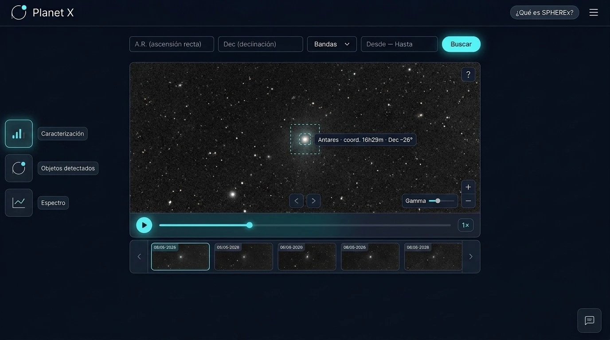

<!-- i18n-header -->
> 🌐 **Sprache:** [English](../../../en/docs/diseno/REVISION_MAQUETA_V1.md) · [Español](../../../es/docs/diseno/REVISION_MAQUETA_V1.md) · [中文](../../../zh/docs/diseno/REVISION_MAQUETA_V1.md) · **Deutsch** · [Italiano](../../../it/docs/diseno/REVISION_MAQUETA_V1.md)
> 🕒 **Dokumentationsdatum:** 2026-11-14 15:35 · **Quelle:** `docs/diseno/REVISION_MAQUETA_V1.md`
> ⚠️ Maschinell übersetzter Entwurf, Prüfung durch Muttersprachler ausstehend.
<!-- /i18n-header -->

# Überprüfung des Viewer-Mockups gegen die realen Daten (14. Nov. 2026)

Überprüfung des Viewer-Mockups gegen das, was die EDA gezeigt hat
([`../09_EDA_HALLAZGOS.md`](../09_EDA_HALLAZGOS.md)). Sie beurteilt nicht den Stil: Sie sagt, was der
Bildschirm verspricht, das die SPHEREx-Daten so nicht liefern werden, und was fehlt. Die Verantwortlichen
sind die aus dem Teamplan ([`../../README.md`](../../README.md) §3).

**Zusammenfassung:** Das Mockup deckt fast alles ab, was die Aufgabenstellung verlangt. Was sich durch die EDA
am meisten ändert, ist, dass **der Subtraktions-Button fehlt** und dass das zentrale Bild und der Fotostreifen
etwas versprechen, das die realen Daten so nicht zeigen werden.

---

## Empfohlene Änderungen

| # | Was zu ändern ist | Warum (Datum aus der EDA) | Verantwortlich |
|---|---|---|---|
| 1 | **Den Button «Subtraktion» hinzufügen** neben dem ▶ (wechselt zwischen blink / Subtraktion) | Die Bewegung beträgt über den gesamten Zeitraum 1–2 px: Im blink fällt sie kaum auf; in der Subtraktion erscheint sie als rot/blaues Paar. Das ist die Hauptansicht, kein Extra. *(Stand 14. Nov.: `Visor.tsx` hat den Subtraktions-Button noch nicht.)* | V1 Antonia (Bildschirm) · D2 Bryan (`diff_first`, `diff_prev`) |
| 2 | **Das zentrale Bild wird nicht so scharf sein.** Den Hintergrund als Kontexthimmel (Aladin) verwenden und den realen SPHEREx-Ausschnitt innerhalb des gepunkteten Rahmens zeigen, oder die Verpixelung mit ungeglättetem Zoom akzeptieren | Ein Ausschnitt von 0,1° misst 58×58 Pixel zu je 6,15″ | V2 Juan Pablo (Aladin) · V1 Antonia (Ausschnitt) |
| 3 | **Das Beispiel ändern: Antares → Epsilon Indi B** | Antares gehört zu den hellsten Sternen am Himmel: Er wird sättigen. Gesättigte Sterne hinterlassen in der Subtraktion ein rot/blaues Paar, auch wenn sie sich nicht bewegen (RW Aur). eps Ind B sättigt nicht und seine gemessene Bewegung stimmt mit dem Katalog überein | V1 Antonia · N Javiera (Demo) |
| 4 | **Die Daten des Fotostreifens korrigieren** und in jeder Miniatur **Datum und λ** zeigen | Die Daten im Mockup enthalten 2020 und 2028; in den 5 Testfeldern gibt es Daten vom 24. Apr. 2025 bis 2. Okt. 2026 (DR1 + QR3). Jedes Foto liegt in einer anderen Wellenlänge, und das erklärt Helligkeitsänderungen | V1 Antonia |
| 5 | **Der Streifen hat 3–5 Fotos, nicht Dutzende.** Eine durchgehende Leiste suggeriert ein langes Video: besser diskrete Schritte, einer pro Durchgang | Pro Zone gibt es 3 oder 4 Durchgänge über den Himmel in 1–1,4 Jahren (laut `docs/09`; R Dra hat eine fast kontinuierliche Beobachtung und WISE 0855 endet 2026,37) | V1 Antonia |
| 6 | **Fortschreitender Ladezustand:** leere Miniaturen, die sich füllen, sobald jedes Foto eintrifft | Ein Ausschnitt braucht im Median 7,3 s und bis zu 29 s; es gab 503-Fehler | V1 Antonia · D1 Vladimir (Cache und Vorberechnung) |
| 7 | **Qualitätshinweise:** der Kasten «Kontamination» aus dem Plan und ein Hinweis «Objekt gesättigt: Die Subtraktion kann täuschen» | Die wirklich schlechten Pixel sind ~4 %; Achtung: Das SOURCE-Bit markiert 72 % und ist kein Fehler | D2 Bryan (`flagged_fraction`, Sättigung) · V1 Antonia · C Mauricio (was angezeigt wird) |
| 8 | **Seitenpanel, «Spektrum»:** Es ist möglich, stammt aber nicht aus dem IRSA-Cube | Der HiPS-Cube, den Aladin lädt, sind PNG zur Visualisierung, ohne Flüsse; die FITS-Version erlaubt keine Ausschnitte. Das Spektrum stammt aus den Level-2-Fotos, die ihre λ bereits berechnet haben | V2 Juan Pablo · D2 Bryan |
| 9 | **Seitenpanel, «Erkannte Objekte» → «Bekannte Objekte»** (SIMBAD und Gaia über dem Bild) | Die automatische Erkennung blieb im Plan für «mit 6 Stunden mehr»; das Katalog-Overlay ist vorhanden | V2 Juan Pablo |

## Schnelle Details

- **Suche nach Namen** («Barnard», «eps Ind B») zusätzlich zu RA und Dec: Das macht das Werkzeug für
  jeden nutzbar, und `/api/resolve` steht bereits im Plan (D1 Vladimir). Achtung: «eps Ind B» mit großem
  Buchstaben ist das Paar Brauner Zwerge; mit kleinem Buchstaben ist es ein Planet in 6,7′ (siehe `data/campos_de_prueba.yml`).
- **Erratum:** «deciinación» → «declinación».
- **Es fehlt die Fußzeile mit der verpflichtenden SPHEREx-Attribution** (`docs/02_DATOS_SPHEREX.md` §8). *(Stand 14. Nov.: Die Fußzeile existiert in `App.tsx`, aber mit einem spanischen Text, der nicht der von IRSA geforderte Wortlaut ist; Codeänderung steht bei N/V1 aus.)*
- **«Von — Bis»:** Bei 3–4 Durchgängen filtert es wenig. Mit dem realen Datenbereich vorbelegen.
- **Zoom + / −:** unverzichtbar, um 1–2 px zu sehen. Der Zoom darf die Pixel nicht glätten.

## Was das Mockup bereits gut löst

- Koordinaten, Bänder und Suche in einer einzigen Zeile oben.
- Wiedergabesteuerung mit Geschwindigkeit und Gamma über dem Bild.
- Der Button «?» und «Was ist SPHEREx?» für alle, die ohne Astronomiekenntnisse kommen.
- Seitenpanel mit Spektrum: Das ist das «Extra-Kudos» der Aufgabenstellung.

## Quellen

Zahlen aus `eda/resultados/` (Inventar, Latenz, Zentroide, Flags); Details und Methode in
[`../09_EDA_HALLAZGOS.md`](../09_EDA_HALLAZGOS.md). Die Aufgaben pro Rolle stehen in
[`../10_REPARTO_DE_TRABAJO.md`](../10_REPARTO_DE_TRABAJO.md).
