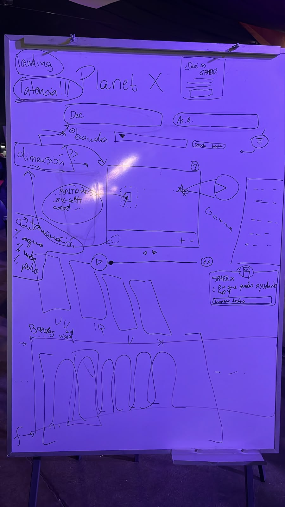
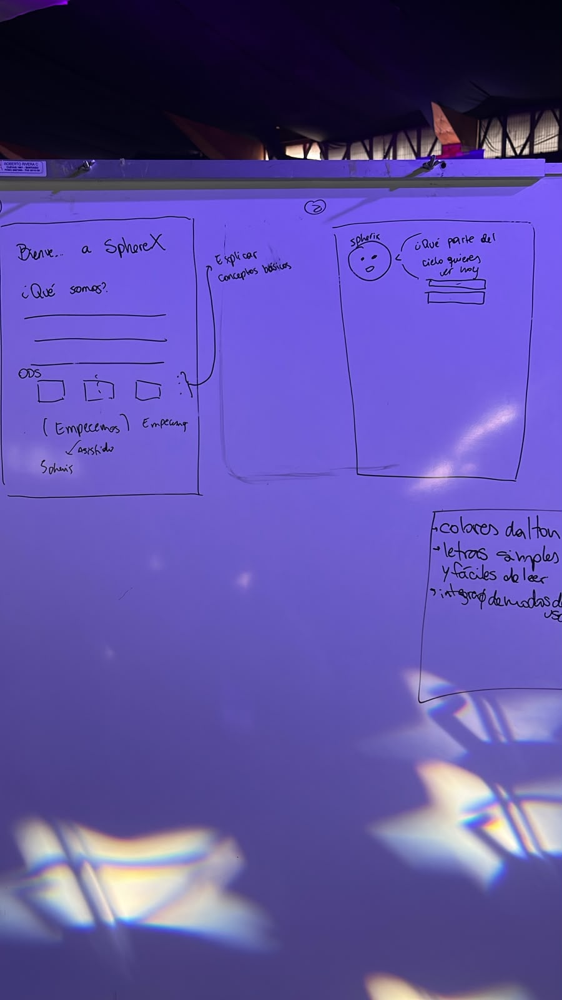

<!-- i18n-header -->
> 🌐 **Language:** **English** · [Español](../es/README.md) · [中文](../zh/README.md) · [Deutsch](../de/README.md) · [Italiano](../it/README.md)
> 🕒 **Documentation date:** 2026-11-14 15:35 · **Source:** `README.md`
> ⚠️ Machine-translated draft, pending native-speaker review.
<!-- /i18n-header -->

# SPHEREX — NASA Space Apps Challenge 2026 · *Planet X and SPHEREx*

**A public web tool where anyone types in sky coordinates and sees that region as a little video: the
sequence of SPHEREx images over time, so you can spot by eye whatever moves or changes brightness, and
also what it is made of (the 102 bands).**

## 🔭 Live viewer: **https://spherex-planet-x-tau.vercel.app**

Direct example: [Barnard's Star in band D1](https://spherex-planet-x-tau.vercel.app/?ra=269.4520769586187&dec=4.693364966576667&size=0.1&band=1).
Today it is the visual skeleton of the whiteboard: landing page, viewer with the real SPHEREx DR1 sky (IRSA cube, per
band), controls wired to the URL, and dotted placeholders with the name of whoever fills them in.
**Every merge to `main` is published automatically** at that URL, within a minute or two. How to test before the merge: see §2.

This README is **the team's main plan**. The detail lives in `docs/` (source of truth),
and the guide to using the work kit is in [`docs/KIT.md`](docs/KIT.md).

> Until Nov 13 there was no code here that solves the challenge; since the official start (Nov 14) there is
> (`eda/` and the viewer in `scaffold/frontend/`). See [`docs/08_REGLAS_DEL_EVENTO.md`](docs/08_REGLAS_DEL_EVENTO.md).

---

## 1. Context

- **Challenge:** [Planet X and SPHEREx](https://www.spaceappschallenge.org/2026/challenges/planet-x-and-spherex/)
  (Advanced). Full official text in [`docs/00_DESAFIO.md`](docs/00_DESAFIO.md).
- **What it asks for:** the user enters RA/Dec; the tool shows a series of SPHEREx images of that
  patch «like a little video». Test with **Barnard's Star, Epsilon Indi B, WISE 0855** (they move) and
  **RW Aurigae, R Draconis** (they change brightness).
- **De facto rubric (the 8 *Potential Considerations*):** easy to update with new releases ·
  show the 102 bands (co-add per detector; **extra kudos: on-the-fly spectrum**) · add/subtract epochs ·
  selectable field of view · Gaia/WISE overlays · coordinates in the URL · contamination flags ·
  use Astropy and Aladin. Model of inspiration: [WiseView](http://byw.tools/wiseview).
- **Event (Santiago):** work Sat 14 10:00 → **submission deadline Sun 15 11:00** (confirmed by JP on Nov 14; announced live
  by the organizers; see [`docs/08`](docs/08_REGLAS_DEL_EVENTO.md)),
  **2-min pitch + 2 questions**. AI use is allowed **and declaring it is mandatory** in the submission.
- **What gets uploaded:** name and summary, link to the final demo, NASA data and other sources, and how AI was used.
- **Jury:** impact, creativity, validity, relevance and presentation.
- **Deployment:** Vercel for the frontend (specified by the organizers); how the backend runs is still to be decided
  in ADR-001. Nothing is deployed without approval from a team member.
- **What it is NOT:** it is not an automatic detector nor a video model. It is a **viewer**; the human detects.
  Any ML layer goes on top, never in place of the viewer ([`docs/01_ESTADO_DEL_ARTE.md`](docs/01_ESTADO_DEL_ARTE.md)).

### Traps already detected

1. **The coordinate in the challenge statement for WISE 0855 is from epoch ~2010.4.** The object moves 8.15″/year:
   today it is at ~130″. Always use the propagated positions in [`data/campos_de_prueba.yml`](../../data/campos_de_prueba.yml).
2. **Consecutive exposures = different wavelengths** (linear variable filter). Blinking without
   grouping by band/λ (`WCS-WAVE`) gives a sequence that shows color, not time.
3. **Use DR1 + QR3.** QR2 is no longer searchable via SIA2.
4. **WISE 0855 is not in Gaia:** its overlay uses CatWISE2020.
5. **WISE 0855 is a mandatory case and looks faint in a single exposure.** It is always shown, and we say so honestly: its motion (~1.3 px over the whole period) is seen with the first − last subtraction and, when it exists, with the per-sweep sum (CatWISE2020 overlay by V2: done on the `v/v2-catwise` branch, PR pending; sum with 1/VARIANCE weights by D2: pending). eps Ind B is where the motion is seen most clearly (`docs/09` §4).

---

## 2. Architecture (summary of [`docs/03_ARQUITECTURA.md`](docs/03_ARQUITECTURA.md))

Two paths on the same screen:

- **Path A — «the sky in 102 colors», no backend:** Aladin Lite v3 + IRSA DR1 HiPS cube with a
  λ slider, Gaia overlay. It is the safety net if the backend fails. (Plan B: SPHEREx HiPS from CDS.)
- **Path B — the temporal blink, with backend:** FastAPI queries SIA2 by position, requests cutouts per
  epoch, groups by band, subtracts ZODI, normalizes and returns PNGs ordered in time.

**API contract** (the only thing front and back take for granted; it is changed first in `docs/03`):
`GET /api/health` · `/api/resolve?q=` · `/api/epochs?ra=&dec=&size=` ·
`/api/frames?ra=&dec=&size=&band=&stretch=&cmap=&mode=` (`raw|zodi_subtracted|diff_first|diff_prev`,
with `wavelength_um` and `flagged_fraction` per frame) · `/api/spectrum?ra=&dec=&aperture=` (with mandatory `caveat`).

**Shareable URL:** `/?ra=…&dec=…&size=…&band=…&fps=…&stretch=…&mode=…` or `/?target=WISE+0855`.
Disk cache with **the five fields pre-warmed**; degraded offline mode for the demo.

Stack ([`docs/adr/ADR-001-stack.md`](docs/adr/ADR-001-stack.md)): Python 3.11 + FastAPI + astropy/astroquery/pyvo ·
React + Vite + TypeScript + Aladin Lite v3.

**Deployment (decided Nov 14): the viewer goes on Vercel.** Project `spherex-planet-x` in the
eMind Vercel team (free Hobby plan, a single member: Mauricio), connected to this repository.
Production: **https://spherex-planet-x-tau.vercel.app**. The configuration is in
[`vercel.json`](../../vercel.json) (builds `scaffold/frontend`), and [`.vercelignore`](../../.vercelignore) leaves out
`docs/`, `data/` and everything that is not frontend.

**How deployment works with the free plan** (adding members to Vercel requires paying):
- **Production:** every merge to `main` is published automatically, because Mauricio does the merge from GitHub.
- **PR previews:** Vercel **only builds Mauricio's commits**. Everyone else's PRs show up
  as *Blocked* in Vercel: this is expected, not a code error.
- **Before asking for the merge, everyone tests locally:** `cd scaffold/frontend && npm ci && npm run build && npm run preview`
  (or `npm run dev` while working). GitHub CI also runs the build on every PR.
- If something looks wrong in production, tell Mauricio, who can see the Vercel logs.

For the backend, the recommendation is:
- **The 5 test fields precomputed as static files** (PNG + JSON in the shape of the contract)
  served by the same Vercel. This solves the whiteboard's «Latency!» and is the demo's offline mode.
- **Arbitrary coordinates:** FastAPI on Vercel Python Functions if the cutouts fit within the function's time
  limit; if not, the same FastAPI in a container (Render/Fly) behind `/api`.
  This is decided in Block 1 with the measured time of a cutout.

---

## 2b. Interface design (whiteboard of Nov 14)

| Main screen (viewer) | Landing and assisted mode |
|---|---|
|  |  |

**Flow:** Landing → (*Let's start* directly **or** *Let's start assisted* with Spherix) → Viewer.
From the landing, a link to *Basic concepts*. Hamburger menu on all screens.

### Screen 1 · Landing «Welcome to SPHEREx»
- «Who are we?»: two or three lines about the project and the mission.
- **SDGs**: cards with the Sustainable Development Goals it contributes to.
- Buttons **Let's start** (goes straight to the viewer) and **Let's start assisted** (opens Spherix).
- Link to **Basic concepts**: what RA/Dec is, a band, infrared, why stars move.

### Screen 2 · Assisted mode with **Spherix** (mascot)
- Spherix asks «Which part of the sky do you want to see today?» with input fields and suggestions
  (the 5 test objects as buttons). It takes you to the viewer with the URL already built (`?target=…`).
- In the viewer, Spherix stays as a **floating chat** at the bottom right: «How can I help you today?».
- **Minimum:** guided flow with answers written by Javiera, no LLM.
  **Extra:** chat with Claude through a Vercel function; the API key goes only in the
  Vercel environment variables, never in the frontend. If done, it is declared in the submission.

### Screen 3 · Viewer «Planet X»
| Whiteboard element | What it does | Data / endpoint |
|---|---|---|
| **Dec** and **R.A.** fields | Center coordinate (also accepts a name) | `/api/resolve` |
| **Bands** (dropdown) | Choose detector D1–D6 or all | `band` |
| **From – to** | Date range of the epochs | `from`, `to` (new, see `docs/03`) |
| **Dimension ??** | Field of view of the crop | `size` |
| **What is SPHEREx?** card | Short explanation, with link to Basic concepts | static |
| Central image with **?**, **+ / −** and minimap | The current frame with zoom; contextual help | `/api/frames` + Aladin |
| **Bubble when hovering over a star** («ANTARES, XV-644, coord…») | Name, catalog identifier and coordinates | SIMBAD / Gaia (overlay) |
| **Click on a star → ▶** | Animation cropped and centered on that star | `/api/frames` with small `size` centered on it |
| **Gamma** | Image stretch/gamma control | `stretch` + client-side gamma |
| **◁ ▷**, **▶**, timeline and **1x** | Previous/next frame, play, position and speed | `fps` |
| **Frame strip** | Thumbnails of each epoch; click to jump | `frames[]` |
| **Side panel** | List of epochs with date, λ and `flagged_fraction` (metadata) | `/api/epochs` |
| **«Contamination: % water, % cloud, % dust»** box | **To be confirmed at the standup:** either percentage of pixels with contamination flags by type, or composition indicators from the spectrum (water ice, dust). If composition, only qualitative and with `caveat` | `flagged_fraction` / `/api/spectrum` |
| **Band chart** at the bottom (flux *f* vs band, curves per band) | The object's spectrum across the 102 bands | `/api/spectrum` |
| **Visual aid UV · V · IR · X** above the chart | Electromagnetic spectrum bar showing where SPHEREx falls (0.75–5 µm, near infrared) | static |
| **Spherix** (floating chat) | Contextual help | see Screen 2 |
| **«Latency!»** | The demo cannot wait for IRSA | 5 precomputed fields + loading states |

### Accessibility (whiteboard 2) — a requirement, not an extra
- **Colorblind-friendly colors:** `viridis`/`cividis` maps by default; never red/green alone to tell things apart.
- **Simple, easy-to-read letters:** sans-serif typography, good contrast, base size ≥ 16 px.
- **Integration of usage modes:** assisted mode (Spherix, explanations) and direct mode (all controls).

---

## 3. The 6 branches (on top of the D/V/C/N roles of [`docs/04_METODOLOGIA.md`](docs/04_METODOLOGIA.md))

| # | Front · branch prefix | Owner | Folder that is theirs | Deliverables, in priority order |
|---|---|---|---|---|
| 1 | **D1 Data-access** · `d/…` (`d/sia2-epochs`, `d/cache`, `d/precalculo`) | Vladimir (programmer) | `scaffold/backend/app/irsa/`, `app/cache/`, `scripts/precalcular/`; routes `resolve`, `epochs`, `health` | Hour-1 checklist ([`docs/02`](docs/02_DATOS_SPHEREX.md) §9) with C, **measuring the time of a cutout** (decides Vercel Functions vs container); SIA2 over `spherex_dr1`+`spherex_qr3`; **`from`/`to`** filter (the whiteboard's date range); parallel cutouts with retry; cache; **script that precomputes the 5 fields to static JSON+PNG for Vercel** («Latency!»); `/api/resolve` also for the **name bubble when hovering over a star**; re-query for new releases |
| 2 | **D2 Data-frames** · `d/…` (`d/frames-banda`, `d/diff`, `d/spectrum`) | Bryan | `scaffold/backend/app/frames/`, `app/spectrum/`; routes `frames`, `spectrum` | Group by band and λ (`WCS-WAVE`); subtract ZODI; reproject to a common grid; stretch → PNG; `wavelength_um` + `flagged_fraction` (feeds the **side panel** and the **«Contamination»** box); `diff_first`/`diff_prev`; co-add per detector; **small crop centered on the clicked star** (same `/api/frames` with small `size`); `/api/spectrum` for the **band chart** |
| 3 | **V1 Viewer-blink** · `v/…` (`v/panel-blink`, `v/controles`, `v/url`, `v/landing`) | Antonia | `scaffold/frontend/src/blink/`, `src/controls/`, `src/state/`, `src/pages/` | Contract mock from hour 1; whiteboard's **Viewer screen**: Dec/R.A. fields, band dropdown, **from–to**, **dimension**, central image with **?**, **◁ ▷ / ▶ / timeline / 1x**, **frame strip**, **gamma**; **landing** and navigation with **hamburger menu**; URL ↔ state; empty/error/loading states; mobile; **accessibility** (colorblind palette, legible typography); footer with attribution |
| 4 | **V2 Viewer-sky** · `v/…` (`v/aladin-hips`, `v/overlay-gaia`, `v/espectro`, `v/spherix`) | Juan Pablo | `scaffold/frontend/src/sky/`, `src/spectrum/`, `src/spherix/` | **Path A**: Aladin Lite + DR1 HiPS cube (CORS in hour 1) with **zoom + / − and minimap**; Gaia DR3 overlay **propagated to the epoch**; WISE/CatWISE overlay; **bubble when hovering over a star** (name, ID, coordinates) and **click → cropped animation**; **band chart** (flux vs λ) with the **UV · V · IR · X bar**; **Spherix** component (floating chat + assisted flow) with Javiera's texts |
| 5 | **C Science, verification and deployment** · `c/…` | Mauricio | `data/campos_de_prueba.yml`, `docs/02`, `docs/07`, `vercel.json`, deployment config | **Vercel project** connected to the repo (production from `main`, preview per PR); decide where `/api` runs with the time measured by D1; hour-1 checklist; verify each function on the 5 fields + controls (`campo_vacio`, `plano_galactico`); **clarify what «Contamination: % water, % cloud, % dust» means** and make sure what is shown is correct; `revisor-cientifico` before each visible merge; offline mode; review PRs |
| 6 | **N Narrative, content and submission** · `n/…` | Javiera (science communicator) | `README.md`, `docs/06`, `src/content/` (texts), demo video, form | **Interface texts**: «Who are we?», **SDG** cards (choose which and why), **Basic concepts** page, **What is SPHEREx?** card, **?** helps; **Spherix's personality and script** (questions, suggestions, answers of the assisted mode); check that everything is understandable without knowing astronomy; one-line sentence; demo video; submission + **AI-use declaration**; rehearse the pitch 3 times |

> Vladimir (programmer) takes D1; Javiera (science communicator) takes N: the pitch, the demo script, the texts
> and Spherix, so that the tool can be understood without knowing astronomy. Full team: 6 people.
>
> **Design priority order** (if time runs short, cut from the bottom): 1) viewer with blink, Dec/R.A.,
> bands, dimension, play and frame strip · 2) landing with *Let's start* · 3) overlay and bubble when hovering
> over a star · 4) band chart · 5) assisted Spherix (fixed script) · 6) click → cropped
> animation · 7) «Contamination» box · 8) Spherix chat with LLM.
>
> Roles are not cages: from hour 12, D1/D2/V1/V2 share out the extra bullets. **C and N do not dissolve.**
> Automatic detection (ALeRCE-style crop classifier, Bryan's idea) stays as «with 6 more hours».

---

## 4. Skills, agents and commands per branch

Everything lives in `.claude/` and loads automatically when opening Claude Code at the repo root.

**For all branches:** skills `spherex-datos`, `coordenadas-astro`; commands `/standup`, `/traspaso`,
`/verifica-cifra`, `/riesgo`; and from the ECC plugin: `ecc:git-workflow`, `ecc:search-first`,
`ecc:documentation-lookup`, `ecc:verification-loop`.

| Branch | Repo skills / agents | Additional skills | Reviewer agents (before the human PR review) |
|---|---|---|---|
| D1 access | `spherex-datos`, `coordenadas-astro`, agent **`explorador-datos`** | `astropy`, `ecc:python-patterns`, `ecc:python-testing`, `ecc:fastapi-patterns`, `ecc:api-connector-builder`, `ecc:content-hash-cache-pattern`, `ecc:error-handling` | `ecc:python-reviewer`, `ecc:silent-failure-hunter`, `ecc:fastapi-reviewer` |
| D2 frames | `spherex-datos`, `visor-sky-blink`, agent `explorador-datos` | `astropy`, `matplotlib`, `ecc:python-patterns`, `ecc:python-testing`, `ecc:data-throughput-accelerator`, `dataviz` | `ecc:python-reviewer`, `ecc:performance-optimizer`, **`revisor-cientifico`** |
| V1 blink + landing | `visor-sky-blink`, `coordenadas-astro`, agent **`revisor-interfaz`**, `/chequeo-demo` | `ecc:react-patterns`, `ecc:vite-patterns`, `ecc:typescript-patterns`, `ecc:frontend-patterns`, `ecc:frontend-design-direction`, **`ecc:accessibility`**, `ecc:motion-foundations`, `ecc:e2e-testing`, `ecc:browser-qa` | `ecc:react-reviewer`, `ecc:typescript-reviewer`, `ecc:e2e-runner`, **`ecc:a11y-architect`** |
| V2 sky + spectrum + Spherix | `visor-sky-blink`, `coordenadas-astro`, agent `revisor-interfaz` | `astropy`, `ecc:react-patterns`, `ecc:typescript-patterns`, `dataviz`, **`claude-api`** (only if Spherix uses an LLM) | `ecc:react-reviewer`, **`revisor-cientifico`**, `ecc:security-reviewer` (LLM key) |
| C science + Vercel | `coordenadas-astro`, `spherex-datos`, agents **`revisor-cientifico`**, `explorador-datos`; `/verifica-cifra`, `/riesgo`, `/chequeo-demo` | `astropy`, **`ecc:deployment-patterns`** (Vercel), `ecc:verification-loop`, `ecc:code-review` | `ecc:security-reviewer`, `ecc:code-reviewer` |
| N content + submission | **`demo-y-pitch`**, **`entrega-nasa`**, `/chequeo-demo` | **`ecc:brand-voice`** (Spherix's voice), `ecc:article-writing`, `ecc:frontend-slides` or `anthropic-skills:pptx`, `ecc:video-editing`, `ecc:ui-demo`, `dataviz` | `ecc:agent-evaluator`, `revisor-interfaz` |

**Origin of the skills:**
- `spherex-datos`, `coordenadas-astro`, `visor-sky-blink`, `demo-y-pitch`, `entrega-nasa` and the 3 agents: Juan Pablo's kit.
  `spherex-datos` §11 and the CatWISE note in `coordenadas-astro` were added with the Nov 14 exploration.
- `astropy`, `matplotlib`, `scikit-learn`: [K-Dense AI scientific skills](https://github.com/K-Dense-AI/claude-scientific-skills) (MIT),
  reviewed before copying (documentation and chart templates only). `scikit-learn` only for the classification extra.
- `ecc:*`: [ECC](https://github.com/affaan-m/ECC) plugin. If you don't have it: `/plugin marketplace add affaan-m/ECC` → `/plugin install ecc@ecc`.
  It is optional: the repo's skills are enough to work.

---

## 5. How we work ([`CONTRIBUTING.md`](CONTRIBUTING.md))

1. **Nobody pushes to `main`.** Everything goes in through a PR, and **a person reviews it** (an agent can prepare it).
2. Branches `<role>/<topic>` that live **less than 3 hours**.
3. **One worktree per person:** `git worktree add ../spherex-<role> <role>/<topic>`.
4. The API contract is changed first in `docs/03_ARQUITECTURA.md` and the team is notified.
5. No FITS or downloaded data in the repo (they go to `data/cache/`, ignored).
6. Each PR: *What it does · How I checked it · What I did NOT check*, tested with at least one test field.

```bash
git clone https://github.com/mauriciovalenzuela742/SPHEREX
cd SPHEREX
claude            # check: /standup must exist
```

---

## 6. Schedule (detail and cut criteria in [`docs/05_PLAN_24H.md`](docs/05_PLAN_24H.md))

**T = Sunday 11:00** (submission deadline). Therefore: **T−6 = Sun 05:00** (scope freeze),
**T−4 = Sun 07:00**, **T−2 = Sun 09:00 (submitted)**. That is ~25 h of work, not 27.

| Block | Hours | Who | What | Cut |
|---|---|---|---|---|
| 0 | h0–1 | Everyone | Read `00_DESAFIO` aloud, sign ADR-001, names in `05`, the scaffold runs for everyone | Nobody moves on until all 6 can run the project |
| 1 | h1–3 | D1 + D2 + C | Data checklist: number of epochs, time of a cutout, **how much λ changes between epochs**, HiPS + CORS. V1/V2 on the mock; N opens the form | At h3, a written answer to each question |
| 2 | h3–8 | Everyone | `/epochs` + `/frames` for one band with cache; coordinate → canvas → play; Path A with Aladin; C verifies fields | **h8: a coordinate produces a little video on screen**, or everyone works on that |
| 3 | h8–14 | Everyone | Priorities 1→8: band, controls, subtraction, names, URL, Gaia overlay, flags, spectrum | **T−6 h: scope freeze** |
| 4 | T−6→T−4 | C + everyone | The 5 fields in the **deployed** app, pre-warm, empty states, mobile, attribution | — |
| 5 | T−4→T−2 | N + C | Demo video, offline degraded mode, **complete submission with AI declaration** | **T−2 h: submitted** |
| 6 | T−2→pitch | N + everyone | Rehearse 3 times, timed, with the uncomfortable questions | — |

---

## 7. Exploration subagents during the event

- **Hour 1:** two `explorador-datos` in parallel (D1: SIA2 rows and cutout time on WISE 0855
  and Barnard; D2: λ drift between epochs with `WCS-WAVE`), plus one agent that **re-checks the Resources
  tab** of the challenge (it may change) and updates `docs/00_DESAFIO.md`.
- **Before each merge that shows up in the demo:** `revisor-cientifico`.
- **Before the freeze and the demo:** `revisor-interfaz` + `/chequeo-demo`.

---

## 8. Verification (criterion for «done»)

- CI ([`.github/workflows/ci.yml`](../../.github/workflows/ci.yml)): `pytest -q` in backend and `npm run build` in frontend.
  At the start of the event, remove the `|| true` from the linter.
- **Acceptance = the 5 fields in the deployed app:** Barnard, WISE 0855 (with propagated coordinate) and
  ε Ind B are seen moving; RW Aur and R Dra change brightness; the Gaia markers fall on the stars
  at the frame's epoch; `campo_vacio` shows a clear empty state.
- `/chequeo-demo` passes; offline mode serves the 5 fields; the pitch lasts ≤ 2 min.

---

## 9. Block 0 to-dos

- [ ] Javiera and Vladimir: read this README, [`docs/00_DESAFIO.md`](docs/00_DESAFIO.md) and [`docs/briefings/`](../../docs/briefings/) (20 min).
- [x] Mauricio: create the Vercel project connected to the repo (root `scaffold/frontend`) and share the URL (done Nov 14: https://spherex-planet-x-tau.vercel.app).
- [ ] At the standup: clarify the «Contamination: % water, % cloud, % dust» box (flags or composition?).
- [ ] Javiera: choose the SDGs and write Spherix's script (welcome, «Which part of the sky do you want to see today?», 5 suggestions).
- [ ] Block 1: with the measured time of a cutout, decide whether `/api` runs on Vercel Functions or in a container (ADR-001).
- [ ] Juan Pablo: confirm with the organizers about food and whether we can stay overnight.
- [ ] Everyone: clone the repo, open `claude` at the root and check `/standup`.
- [ ] Everyone: Python 3.11, Node 20, Docker installed.
- [ ] Juan Pablo: bring the power strip.

---

## Team

Mauricio Valenzuela · Bryan Cabezas · Juan Pablo Castillo · Antonia Del Castillo · Javiera · Vladimir.
Original work kit: [jpcastillo714/spherex-kit](https://github.com/jpcastillo714/spherex-kit).
Material from the preparation meeting (Nov 13): [`docs/reuniones/`](../../docs/reuniones/).

## License and attribution

Code under the MIT license ([`LICENSE`](../../LICENSE)). SPHEREx data are public and require the acknowledgment note from
[`docs/02_DATOS_SPHEREX.md`](docs/02_DATOS_SPHEREX.md) §8 in the final README and in the tool's footer.

> This publication makes use of data products from the Spectro-Photometer for the History of the Universe, Epoch of Reionization and Ices Explorer (SPHEREx), which is a joint project of the Jet Propulsion Laboratory and the California Institute of Technology, and is funded by the National Aeronautics and Space Administration.
>
> *(Pending in the code: the viewer's footer, `scaffold/frontend/src/content/textos.ts`, still carries a Spanish paraphrase instead of this text.)*
