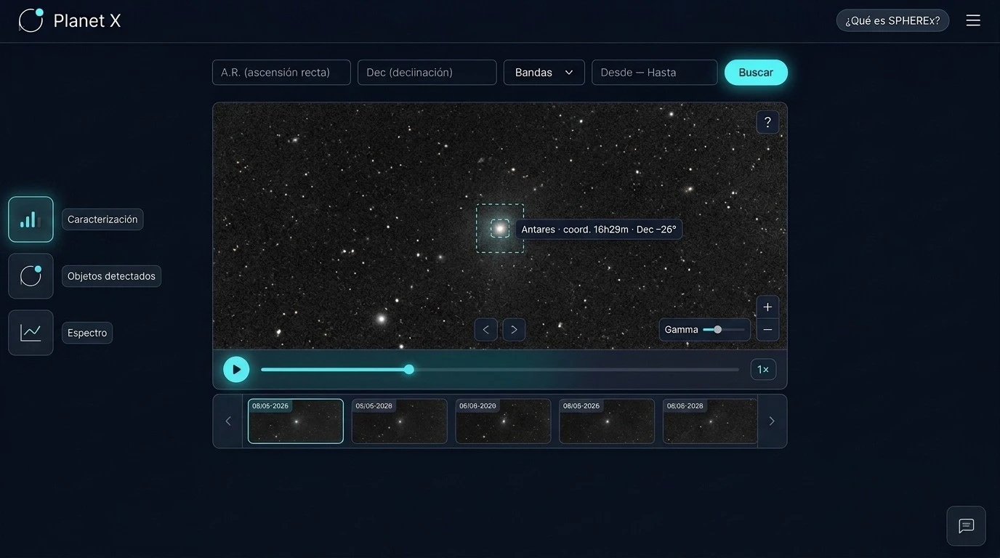

<!-- i18n-header -->
> 🌐 **Language:** **English** · [Español](../../../es/docs/diseno/REVISION_MAQUETA_V1.md) · [中文](../../../zh/docs/diseno/REVISION_MAQUETA_V1.md) · [Deutsch](../../../de/docs/diseno/REVISION_MAQUETA_V1.md) · [Italiano](../../../it/docs/diseno/REVISION_MAQUETA_V1.md)
> 🕒 **Documentation date:** 2026-11-14 15:35 · **Source:** `docs/diseno/REVISION_MAQUETA_V1.md`
> ⚠️ Machine-translated draft, pending native-speaker review.
<!-- /i18n-header -->

# Review of the viewer mockup against the real data (Nov 14, 2026)

Review of the viewer mockup against what the EDA showed
([`../09_EDA_HALLAZGOS.md`](../09_EDA_HALLAZGOS.md)). It does not judge the style: it says what the screen
promises that the SPHEREx data will not deliver that way, and what is missing. The owners are those of the team
plan ([`../../README.md`](../../README.md) §3).

**Summary:** the mockup covers almost everything the challenge asks for. What changes most with the EDA is that
**the subtraction button is missing**, and that the central image and the photo strip promise something that the real
data will not show that way.

---

## Recommended changes

| # | What to change | Why (EDA data) | Owner |
|---|---|---|---|
| 1 | **Add the «Subtract» button** next to the ▶ (toggles blink / subtraction) | The motion is 1–2 px over the whole period: in the blink it is barely noticeable; in the subtraction it appears as a red/blue pair. It is the main view, not an extra. *(Status Nov 14: `Visor.tsx` does not have the subtraction button yet.)* | V1 Antonia (screen) · D2 Bryan (`diff_first`, `diff_prev`) |
| 2 | **The central image will not be that sharp.** Use the background as context sky (Aladin) and show the real SPHEREx crop inside the dotted frame, or accept the pixelation with unsmoothed zoom | A 0.1° cutout measures 58×58 pixels of 6.15″ | V2 Juan Pablo (Aladin) · V1 Antonia (crop) |
| 3 | **Change the example: Antares → Epsilon Indi B** | Antares is among the brightest stars in the sky: it will saturate. Saturated stars leave a red/blue pair in the subtraction even if they do not move (RW Aur). eps Ind B does not saturate and its measured motion matches the catalog | V1 Antonia · N Javiera (demo) |
| 4 | **Fix the dates of the photo strip** and show on each thumbnail **date and λ** | The mockup dates include 2020 and 2028; in the 5 test fields there is data from Apr 24, 2025 to Oct 2, 2026 (DR1 + QR3). Each photo is at another wavelength, and that explains brightness changes | V1 Antonia |
| 5 | **The strip has 3–5 photos, not dozens.** A continuous bar suggests a long video: better discrete steps, one per sweep | Per area there are 3 or 4 sweeps of the sky in 1–1.4 years (according to `docs/09`; R Dra has almost continuous observation and WISE 0855 ends at 2026.37) | V1 Antonia |
| 6 | **Progressive loading state:** empty thumbnails that fill in as each photo arrives | A cutout takes 7.3 s median and up to 29 s; there were 503 errors | V1 Antonia · D1 Vladimir (cache and precomputation) |
| 7 | **Quality notices:** the plan's «Contamination» box and a «saturated object: the subtraction may deceive» notice | The truly bad pixels are ~4%; careful: the SOURCE bit marks 72% and is not an error | D2 Bryan (`flagged_fraction`, saturation) · V1 Antonia · C Mauricio (what is shown) |
| 8 | **Side panel, «Spectrum»:** it can be done, but it does not come from the IRSA cube | The HiPS cube that Aladin loads is PNG for visualization, without fluxes; the FITS version does not admit cutouts. The spectrum comes from the level 2 photos, which already have their λ computed | V2 Juan Pablo · D2 Bryan |
| 9 | **Side panel, «Detected objects» → «Known objects»** (SIMBAD and Gaia over the image) | Automatic detection was left for «with 6 more hours» in the plan; the catalog overlay is there | V2 Juan Pablo |

## Quick details

- **Search by name** («Barnard», «eps Ind B») in addition to R.A. and Dec: it makes the tool usable by
  anyone, and `/api/resolve` is already in the plan (D1 Vladimir). Careful: «eps Ind B» in uppercase is the
  pair of brown dwarfs; in lowercase it is a planet at 6.7′ (see `data/campos_de_prueba.yml`).
- **Typo:** «deciinación» → «declinación».
- **The footer with the mandatory SPHEREx attribution is missing** (`docs/02_DATOS_SPHEREX.md` §8). *(Status Nov 14: the footer exists in `App.tsx`, but with a Spanish text that is not the verbatim one IRSA requires; code change pending from N/V1.)*
- **«From — To»:** with 3–4 sweeps it filters little. Leave it prefilled with the real data range.
- **Zoom + / −:** essential to see 1–2 px. The zoom must not smooth the pixels.

## What the mockup already solves well

- Coordinates, bands and search on a single line at the top.
- Playback controls with speed, and gamma over the image.
- The «?» button and «What is SPHEREx?» for those who arrive knowing no astronomy.
- Side panel with spectrum: it is the challenge's «extra kudos».

## Sources

Figures from `eda/resultados/` (inventory, latency, centroids, flags); detail and method in
[`../09_EDA_HALLAZGOS.md`](../09_EDA_HALLAZGOS.md). The tasks by role are in
[`../10_REPARTO_DE_TRABAJO.md`](../10_REPARTO_DE_TRABAJO.md).
