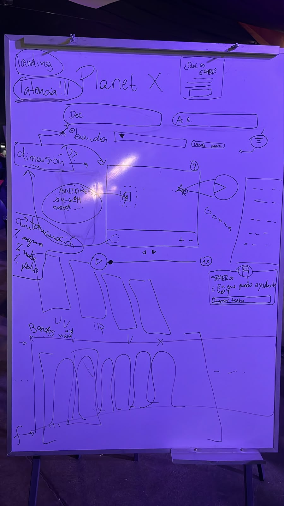
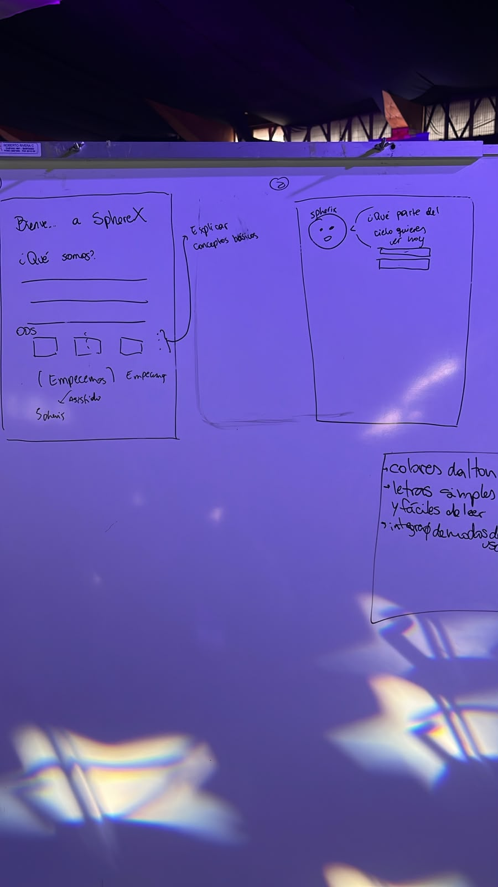

<!-- i18n-header -->
> 🌐 **Lingua:** [English](../en/README.md) · [Español](../es/README.md) · [中文](../zh/README.md) · [Deutsch](../de/README.md) · **Italiano**
> 🕒 **Data della documentazione:** 2026-11-14 15:35 · **Fonte:** `README.md`
> ⚠️ Bozza tradotta automaticamente, in attesa di revisione di un madrelingua.
<!-- /i18n-header -->

# SPHEREX — NASA Space Apps Challenge 2026 · *Planet X and SPHEREx*

**Uno strumento web pubblico in cui chiunque scrive delle coordinate del cielo e vede quella zona come un
videino: la sequenza di immagini di SPHEREx nel tempo, per individuare a occhio ciò che si muove
o cambia di luminosità, e inoltre di cosa è fatto (le 102 bande).**

## 🔭 Visore live: **https://spherex-planet-x-tau.vercel.app**

Esempio diretto: [Stella di Barnard nella banda D1](https://spherex-planet-x-tau.vercel.app/?ra=269.4520769586187&dec=4.693364966576667&size=0.1&band=1).
Oggi è lo scheletro visivo della lavagna: landing, visore con il cielo reale di SPHEREx DR1 (cubo di IRSA, per
banda), controlli collegati all'URL e riquadri tratteggiati con il nome di chi li completa.
**Ogni merge su `main` viene pubblicato in automatico** a quell'URL, in uno o due minuti. Come provare prima del merge: vedi §2.

Questo README è **il piano principale del team**. Il dettaglio sta in `docs/` (fonte di verità),
e la guida all'uso del kit di lavoro è in [`docs/KIT.md`](docs/KIT.md).

> Fino al 13 nov qui non c'era codice che risolvesse la sfida; dall'inizio ufficiale (14 nov) sì
> (`eda/` e il visore in `scaffold/frontend/`). Vedi [`docs/08_REGLAS_DEL_EVENTO.md`](docs/08_REGLAS_DEL_EVENTO.md).

---

## 1. Contesto

- **Sfida:** [Planet X and SPHEREx](https://www.spaceappschallenge.org/2026/challenges/planet-x-and-spherex/)
  (Advanced). Testo ufficiale completo in [`docs/00_DESAFIO.md`](docs/00_DESAFIO.md).
- **Cosa chiede:** l'utente inserisce RA/Dec; lo strumento mostra una serie di immagini di SPHEREx di quella
  porzione «like a little video». Provare con **Barnard's Star, Epsilon Indi B, WISE 0855** (si muovono) e
  **RW Aurigae, R Draconis** (cambiano di luminosità).
- **Rubrica di fatto (le 8 *Potential Considerations*):** facile da aggiornare con nuovi release ·
  mostrare le 102 bande (co-add per detector; **extra kudos: spettro al volo**) · sommare/sottrarre epoche ·
  campo visivo selezionabile · overlay di Gaia/WISE · coordinate nell'URL · flag di contaminazione ·
  usare Astropy e Aladin. Modello di ispirazione: [WiseView](http://byw.tools/wiseview).
- **Evento (Santiago):** lavoro sab 14 10:00 → **chiusura delle consegne dom 15 11:00** (confermato da JP il 14 nov; comunicato dal vivo
  dall'organizzazione; vedi [`docs/08`](docs/08_REGLAS_DEL_EVENTO.md)),
  pitch di **2 min + 2 domande**. Uso dell'IA consentito **e la sua dichiarazione è obbligatoria** nella consegna.
- **Si carica:** nome e riassunto, link alla demo finale, dati della NASA e altre fonti, e come è stata usata l'IA.
- **Giuria:** impatto, creatività, validità, rilevanza e presentazione.
- **Deploy:** Vercel per il frontend (indicato dall'organizzazione); come gira il backend è ancora da decidere
  nell'ADR-001. Nulla viene messo in produzione senza l'approvazione di una persona del team.
- **Cosa NON è:** non è un rilevatore automatico né un modello video. È un **visore**; è l'umano a individuare.
  Qualsiasi livello di ML va sopra, mai al posto del visore ([`docs/01_ESTADO_DEL_ARTE.md`](docs/01_ESTADO_DEL_ARTE.md)).

### Trappole già individuate

1. **La coordinata dell'enunciato per WISE 0855 è dell'epoca ~2010,4.** L'oggetto si muove di 8,15″/anno:
   oggi è a ~130″. Usare sempre le posizioni propagate di [`data/campos_de_prueba.yml`](../../data/campos_de_prueba.yml).
2. **Esposizioni consecutive = lunghezze d'onda diverse** (filtro lineare variabile). Fare il blink senza
   raggruppare per banda/λ (`WCS-WAVE`) dà una sequenza che mostra colore, non tempo.
3. **Usare DR1 + QR3.** QR2 non è più ricercabile tramite SIA2.
4. **WISE 0855 non è in Gaia:** il suo overlay usa CatWISE2020.
5. **WISE 0855 è un caso obbligatorio e si vede debole in una singola esposizione.** Si mostra sempre, e lo si dice con onestà: il suo moto (~1,3 px in tutto il periodo) si vede con la sottrazione primo − ultimo e, quando esisterà, con la somma per passata (overlay CatWISE2020 di V2: fatto nel branch `v/v2-catwise`, in attesa di PR; somma con pesi 1/VARIANCE di D2: in sospeso). eps Ind B è dove il moto si vede più chiaramente (`docs/09` §4).

---

## 2. Architettura (riassunto di [`docs/03_ARQUITECTURA.md`](docs/03_ARQUITECTURA.md))

Due vie nella stessa schermata:

- **Via A — «il cielo in 102 colori», senza backend:** Aladin Lite v3 + cubo HiPS di DR1 di IRSA con
  slider di λ, overlay Gaia. È l'assicurazione se il backend fallisce. (Piano B: HiPS di SPHEREx del CDS.)
- **Via B — il blink temporale, con backend:** FastAPI interroga SIA2 per posizione, richiede cutout per
  epoca, raggruppa per banda, sottrae ZODI, normalizza e restituisce PNG ordinati nel tempo.

**Contratto dell'API** (l'unica cosa che front e back danno per certa; si cambia prima in `docs/03`):
`GET /api/health` · `/api/resolve?q=` · `/api/epochs?ra=&dec=&size=` ·
`/api/frames?ra=&dec=&size=&band=&stretch=&cmap=&mode=` (`raw|zodi_subtracted|diff_first|diff_prev`,
con `wavelength_um` e `flagged_fraction` per fotogramma) · `/api/spectrum?ra=&dec=&aperture=` (con `caveat` obbligatorio).

**URL condivisibile:** `/?ra=…&dec=…&size=…&band=…&fps=…&stretch=…&mode=…` oppure `/?target=WISE+0855`.
Cache su disco con **i cinque campi precaricati**; modalità degradata offline per la demo.

Stack ([`docs/adr/ADR-001-stack.md`](docs/adr/ADR-001-stack.md)): Python 3.11 + FastAPI + astropy/astroquery/pyvo ·
React + Vite + TypeScript + Aladin Lite v3.

**Deploy (deciso il 14 nov): il visore va su Vercel.** Progetto `spherex-planet-x` nel team
eMind di Vercel (piano gratuito Hobby, un solo membro: Mauricio), collegato a questo repository.
Produzione: **https://spherex-planet-x-tau.vercel.app**. La configurazione è in
[`vercel.json`](../../vercel.json) (compila `scaffold/frontend`), e [`.vercelignore`](../../.vercelignore) lascia fuori
`docs/`, `data/` e tutto ciò che non è frontend.

**Come si fa il deploy con il piano gratuito** (aggiungere membri a Vercel richiede di pagare):
- **Produzione:** ogni merge su `main` viene pubblicato in automatico, perché il merge lo fa Mauricio da GitHub.
- **Anteprime delle PR:** Vercel **compila solo commit di Mauricio**. Le PR degli altri compaiono
  come *Blocked* su Vercel: è previsto, non è un errore del codice.
- **Prima di chiedere il merge, ognuno prova in locale:** `cd scaffold/frontend && npm ci && npm run build && npm run preview`
  (o `npm run dev` mentre lavora). Anche la CI di GitHub esegue la build a ogni PR.
- Se qualcosa si vede male in produzione, si avvisa Mauricio, che vede i log di Vercel.

Per il backend, la raccomandazione è:
- **I 5 campi di prova precalcolati come file statici** (PNG + JSON con la forma del contratto)
  serviti dallo stesso Vercel. Risolve la «Latenza!» della lavagna ed è la modalità offline della demo.
- **Coordinate arbitrarie:** FastAPI su Vercel Python Functions se i cutout rientrano nel tempo
  limite della funzione; altrimenti, lo stesso FastAPI in un container (Render/Fly) dietro `/api`.
  Si decide nel Blocco 1 con il tempo misurato di un cutout.

---

## 2b. Design dell'interfaccia (lavagna del 14 nov)

| Schermata principale (visore) | Landing e modalità assistita |
|---|---|
|  |  |

**Flusso:** Landing → (*Iniziamo* diretto **oppure** *Iniziamo assistiti* con Spherix) → Visore.
Dalla landing, un link a *Concetti di base*. Menu hamburger in tutte le schermate.

### Schermata 1 · Landing «Benvenuto in SPHEREx»
- «Chi siamo?»: due o tre righe sul progetto e sulla missione.
- **SDG**: schede con gli Obiettivi di Sviluppo Sostenibile a cui contribuisce.
- Pulsanti **Iniziamo** (va diretto al visore) e **Iniziamo assistiti** (apre Spherix).
- Link a **Concetti di base**: cos'è RA/Dec, una banda, l'infrarosso, perché le stelle si muovono.

### Schermata 2 · Modalità assistita con **Spherix** (mascotte)
- Spherix chiede «Quale parte del cielo vuoi vedere oggi?» con campi di input e suggerimenti
  (i 5 oggetti di prova come pulsanti). Porta al visore con l'URL già pronto (`?target=…`).
- Nel visore, Spherix resta come **chat flottante** in basso a destra: «Come posso aiutarti oggi?».
- **Minimo:** flusso guidato con risposte scritte da Javiera, senza LLM.
  **Extra:** chat con Claude tramite una funzione di Vercel; la chiave API va solo nelle
  variabili d'ambiente di Vercel, mai nel frontend. Se si fa, lo si dichiara nella consegna.

### Schermata 3 · Visore «Planet X»
| Elemento della lavagna | Cosa fa | Dato / endpoint |
|---|---|---|
| Campi **Dec** e **A.R.** | Coordinata del centro (accetta anche un nome) | `/api/resolve` |
| **Bande** (menu a tendina) | Sceglie il detector D1–D6 o tutti | `band` |
| **Da – a** | Intervallo di date delle epoche | `from`, `to` (nuovo, vedi `docs/03`) |
| **Dimensione ??** | Campo visivo del ritaglio | `size` |
| Scheda **Cos'è SPHEREx?** | Spiegazione breve, con link a Concetti di base | statico |
| Immagine centrale con **?**, **+ / −** e minimappa | Il fotogramma attuale con zoom; aiuto contestuale | `/api/frames` + Aladin |
| **Fumetto al passaggio sopra una stella** («ANTARES, XV-644, coord…») | Nome, identificatore di catalogo e coordinate | SIMBAD / Gaia (overlay) |
| **Clic su una stella → ▶** | Animazione ritagliata e centrata su quella stella | `/api/frames` con `size` piccolo centrato su di essa |
| **Gamma** | Controllo di stretching/gamma dell'immagine | `stretch` + gamma sul client |
| **◁ ▷**, **▶**, linea del tempo e **1x** | Fotogramma precedente/successivo, play, posizione e velocità | `fps` |
| **Striscia di fotogrammi** | Miniature di ogni epoca; clic per saltare | `frames[]` |
| **Pannello laterale** | Elenco delle epoche con data, λ e `flagged_fraction` (metadati) | `/api/epochs` |
| Riquadro **«Contaminazione: % acqua, % nube, % polvere»** | **Da confermare nello standup:** o percentuale di pixel con flag di contaminazione per tipo, o indicatori di composizione dallo spettro (ghiaccio d'acqua, polvere). Se è composizione, solo qualitativo e con `caveat` | `flagged_fraction` / `/api/spectrum` |
| **Grafico delle bande** in basso (flusso *f* vs banda, curve per banda) | Lo spettro dell'oggetto nelle 102 bande | `/api/spectrum` |
| **Aiuto visivo UV · V · IR · X** sopra il grafico | Barra dello spettro elettromagnetico che mostra dove cade SPHEREx (0,75–5 µm, infrarosso vicino) | statico |
| **Spherix** (chat flottante) | Aiuto contestuale | vedi Schermata 2 |
| **«Latenza!»** | La demo non può aspettare IRSA | 5 campi precalcolati + stati di caricamento |

### Accessibilità (lavagna 2) — requisito, non extra
- **Colori adatti ai daltonici:** mappe `viridis`/`cividis` di default; mai rosso/verde da soli per distinguere.
- **Caratteri semplici e facili da leggere:** tipografia sans-serif, buon contrasto, dimensione base ≥ 16 px.
- **Integrazione delle modalità d'uso:** modalità assistita (Spherix, spiegazioni) e modalità diretta (tutti i controlli).

---

## 3. I 6 branch (sui ruoli D/V/C/N di [`docs/04_METODOLOGIA.md`](docs/04_METODOLOGIA.md))

| # | Fronte · prefisso del branch | Responsabile | Cartella di sua competenza | Consegne, in ordine di priorità |
|---|---|---|---|---|
| 1 | **D1 Dati-accesso** · `d/…` (`d/sia2-epochs`, `d/cache`, `d/precalculo`) | Vladimir (programmatore) | `scaffold/backend/app/irsa/`, `app/cache/`, `scripts/precalcular/`; rotte `resolve`, `epochs`, `health` | Checklist dell'ora 1 ([`docs/02`](docs/02_DATOS_SPHEREX.md) §9) con C, **misurando il tempo di un cutout** (decide Vercel Functions vs container); SIA2 su `spherex_dr1`+`spherex_qr3`; filtro **`from`/`to`** (intervallo di date della lavagna); cutout in parallelo con retry; cache; **script che precalcola i 5 campi in JSON+PNG statici per Vercel** («Latenza!»); `/api/resolve` anche per il **fumetto del nome al passaggio sopra una stella**; nuova interrogazione per i nuovi release |
| 2 | **D2 Dati-fotogrammi** · `d/…` (`d/frames-banda`, `d/diff`, `d/spectrum`) | Bryan | `scaffold/backend/app/frames/`, `app/spectrum/`; rotte `frames`, `spectrum` | Raggruppare per banda e λ (`WCS-WAVE`); sottrarre ZODI; riproiettare su una griglia comune; stretching → PNG; `wavelength_um` + `flagged_fraction` (alimenta il **pannello laterale** e il riquadro **«Contaminazione»**); `diff_first`/`diff_prev`; co-add per detector; **ritaglio piccolo centrato sulla stella cliccata** (stesso `/api/frames` con `size` piccolo); `/api/spectrum` per il **grafico delle bande** |
| 3 | **V1 Visore-blink** · `v/…` (`v/panel-blink`, `v/controles`, `v/url`, `v/landing`) | Antonia | `scaffold/frontend/src/blink/`, `src/controls/`, `src/state/`, `src/pages/` | Mock del contratto dall'ora 1; **schermata Visore** della lavagna: campi Dec/A.R., menu a tendina delle bande, **da–a**, **dimensione**, immagine centrale con **?**, **◁ ▷ / ▶ / linea del tempo / 1x**, **striscia di fotogrammi**, **gamma**; **landing** e navigazione con **menu hamburger**; URL ↔ stato; stati vuoto/errore/caricamento; mobile; **accessibilità** (palette per daltonici, tipografia leggibile); piè di pagina con attribuzione |
| 4 | **V2 Visore-cielo** · `v/…` (`v/aladin-hips`, `v/overlay-gaia`, `v/espectro`, `v/spherix`) | Juan Pablo | `scaffold/frontend/src/sky/`, `src/spectrum/`, `src/spherix/` | **Via A**: Aladin Lite + cubo HiPS DR1 (CORS nell'ora 1) con **zoom + / − e minimappa**; overlay Gaia DR3 **propagato all'epoca**; overlay WISE/CatWISE; **fumetto al passaggio sopra una stella** (nome, ID, coordinate) e **clic → animazione ritagliata**; **grafico delle bande** (flusso vs λ) con la **barra UV · V · IR · X**; componente **Spherix** (chat flottante + flusso assistito) con i testi di Javiera |
| 5 | **C Scienza, verifica e deploy** · `c/…` | Mauricio | `data/campos_de_prueba.yml`, `docs/02`, `docs/07`, `vercel.json`, config di deploy | **Progetto su Vercel** collegato al repo (produzione da `main`, preview per PR); decidere dove gira `/api` con il tempo misurato da D1; checklist dell'ora 1; verificare ogni funzione sui 5 campi + controlli (`campo_vacio`, `plano_galactico`); **chiarire cosa significa «Contaminazione: % acqua, % nube, % polvere»** e che ciò che viene mostrato sia corretto; `revisor-cientifico` prima di ogni merge visibile; modalità offline; revisione delle PR |
| 6 | **N Narrativa, contenuti e consegna** · `n/…` | Javiera (divulgatrice) | `README.md`, `docs/06`, `src/content/` (testi), video della demo, modulo | **Testi dell'interfaccia**: «Chi siamo?», schede **SDG** (scegliere quali e perché), pagina **Concetti di base**, scheda **Cos'è SPHEREx?**, aiuti **?**; **personalità e copione di Spherix** (domande, suggerimenti, risposte della modalità assistita); verificare che tutto si capisca senza sapere di astronomia; frase di una riga; video della demo; consegna + **dichiarazione di uso dell'IA**; provare il pitch 3 volte |

> Vladimir (programmatore) prende D1; Javiera (divulgatrice) prende N: il pitch, il copione della demo, i testi
> e Spherix, perché lo strumento si capisca senza sapere di astronomia. Team completo: 6 persone.
>
> **Ordine di priorità del design** (se manca tempo, si taglia dal basso): 1) visore con blink, Dec/A.R.,
> bande, dimensione, play e striscia di fotogrammi · 2) landing con *Iniziamo* · 3) overlay e fumetto al passaggio
> sopra una stella · 4) grafico delle bande · 5) Spherix assistito (copione fisso) · 6) clic → animazione
> ritagliata · 7) riquadro «Contaminazione» · 8) chat di Spherix con LLM.
>
> I ruoli non sono gabbie: dall'ora 12, D1/D2/V1/V2 si dividono le voci extra. **C e N non si sciolgono.**
> Il rilevamento automatico (classificatore di ritagli in stile ALeRCE, idea di Bryan) resta come «con 6 ore in più».

---

## 4. Skill, agenti e comandi per branch

Tutto vive in `.claude/` e si carica da solo aprendo Claude Code nella radice del repo.

**Per tutti i branch:** skill `spherex-datos`, `coordenadas-astro`; comandi `/standup`, `/traspaso`,
`/verifica-cifra`, `/riesgo`; e dal plugin ECC: `ecc:git-workflow`, `ecc:search-first`,
`ecc:documentation-lookup`, `ecc:verification-loop`.

| Branch | Skill del repo / agenti | Skill aggiuntive | Agenti revisori (prima della revisione umana della PR) |
|---|---|---|---|
| D1 accesso | `spherex-datos`, `coordenadas-astro`, agente **`explorador-datos`** | `astropy`, `ecc:python-patterns`, `ecc:python-testing`, `ecc:fastapi-patterns`, `ecc:api-connector-builder`, `ecc:content-hash-cache-pattern`, `ecc:error-handling` | `ecc:python-reviewer`, `ecc:silent-failure-hunter`, `ecc:fastapi-reviewer` |
| D2 fotogrammi | `spherex-datos`, `visor-sky-blink`, agente `explorador-datos` | `astropy`, `matplotlib`, `ecc:python-patterns`, `ecc:python-testing`, `ecc:data-throughput-accelerator`, `dataviz` | `ecc:python-reviewer`, `ecc:performance-optimizer`, **`revisor-cientifico`** |
| V1 blink + landing | `visor-sky-blink`, `coordenadas-astro`, agente **`revisor-interfaz`**, `/chequeo-demo` | `ecc:react-patterns`, `ecc:vite-patterns`, `ecc:typescript-patterns`, `ecc:frontend-patterns`, `ecc:frontend-design-direction`, **`ecc:accessibility`**, `ecc:motion-foundations`, `ecc:e2e-testing`, `ecc:browser-qa` | `ecc:react-reviewer`, `ecc:typescript-reviewer`, `ecc:e2e-runner`, **`ecc:a11y-architect`** |
| V2 cielo + spettro + Spherix | `visor-sky-blink`, `coordenadas-astro`, agente `revisor-interfaz` | `astropy`, `ecc:react-patterns`, `ecc:typescript-patterns`, `dataviz`, **`claude-api`** (solo se Spherix usa un LLM) | `ecc:react-reviewer`, **`revisor-cientifico`**, `ecc:security-reviewer` (chiave dell'LLM) |
| C scienza + Vercel | `coordenadas-astro`, `spherex-datos`, agenti **`revisor-cientifico`**, `explorador-datos`; `/verifica-cifra`, `/riesgo`, `/chequeo-demo` | `astropy`, **`ecc:deployment-patterns`** (Vercel), `ecc:verification-loop`, `ecc:code-review` | `ecc:security-reviewer`, `ecc:code-reviewer` |
| N contenuti + consegna | **`demo-y-pitch`**, **`entrega-nasa`**, `/chequeo-demo` | **`ecc:brand-voice`** (voce di Spherix), `ecc:article-writing`, `ecc:frontend-slides` o `anthropic-skills:pptx`, `ecc:video-editing`, `ecc:ui-demo`, `dataviz` | `ecc:agent-evaluator`, `revisor-interfaz` |

**Origine delle skill:**
- `spherex-datos`, `coordenadas-astro`, `visor-sky-blink`, `demo-y-pitch`, `entrega-nasa` e i 3 agenti: kit di Juan Pablo.
  `spherex-datos` §11 e la nota su CatWISE in `coordenadas-astro` sono state aggiunte con l'esplorazione del 14 nov.
- `astropy`, `matplotlib`, `scikit-learn`: [K-Dense AI scientific skills](https://github.com/K-Dense-AI/claude-scientific-skills) (MIT),
  riviste prima di copiarle (solo documentazione e template di grafici). `scikit-learn` solo per l'extra di classificazione.
- `ecc:*`: plugin [ECC](https://github.com/affaan-m/ECC). Chi non ce l'ha: `/plugin marketplace add affaan-m/ECC` → `/plugin install ecc@ecc`.
  È opzionale: le skill del repo bastano per lavorare.

---

## 5. Come lavoriamo ([`CONTRIBUTING.md`](CONTRIBUTING.md))

1. **Nessuno fa push su `main`.** Tutto entra tramite PR, e **la revisiona una persona** (un agente può prepararla).
2. Branch `<ruolo>/<tema>` che vivono **meno di 3 ore**.
3. **Un worktree per persona:** `git worktree add ../spherex-<ruolo> <ruolo>/<tema>`.
4. Il contratto dell'API si cambia prima in `docs/03_ARQUITECTURA.md` e si avvisa il team.
5. Niente FITS né dati scaricati nel repo (vanno in `data/cache/`, ignorato).
6. Ogni PR: *Cosa fa · Come l'ho verificato · Cosa NON ho verificato*, provata con almeno un campo di prova.

```bash
git clone https://github.com/mauriciovalenzuela742/SPHEREX
cd SPHEREX
claude            # comprobación: /standup debe existir
```

---

## 6. Cronoprogramma (dettaglio e criteri di taglio in [`docs/05_PLAN_24H.md`](docs/05_PLAN_24H.md))

**T = domenica 11:00** (chiusura delle consegne). Quindi: **T−6 = dom 05:00** (congelamento dello scope),
**T−4 = dom 07:00**, **T−2 = dom 09:00 (consegnato)**. Sono ~25 h di lavoro, non 27.

| Blocco | Ore | Chi | Cosa | Taglio |
|---|---|---|---|---|
| 0 | h0–1 | Tutti | Leggere `00_DESAFIO` ad alta voce, firmare ADR-001, nomi in `05`, lo scaffold parte per tutti | Nessuno avanza finché tutti e 6 non riescono a far girare il progetto |
| 1 | h1–3 | D1 + D2 + C | Checklist dei dati: n. di epoche, tempo di un cutout, **quanto cambia la λ tra epoche**, HiPS + CORS. V1/V2 sul mock; N apre il modulo | Alla h3, risposta scritta a ogni domanda |
| 2 | h3–8 | Tutti | `/epochs` + `/frames` di una banda con cache; coordinata → canvas → play; Via A con Aladin; C verifica i campi | **h8: una coordinata produce un videino a schermo**, o tutti si mettono su quello |
| 3 | h8–14 | Tutti | Priorità 1→8: banda, controlli, sottrazione, nomi, URL, overlay Gaia, flag, spettro | **T−6 h: congelamento dello scope** |
| 4 | T−6→T−4 | C + tutti | I 5 campi nell'app **in produzione**, precaricare, stati vuoti, mobile, attribuzione | — |
| 5 | T−4→T−2 | N + C | Video della demo, modalità degradata offline, **consegna completa con dichiarazione di IA** | **T−2 h: consegnato** |
| 6 | T−2→pitch | N + tutti | Provare 3 volte, cronometrato, con le domande scomode | — |

---

## 7. Subagent di esplorazione durante l'evento

- **Ora 1:** due `explorador-datos` in parallelo (D1: righe di SIA2 e tempo del cutout su WISE 0855
  e Barnard; D2: deriva della λ tra epoche con `WCS-WAVE`), più un agente che **riesamina la scheda
  Resources** della sfida (può cambiare) e aggiorna `docs/00_DESAFIO.md`.
- **Prima di ogni merge visibile nella demo:** `revisor-cientifico`.
- **Prima del congelamento e della demo:** `revisor-interfaz` + `/chequeo-demo`.

---

## 8. Verifica (criterio di «finito»)

- CI ([`.github/workflows/ci.yml`](../../.github/workflows/ci.yml)): `pytest -q` nel backend e `npm run build` nel frontend.
  All'inizio dell'evento, togliere il `|| true` del linter.
- **Accettazione = i 5 campi nell'app in produzione:** Barnard, WISE 0855 (con coordinata propagata) e
  ε Ind B si vedono muoversi; RW Aur e R Dra cambiano di luminosità; i marcatori di Gaia cadono sulle stelle
  all'epoca del fotogramma; `campo_vacio` mostra uno stato vuoto chiaro.
- `/chequeo-demo` passa; la modalità offline serve i 5 campi; il pitch dura ≤ 2 min.

---

## 9. Pendenze del Blocco 0

- [ ] Javiera e Vladimir: leggere questo README, [`docs/00_DESAFIO.md`](docs/00_DESAFIO.md) e [`docs/briefings/`](../../docs/briefings/) (20 min).
- [x] Mauricio: creare il progetto su Vercel collegato al repo (radice `scaffold/frontend`) e condividere l'URL (fatto il 14 nov: https://spherex-planet-x-tau.vercel.app).
- [ ] Nello standup: chiarire il riquadro «Contaminazione: % acqua, % nube, % polvere» (flag o composizione?).
- [ ] Javiera: scegliere gli SDG e scrivere il copione di Spherix (benvenuto, «Quale parte del cielo vuoi vedere oggi?», 5 suggerimenti).
- [ ] Blocco 1: con il tempo misurato di un cutout, decidere se `/api` gira su Vercel Functions o in un container (ADR-001).
- [ ] Juan Pablo: confermare con l'organizzazione il cibo e se ci si può fermare di notte.
- [ ] Tutti: clonare il repo, aprire `claude` nella radice e verificare `/standup`.
- [ ] Tutti: Python 3.11, Node 20, Docker installati.
- [ ] Juan Pablo: portare la ciabatta elettrica.

---

## Team

Mauricio Valenzuela · Bryan Cabezas · Juan Pablo Castillo · Antonia Del Castillo · Javiera · Vladimir.
Kit di lavoro originale: [jpcastillo714/spherex-kit](https://github.com/jpcastillo714/spherex-kit).
Materiale della riunione di preparazione (13 nov): [`docs/reuniones/`](../../docs/reuniones/).

## Licenza e attribuzione

Codice con licenza MIT ([`LICENSE`](../../LICENSE)). I dati di SPHEREx sono pubblici e richiedono la nota di
ringraziamento di [`docs/02_DATOS_SPHEREX.md`](docs/02_DATOS_SPHEREX.md) §8 nel README finale e nel piè di pagina dello strumento.

> This publication makes use of data products from the Spectro-Photometer for the History of the Universe, Epoch of Reionization and Ices Explorer (SPHEREx), which is a joint project of the Jet Propulsion Laboratory and the California Institute of Technology, and is funded by the National Aeronautics and Space Administration.
>
> *(In sospeso nel codice: il piè di pagina del visore, `scaffold/frontend/src/content/textos.ts`, riporta ancora una parafrasi in spagnolo invece di questo testo.)*
