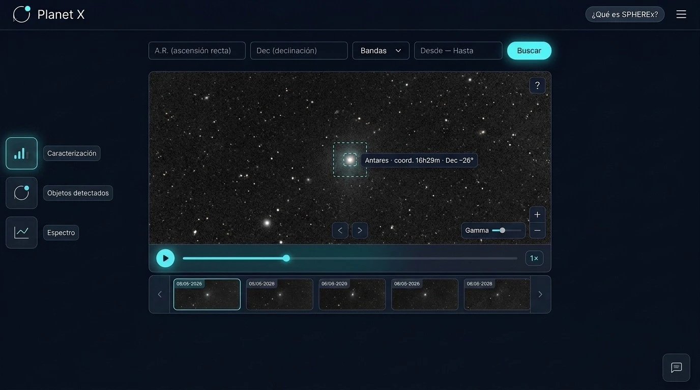

<!-- i18n-header -->
> 🌐 **Lingua:** [English](../../../en/docs/diseno/REVISION_MAQUETA_V1.md) · [Español](../../../es/docs/diseno/REVISION_MAQUETA_V1.md) · [中文](../../../zh/docs/diseno/REVISION_MAQUETA_V1.md) · [Deutsch](../../../de/docs/diseno/REVISION_MAQUETA_V1.md) · **Italiano**
> 🕒 **Data della documentazione:** 2026-11-14 15:35 · **Fonte:** `docs/diseno/REVISION_MAQUETA_V1.md`
> ⚠️ Bozza tradotta automaticamente, in attesa di revisione di un madrelingua.
<!-- /i18n-header -->

# Revisione del mockup del visore rispetto ai dati reali (14 nov 2026)

Revisione del mockup del visore rispetto a ciò che ha mostrato l'EDA
([`../09_EDA_HALLAZGOS.md`](../09_EDA_HALLAZGOS.md)). Non giudica lo stile: dice cosa promette lo
schermo che i dati di SPHEREx non consegneranno così, e cosa manca. I responsabili sono quelli del piano
del team ([`../../README.md`](../../README.md) §3).

**Riepilogo:** il mockup copre quasi tutto ciò che chiede la sfida. Ciò che cambia di più con l'EDA è che
**manca il pulsante di sottrazione**, e che l'immagine centrale e la striscia di foto promettono qualcosa che i dati
reali non mostreranno così.

---

## Modifiche raccomandate

| # | Cosa cambiare | Perché (dato dell'EDA) | Responsabile |
|---|---|---|---|
| 1 | **Aggiungere il pulsante «Sottrazione»** accanto al ▶ (alterna blink / sottrazione) | Il movimento è di 1–2 px in tutto il periodo: nel blink quasi non si nota; nella sottrazione appare come una coppia rosso/blu. È la vista principale, non un extra. *(Stato 14 nov: `Visor.tsx` non ha ancora il pulsante di sottrazione.)* | V1 Antonia (schermata) · D2 Bryan (`diff_first`, `diff_prev`) |
| 2 | **L'immagine centrale non sarà così nitida.** Usare lo sfondo come cielo di contesto (Aladin) e mostrare il ritaglio reale di SPHEREx dentro il riquadro tratteggiato, oppure accettare la pixelatura con zoom senza sfumatura | Un ritaglio di 0,1° misura 58×58 pixel da 6,15″ | V2 Juan Pablo (Aladin) · V1 Antonia (ritaglio) |
| 3 | **Cambiare l'esempio: Antares → Epsilon Indi B** | Antares è tra le stelle più luminose del cielo: saturerà. Le stelle sature lasciano una coppia rosso/blu nella sottrazione anche se non si muovono (RW Aur). eps Ind B non satura e il suo movimento misurato coincide con il catalogo | V1 Antonia · N Javiera (demo) |
| 4 | **Correggere le date della striscia di foto** e mostrare in ogni miniatura **data e λ** | Le date del mockup includono il 2020 e il 2028; nei 5 campi di prova ci sono dati dal 24 apr 2025 al 2 ott 2026 (DR1 + QR3). Ogni foto è a un'altra lunghezza d'onda, e questo spiega i cambi di luminosità | V1 Antonia |
| 5 | **La striscia ha 3–5 foto, non decine.** Una barra continua suggerisce un video lungo: meglio passi discreti, uno per passata | Per zona ci sono 3 o 4 passate del cielo in 1–1,4 anni (secondo `docs/09`; R Dra ha un'osservazione quasi continua e WISE 0855 termina nel 2026,37) | V1 Antonia |
| 6 | **Stato di caricamento progressivo:** miniature vuote che si completano man mano che arriva ogni foto | Un ritaglio impiega 7,3 s di mediana e fino a 29 s; ci sono stati errori 503 | V1 Antonia · D1 Vladimir (cache e precalcolo) |
| 7 | **Avvisi di qualità:** il riquadro «Contaminazione» del piano e un avviso «oggetto saturo: la sottrazione può ingannare» | I pixel davvero cattivi sono ~4 %; attenzione: il bit SOURCE ne segna il 72 % e non è un errore | D2 Bryan (`flagged_fraction`, saturazione) · V1 Antonia · C Mauricio (cosa si mostra) |
| 8 | **Pannello laterale, «Spettro»:** si può, ma non esce dal cubo di IRSA | Il cubo HiPS che carica Aladin sono PNG per visualizzare, senza flussi; la versione FITS non ammette ritagli. Lo spettro esce dalle foto di livello 2, che hanno già la loro λ calcolata | V2 Juan Pablo · D2 Bryan |
| 9 | **Pannello laterale, «Oggetti rilevati» → «Oggetti noti»** (SIMBAD e Gaia sull'immagine) | Il rilevamento automatico è rimasto per «con 6 ore in più» nel piano; l'overlay dei cataloghi invece c'è | V2 Juan Pablo |

## Dettagli rapidi

- **Cercare per nome** («Barnard», «eps Ind B») oltre ad A.R. e Dec: rende lo strumento utilizzabile per
  chiunque, e `/api/resolve` è già nel piano (D1 Vladimir). Attenzione: «eps Ind B» con la maiuscola è la
  coppia di nane brune; con la minuscola è un pianeta a 6,7′ (vedi `data/campos_de_prueba.yml`).
- **Refuso:** «deciinación» → «declinación».
- **Manca il piè di pagina con l'attribuzione obbligatoria di SPHEREx** (`docs/02_DATOS_SPHEREX.md` §8). *(Stato 14 nov: il piè di pagina esiste in `App.tsx`, ma con un testo in spagnolo che non è quello letterale richiesto da IRSA; modifica del codice in sospeso di N/V1.)*
- **«Dal — Al»:** con 3–4 passate filtra poco. Lasciarlo precompilato con l'intervallo reale dei dati.
- **Zoom + / −:** indispensabile per vedere 1–2 px. Che lo zoom non sfumi i pixel.

## Ciò che il mockup risolve già bene

- Coordinate, bande e ricerca in una sola riga in alto.
- Controlli di riproduzione con velocità, e gamma sull'immagine.
- Il pulsante «?» e «Cos'è SPHEREx?» per chi arriva senza sapere di astronomia.
- Pannello laterale con spettro: è l'«extra kudos» della sfida.

## Fonti

Cifre di `eda/resultados/` (inventario, latenza, centroidi, flags); dettaglio e metodo in
[`../09_EDA_HALLAZGOS.md`](../09_EDA_HALLAZGOS.md). I compiti per ruolo sono in
[`../10_REPARTO_DE_TRABAJO.md`](../10_REPARTO_DE_TRABAJO.md).
