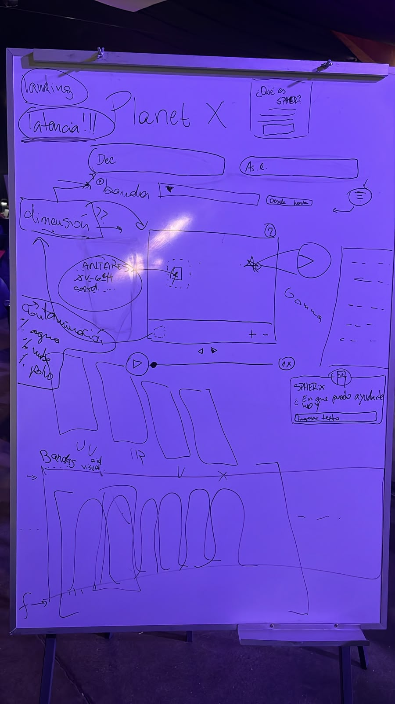
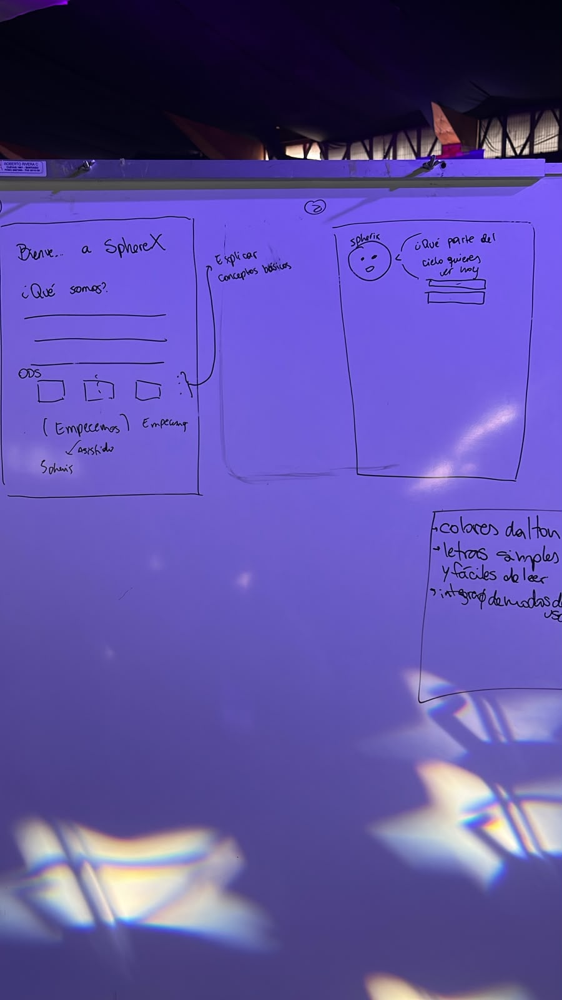

<!-- i18n-header -->
> 🌐 **语言:** [English](../en/README.md) · [Español](../es/README.md) · **中文** · [Deutsch](../de/README.md) · [Italiano](../it/README.md)
> 🕒 **文档日期:** 2026-11-14 15:35 · **来源:** `README.md`
> ⚠️ 机器翻译草稿，尚待母语人士审校。
<!-- /i18n-header -->

# SPHEREX — NASA Space Apps Challenge 2026 · *Planet X and SPHEREx*

**一个公开的网页工具：任何人输入一组天空坐标，就能把那片区域当作一段小视频来观看：SPHEREx 随时间推移的图像序列，用肉眼检测发生移动或亮度变化的东西，同时还能看到它由什么构成（102 个波段）。**

## 🔭 在线查看器：**https://spherex-planet-x-tau.vercel.app**

直接示例：[D1 波段中的 Barnard 星](https://spherex-planet-x-tau.vercel.app/?ra=269.4520769586187&dec=4.693364966576667&size=0.1&band=1)。
目前它是白板的视觉骨架：landing 页面、带有 SPHEREx DR1 真实天空的查看器（IRSA 的立方体，按波段）、与 URL 相连的控件，以及标有负责人姓名的虚线空位。
**每次合并到 `main` 都会自动发布**到该 URL，耗时一到两分钟。合并前如何测试：见 §2。

本 README 是**团队的主计划**。细节在 `docs/` 中（权威来源），工作套件的使用指南在 [`docs/KIT.md`](docs/KIT.md)。

> 截至 11月13日，这里没有解决挑战的代码；自正式开始（11月14日）起已有（`eda/` 以及 `scaffold/frontend/` 中的查看器）。见 [`docs/08_REGLAS_DEL_EVENTO.md`](docs/08_REGLAS_DEL_EVENTO.md)。

---

## 1. 背景

- **挑战：** [Planet X and SPHEREx](https://www.spaceappschallenge.org/2026/challenges/planet-x-and-spherex/)
  （Advanced）。完整官方文本在 [`docs/00_DESAFIO.md`](docs/00_DESAFIO.md)。
- **要求：** 用户输入 RA/Dec；工具显示该天区的一系列 SPHEREx 图像，“like a little video”。用 **Barnard's Star、Epsilon Indi B、WISE 0855**（会移动）和 **RW Aurigae、R Draconis**（亮度会变化）来测试。
- **事实上的评分标准（8 条 *Potential Considerations*）：** 易于随新的 releases 更新 · 展示 102 个波段（按探测器 co-add；**extra kudos：即时光谱**）· 对历元做加减 · 可选择的视场 · Gaia/WISE 的 overlay · URL 中的坐标 · 污染 flags · 使用 Astropy 和 Aladin。灵感范例：[WiseView](http://byw.tools/wiseview)。
- **活动（圣地亚哥）：** 周六 14日 10:00 开始工作 → **周日 15日 11:00 提交截止**（由 JP 于 11月14日 确认；由组织方现场宣布；见 [`docs/08`](docs/08_REGLAS_DEL_EVENTO.md)），
  pitch **2 分钟 + 2 个问题**。允许使用 AI，**且在提交中必须声明**。
- **提交内容：** 名称和摘要、最终演示的链接、NASA 数据和其他来源，以及如何使用了 AI。
- **评审团：** 影响力、创造力、有效性、相关性和展示。
- **部署：** 前端用 Vercel（由组织方指定）；后端如何运行有待在 ADR-001 中决定。未经团队中一个人的批准，不部署任何东西。
- **它不是什么：** 它不是自动检测器，也不是视频模型。它是一个**查看器**；由人来检测。任何 ML 层都叠加在其上，绝不取代查看器（[`docs/01_ESTADO_DEL_ARTE.md`](docs/01_ESTADO_DEL_ARTE.md)）。

### 已发现的陷阱

1. **题目中 WISE 0855 的坐标是约 2010.4 历元的。** 该天体每年移动 8.15″：如今它在约 130″ 之外。请始终使用 [`data/campos_de_prueba.yml`](../../data/campos_de_prueba.yml) 中传播后的位置。
2. **连续曝光 = 不同的波长**（线性可变滤光片）。不按波段/λ（`WCS-WAVE`）分组就做 blink，得到的序列显示的是颜色，而不是时间。
3. **使用 DR1 + QR3。** QR2 已无法通过 SIA2 搜索。
4. **WISE 0855 不在 Gaia 中：** 它的 overlay 使用 CatWISE2020。
5. **WISE 0855 是必选案例，且在单次曝光中显得很暗。** 始终展示它，并诚实说明：它的运动（整个时段约 1.3 px）通过第一帧 − 最后一帧的减法可见，待有了按扫描轮次求和后也可见（V2 的 CatWISE2020 overlay：已在分支 `v/v2-catwise` 中完成，待 PR；D2 的 1/VARIANCE 加权求和：待办）。eps Ind B 是运动最清晰的地方（`docs/09` §4）。

---

## 2. 架构（[`docs/03_ARQUITECTURA.md`](docs/03_ARQUITECTURA.md) 的摘要）

同一屏幕上有两条路线：

- **路线 A — “102 种颜色的天空”，无后端：** Aladin Lite v3 + IRSA 的 DR1 HiPS 立方体，带 λ 滑块、Gaia overlay。如果后端失败，这就是保险。（B 计划：CDS 的 SPHEREx HiPS。）
- **路线 B — 时间 blink，带后端：** FastAPI 按位置查询 SIA2，按历元请求 cutouts，按波段分组，扣除 ZODI，归一化，并返回按时间排序的 PNG。

**API 契约**（前后端唯一共同认定的东西；修改时先改 `docs/03`）：
`GET /api/health` · `/api/resolve?q=` · `/api/epochs?ra=&dec=&size=` ·
`/api/frames?ra=&dec=&size=&band=&stretch=&cmap=&mode=`（`raw|zodi_subtracted|diff_first|diff_prev`，
每帧带有 `wavelength_um` 和 `flagged_fraction`）· `/api/spectrum?ra=&dec=&aperture=`（必须带 `caveat`）。

**可分享的 URL：** `/?ra=…&dec=…&size=…&band=…&fps=…&stretch=…&mode=…` 或 `/?target=WISE+0855`。
磁盘缓存，**五个天区已预热**；演示用的离线降级模式。

技术栈（[`docs/adr/ADR-001-stack.md`](docs/adr/ADR-001-stack.md)）：Python 3.11 + FastAPI + astropy/astroquery/pyvo ·
React + Vite + TypeScript + Aladin Lite v3。

**部署（11月14日 已决定）：查看器放在 Vercel 上。** 项目 `spherex-planet-x` 位于 Vercel 的 eMind 团队（免费 Hobby 计划，仅一名成员：Mauricio），连接到本仓库。
生产环境：**https://spherex-planet-x-tau.vercel.app**。配置在
[`vercel.json`](../../vercel.json)（构建 `scaffold/frontend`），而 [`.vercelignore`](../../.vercelignore) 排除了 `docs/`、`data/` 以及所有非前端的内容。

**在免费计划下如何部署**（向 Vercel 添加成员需要付费）：
- **生产环境：** 每次合并到 `main` 都会自动发布，因为合并由 Mauricio 在 GitHub 上完成。
- **PR 的预览：** Vercel **只构建 Mauricio 的 commits**。其他人的 PR 在 Vercel 中显示为 *Blocked*：这是预期的，不是代码错误。
- **在请求合并之前，每个人先在本地测试：** `cd scaffold/frontend && npm ci && npm run build && npm run preview`
  （或工作时使用 `npm run dev`）。GitHub 的 CI 也会在每个 PR 上运行构建。
- 如果生产环境中某处显示异常，请通知 Mauricio，他可以查看 Vercel 的日志。

对于后端，建议是：
- **5 个测试天区预先计算为静态文件**（PNG + 契约格式的 JSON），由同一个 Vercel 提供。这解决了白板上的“¡Latencia!”（延迟！），并且是演示的离线模式。
- **任意坐标：** 如果 cutouts 能放进函数的时间限制，就用 Vercel Python Functions 上的 FastAPI；否则，把同一个 FastAPI 放在容器（Render/Fly）中，位于 `/api` 之后。
  在块 1 中根据测得的一个 cutout 的耗时来决定。

---

## 2b. 界面设计（11月14日 的白板）

| 主屏幕（查看器） | Landing 与辅助模式 |
|---|---|
|  |  |

**流程：** Landing →（直接 *Empecemos*（开始吧）**或** 与 Spherix 一起的 *Empecemos asistido*（辅助开始））→ 查看器。
在 landing 上有一个指向 *Conceptos básicos*（基本概念）的链接。所有屏幕上都有汉堡菜单。

### 屏幕 1 · Landing “Bienvenido a SPHEREx”（欢迎来到 SPHEREx）
- “我们是谁？”：两三行关于项目和任务的介绍。
- **ODS**：卡片，展示项目所贡献的可持续发展目标。
- 按钮 **Empecemos**（直接进入查看器）和 **Empecemos asistido**（打开 Spherix）。
- 指向 **基本概念** 的链接：什么是 RA/Dec、什么是波段、红外线、恒星为什么会移动。

### 屏幕 2 · 使用 **Spherix**（吉祥物）的辅助模式
- Spherix 问“你今天想看天空的哪一部分？”，带有输入框和建议（5 个测试天体作为按钮）。它会带你进入已经拼好 URL（`?target=…`）的查看器。
- 在查看器中，Spherix 作为**悬浮聊天**位于右下角：“今天我能帮你什么？”。
- **最低要求：** 由 Javiera 撰写回答的引导式流程，不用 LLM。
  **额外：** 通过 Vercel 函数与 Claude 聊天；API 密钥只放在 Vercel 的环境变量中，绝不放在前端。如果做了，要在提交中声明。

### 屏幕 3 · 查看器 “Planet X”
| 白板上的元素 | 作用 | 数据 / endpoint |
|---|---|---|
| **Dec** 和 **A.R.** 输入框 | 中心坐标（也接受名称） | `/api/resolve` |
| **Bandas**（波段，下拉菜单） | 选择探测器 D1–D6 或全部 | `band` |
| **Desde – hasta**（从 – 到） | 历元的日期范围 | `from`、`to`（新增，见 `docs/03`） |
| **Dimensión ??**（尺寸） | 裁切图的视场 | `size` |
| **¿Qué es SPHEREx?** 卡片 | 简短说明，带有指向基本概念的链接 | 静态 |
| 带有 **?**、**+ / −** 和小地图的中央图像 | 当前帧及其缩放；上下文帮助 | `/api/frames` + Aladin |
| **悬停在一颗恒星上的气泡**（“ANTARES, XV-644, coord…”） | 名称、星表标识符和坐标 | SIMBAD / Gaia（overlay） |
| **点击一颗恒星 → ▶** | 以该恒星为中心裁切的动画 | `/api/frames`，以它为中心的小 `size` |
| **Gamma** | 图像拉伸/gamma 控制 | `stretch` + 客户端 gamma |
| **◁ ▷**、**▶**、时间线和 **1x** | 上一帧/下一帧、播放、位置和速度 | `fps` |
| **帧缩略条** | 每个历元的缩略图；点击跳转 | `frames[]` |
| **侧边栏** | 历元列表，带日期、λ 和 `flagged_fraction`（元数据） | `/api/epochs` |
| 方框 **“Contaminación: % agua, % nube, % polvo”**（污染：% 水、% 云、% 尘） | **待在 standup 中确认：** 要么是按类型划分的带污染 flags 的像素百分比，要么是来自光谱的成分指标（水冰、尘埃）。如果是成分，则只作定性展示并带 `caveat` | `flagged_fraction` / `/api/spectrum` |
| 下方的**波段图**（流量 *f* 对波段，按波段的曲线） | 天体在 102 个波段中的光谱 | `/api/spectrum` |
| 图上的**视觉辅助 UV · V · IR · X** | 电磁波谱条，显示 SPHEREx 所处的位置（0.75–5 µm，近红外） | 静态 |
| **Spherix**（悬浮聊天） | 上下文帮助 | 见屏幕 2 |
| **“¡Latencia!”** | 演示不能等待 IRSA | 5 个预先计算的天区 + 加载状态 |

### 无障碍（白板 2）— 是要求，不是额外项
- **适合色盲者的颜色：** 默认使用 `viridis`/`cividis` 色图；绝不单靠红/绿来区分。
- **简单易读的字体：** 无衬线字体，良好的对比度，基础字号 ≥ 16 px。
- **整合使用模式：** 辅助模式（Spherix、说明）和直接模式（所有控件）。

---

## 3. 6 个分支（基于 [`docs/04_METODOLOGIA.md`](docs/04_METODOLOGIA.md) 的 D/V/C/N 角色）

| # | 前线 · 分支前缀 | 负责人 | 属于其的目录 | 交付物，按优先级排序 |
|---|---|---|---|---|
| 1 | **D1 数据-访问** · `d/…`（`d/sia2-epochs`、`d/cache`、`d/precalculo`） | Vladimir（程序员） | `scaffold/backend/app/irsa/`、`app/cache/`、`scripts/precalcular/`；路由 `resolve`、`epochs`、`health` | 与 C 一起完成第 1 小时的检查清单（[`docs/02`](docs/02_DATOS_SPHEREX.md) §9），**测量一个 cutout 的耗时**（决定 Vercel Functions 还是容器）；对 `spherex_dr1`+`spherex_qr3` 做 SIA2；**`from`/`to`** 过滤（白板上的日期范围）；带重试的并行 cutouts；缓存；**把 5 个天区预先计算为静态 JSON+PNG 供 Vercel 使用的脚本**（“¡Latencia!”）；`/api/resolve` 也用于**悬停在恒星上时的名称气泡**；对新 releases 重新查询 |
| 2 | **D2 数据-帧** · `d/…`（`d/frames-banda`、`d/diff`、`d/spectrum`） | Bryan | `scaffold/backend/app/frames/`、`app/spectrum/`；路由 `frames`、`spectrum` | 按波段和 λ（`WCS-WAVE`）分组；扣除 ZODI；重投影到公共网格；拉伸 → PNG；`wavelength_um` + `flagged_fraction`（为**侧边栏**和**“Contaminación”**方框提供数据）；`diff_first`/`diff_prev`；按探测器 co-add；**以被点击恒星为中心的小裁切图**（同一个 `/api/frames`，使用小 `size`）；为**波段图**提供 `/api/spectrum` |
| 3 | **V1 查看器-blink** · `v/…`（`v/panel-blink`、`v/controles`、`v/url`、`v/landing`） | Antonia | `scaffold/frontend/src/blink/`、`src/controls/`、`src/state/`、`src/pages/` | 从第 1 小时起提供契约的 mock；白板上的**查看器屏幕**：Dec/A.R. 输入框、波段下拉菜单、**从–到**、**尺寸**、带 **?** 的中央图像、**◁ ▷ / ▶ / 时间线 / 1x**、**帧缩略条**、**gamma**；**landing** 以及带**汉堡菜单**的导航；URL ↔ 状态；空/错误/加载状态；移动端；**无障碍**（适合色盲者的配色、易读的字体）；带署名的页脚 |
| 4 | **V2 查看器-天空** · `v/…`（`v/aladin-hips`、`v/overlay-gaia`、`v/espectro`、`v/spherix`） | Juan Pablo | `scaffold/frontend/src/sky/`、`src/spectrum/`、`src/spherix/` | **路线 A**：Aladin Lite + DR1 HiPS 立方体（第 1 小时验证 CORS），带**缩放 + / − 和小地图**；**传播到该历元**的 Gaia DR3 overlay；WISE/CatWISE overlay；**悬停在恒星上的气泡**（名称、ID、坐标）以及**点击 → 裁切动画**；带 **UV · V · IR · X 条**的**波段图**（流量对 λ）；**Spherix** 组件（悬浮聊天 + 辅助流程），使用 Javiera 的文本 |
| 5 | **C 科学、验证与部署** · `c/…` | Mauricio | `data/campos_de_prueba.yml`、`docs/02`、`docs/07`、`vercel.json`、部署配置 | 连接到仓库的 **Vercel 项目**（生产来自 `main`，每个 PR 有预览）；根据 D1 测得的耗时决定 `/api` 在哪里运行；第 1 小时的检查清单；在 5 个天区 + 控件（`campo_vacio`、`plano_galactico`）上验证每项功能；**澄清“Contaminación: % agua, % nube, % polvo”是什么意思**，并确保所展示的内容是正确的；每次可见的合并前运行 `revisor-cientifico`；离线模式；审查 PR |
| 6 | **N 叙事、内容与提交** · `n/…` | Javiera（科普工作者） | `README.md`、`docs/06`、`src/content/`（文本）、演示视频、表单 | **界面文本**：“我们是谁？”、**ODS** 卡片（选择哪些以及原因）、**基本概念**页面、**¿Qué es SPHEREx?** 卡片、**?** 帮助；**Spherix 的个性与脚本**（辅助模式的问题、建议、回答）；检查所有内容不懂天文学也能看懂；一句话描述；演示视频；提交 + **AI 使用声明**；排练 pitch 3 次 |

> Vladimir（程序员）承担 D1；Javiera（科普工作者）承担 N：pitch、演示脚本、文本和 Spherix，使工具在不懂天文学的情况下也能被理解。完整团队：6 人。
>
> **设计的优先顺序**（如果时间不够，从下往上砍）：1) 带 blink、Dec/A.R.、波段、尺寸、播放和帧缩略条的查看器 · 2) 带 *Empecemos* 的 landing · 3) overlay 和悬停在恒星上的气泡 · 4) 波段图 · 5) 辅助的 Spherix（固定脚本）· 6) 点击 → 裁切动画 · 7) “Contaminación”方框 · 8) 带 LLM 的 Spherix 聊天。
>
> 角色不是牢笼：从第 12 小时起，D1/D2/V1/V2 分担额外的要点。**C 和 N 不解散。**
> 自动检测（ALeRCE 风格的裁切图分类器，Bryan 的想法）留作“再多 6 小时”。

---

## 4. 每个分支的 skills、智能体和命令

一切都在 `.claude/` 中，在仓库根目录打开 Claude Code 时自动加载。

**所有分支通用：** skills `spherex-datos`、`coordenadas-astro`；命令 `/standup`、`/traspaso`、
`/verifica-cifra`、`/riesgo`；以及 ECC 插件的：`ecc:git-workflow`、`ecc:search-first`、
`ecc:documentation-lookup`、`ecc:verification-loop`。

| 分支 | 仓库的 skills / 智能体 | 额外的 skills | 审查智能体（在人工审查 PR 之前） |
|---|---|---|---|
| D1 访问 | `spherex-datos`、`coordenadas-astro`、智能体 **`explorador-datos`** | `astropy`、`ecc:python-patterns`、`ecc:python-testing`、`ecc:fastapi-patterns`、`ecc:api-connector-builder`、`ecc:content-hash-cache-pattern`、`ecc:error-handling` | `ecc:python-reviewer`、`ecc:silent-failure-hunter`、`ecc:fastapi-reviewer` |
| D2 帧 | `spherex-datos`、`visor-sky-blink`、智能体 `explorador-datos` | `astropy`、`matplotlib`、`ecc:python-patterns`、`ecc:python-testing`、`ecc:data-throughput-accelerator`、`dataviz` | `ecc:python-reviewer`、`ecc:performance-optimizer`、**`revisor-cientifico`** |
| V1 blink + landing | `visor-sky-blink`、`coordenadas-astro`、智能体 **`revisor-interfaz`**、`/chequeo-demo` | `ecc:react-patterns`、`ecc:vite-patterns`、`ecc:typescript-patterns`、`ecc:frontend-patterns`、`ecc:frontend-design-direction`、**`ecc:accessibility`**、`ecc:motion-foundations`、`ecc:e2e-testing`、`ecc:browser-qa` | `ecc:react-reviewer`、`ecc:typescript-reviewer`、`ecc:e2e-runner`、**`ecc:a11y-architect`** |
| V2 天空 + 光谱 + Spherix | `visor-sky-blink`、`coordenadas-astro`、智能体 `revisor-interfaz` | `astropy`、`ecc:react-patterns`、`ecc:typescript-patterns`、`dataviz`、**`claude-api`**（仅当 Spherix 使用 LLM 时） | `ecc:react-reviewer`、**`revisor-cientifico`**、`ecc:security-reviewer`（LLM 的密钥） |
| C 科学 + Vercel | `coordenadas-astro`、`spherex-datos`、智能体 **`revisor-cientifico`**、`explorador-datos`；`/verifica-cifra`、`/riesgo`、`/chequeo-demo` | `astropy`、**`ecc:deployment-patterns`**（Vercel）、`ecc:verification-loop`、`ecc:code-review` | `ecc:security-reviewer`、`ecc:code-reviewer` |
| N 内容 + 提交 | **`demo-y-pitch`**、**`entrega-nasa`**、`/chequeo-demo` | **`ecc:brand-voice`**（Spherix 的声音）、`ecc:article-writing`、`ecc:frontend-slides` 或 `anthropic-skills:pptx`、`ecc:video-editing`、`ecc:ui-demo`、`dataviz` | `ecc:agent-evaluator`、`revisor-interfaz` |

**skills 的来源：**
- `spherex-datos`、`coordenadas-astro`、`visor-sky-blink`、`demo-y-pitch`、`entrega-nasa` 以及 3 个智能体：Juan Pablo 的套件。
  `spherex-datos` §11 和 `coordenadas-astro` 中关于 CatWISE 的说明，是随 11月14日 的探索一起加入的。
- `astropy`、`matplotlib`、`scikit-learn`：[K-Dense AI scientific skills](https://github.com/K-Dense-AI/claude-scientific-skills)（MIT），
  复制前已审查（仅文档和绘图模板）。`scikit-learn` 仅用于分类的额外项。
- `ecc:*`：[ECC](https://github.com/affaan-m/ECC) 插件。没有的人：`/plugin marketplace add affaan-m/ECC` → `/plugin install ecc@ecc`。
  这是可选的：仓库中的 skills 已足够工作。

---

## 5. 我们如何工作（[`CONTRIBUTING.md`](CONTRIBUTING.md)）

1. **没有人推送到 `main`。** 一切通过 PR 进入，并由**一个人审查**（智能体可以准备）。
2. 分支 `<rol>/<tema>`，**存活不超过 3 小时**。
3. **每人一个 worktree：** `git worktree add ../spherex-<rol> <rol>/<tema>`。
4. API 契约先在 `docs/03_ARQUITECTURA.md` 中修改，并通知团队。
5. 仓库中不放 FITS 或下载的数据（放入 `data/cache/`，已被忽略）。
6. 每个 PR：*做了什么 · 我如何验证 · 未验证的内容*，至少用一个测试天区测试过。

```bash
git clone https://github.com/mauriciovalenzuela742/SPHEREX
cd SPHEREX
claude            # comprobación: /standup debe existir
```

---

## 6. 时间表（细节和截止标准见 [`docs/05_PLAN_24H.md`](docs/05_PLAN_24H.md)）

**T = 周日 11:00**（提交截止）。因此：**T−6 = 周日 05:00**（范围冻结），
**T−4 = 周日 07:00**，**T−2 = 周日 09:00（已提交）**。约 25 小时的工作，而不是 27。

| 块 | 小时 | 谁 | 内容 | 截止 |
|---|---|---|---|---|
| 0 | h0–1 | 所有人 | 大声朗读 `00_DESAFIO`，签署 ADR-001，在 `05` 中写上姓名，scaffold 对所有人都能启动 | 在 6 个人都能运行项目之前，没有人继续往前 |
| 1 | h1–3 | D1 + D2 + C | 数据检查清单：历元数、一个 cutout 的耗时、**λ 在各历元之间变化多少**、HiPS + CORS。V1/V2 基于 mock；N 打开表单 | 到 h3，每个问题都有书面答案 |
| 2 | h3–8 | 所有人 | 带缓存的单个波段的 `/epochs` + `/frames`；坐标 → canvas → 播放；用 Aladin 做路线 A；C 验证天区 | **h8：一个坐标在屏幕上生成一小段视频**，否则所有人都投入其中 |
| 3 | h8–14 | 所有人 | 优先级 1→8：波段、控件、减法、名称、URL、Gaia overlay、flags、光谱 | **T−6 小时：范围冻结** |
| 4 | T−6→T−4 | C + 所有人 | 在**已部署**的应用中的 5 个天区，预热，空状态，移动端，署名 | — |
| 5 | T−4→T−2 | N + C | 演示视频，离线降级模式，**带 AI 声明的完整提交** | **T−2 小时：已提交** |
| 6 | T−2→pitch | N + 所有人 | 排练 3 次，计时，并带上令人不舒服的问题 | — |

---

## 7. 活动期间的探索子智能体

- **第 1 小时：** 两个 `explorador-datos` 并行（D1：针对 WISE 0855 和 Barnard 的 SIA2 行数和 cutout 耗时；D2：用 `WCS-WAVE` 看 λ 在历元之间的漂移），外加一个智能体**重新检查挑战的 Resources 标签页**（可能会变）并更新 `docs/00_DESAFIO.md`。
- **每次在演示中可见的合并之前：** `revisor-cientifico`。
- **范围冻结之前和演示之前：** `revisor-interfaz` + `/chequeo-demo`。

---

## 8. 验证（“完成”的标准）

- CI（[`.github/workflows/ci.yml`](../../.github/workflows/ci.yml)）：后端的 `pytest -q` 和前端的 `npm run build`。
  活动开始时，去掉 linter 中的 `|| true`。
- **验收 = 已部署应用中的 5 个天区：** Barnard、WISE 0855（使用传播后的坐标）和 ε Ind B 能看到移动；RW Aur 和 R Dra 亮度变化；Gaia 的标记在该帧历元落在恒星上；`campo_vacio` 显示清晰的空状态。
- `/chequeo-demo` 通过；离线模式能提供 5 个天区；pitch 时长 ≤ 2 分钟。

---

## 9. 块 0 的待办事项

- [ ] Javiera 和 Vladimir：阅读本 README、[`docs/00_DESAFIO.md`](docs/00_DESAFIO.md) 和 [`docs/briefings/`](../../docs/briefings/)（20 分钟）。
- [x] Mauricio：创建连接到仓库的 Vercel 项目（根目录 `scaffold/frontend`）并分享 URL（已于 11月14日 完成：https://spherex-planet-x-tau.vercel.app）。
- [ ] 在 standup 中：澄清“Contaminación: % agua, % nube, % polvo”方框（是 flags 还是成分？）。
- [ ] Javiera：选择 ODS 并撰写 Spherix 的脚本（欢迎语、“你今天想看天空的哪一部分？”、5 条建议）。
- [ ] 块 1：根据测得的一个 cutout 的耗时，决定 `/api` 在 Vercel Functions 还是容器中运行（ADR-001）。
- [ ] Juan Pablo：与组织方确认餐食，以及是否可以通宵留下。
- [ ] 所有人：克隆仓库，在根目录打开 `claude` 并检查 `/standup`。
- [ ] 所有人：已安装 Python 3.11、Node 20、Docker。
- [ ] Juan Pablo：带上电源插线板。

---

## 团队

Mauricio Valenzuela · Bryan Cabezas · Juan Pablo Castillo · Antonia Del Castillo · Javiera · Vladimir。
原始工作套件：[jpcastillo714/spherex-kit](https://github.com/jpcastillo714/spherex-kit)。
筹备会议（11月13日）的材料：[`docs/reuniones/`](../../docs/reuniones/)。

## 许可证与署名

代码采用 MIT 许可证（[`LICENSE`](../../LICENSE)）。SPHEREx 的数据是公开的，要求在最终的 README 和工具页脚中包含 [`docs/02_DATOS_SPHEREX.md`](docs/02_DATOS_SPHEREX.md) §8 中的致谢说明。

> This publication makes use of data products from the Spectro-Photometer for the History of the Universe, Epoch of Reionization and Ices Explorer (SPHEREx), which is a joint project of the Jet Propulsion Laboratory and the California Institute of Technology, and is funded by the National Aeronautics and Space Administration.
>
> *（代码中的待办：查看器的页脚 `scaffold/frontend/src/content/textos.ts` 目前仍是西班牙语的意译，而不是这段文本。）*
