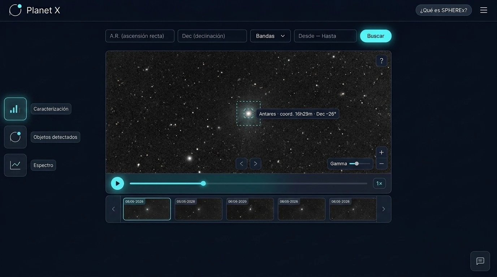

<!-- i18n-header -->
> 🌐 **语言:** [English](../../../en/docs/diseno/REVISION_MAQUETA_V1.md) · [Español](../../../es/docs/diseno/REVISION_MAQUETA_V1.md) · **中文** · [Deutsch](../../../de/docs/diseno/REVISION_MAQUETA_V1.md) · [Italiano](../../../it/docs/diseno/REVISION_MAQUETA_V1.md)
> 🕒 **文档日期:** 2026-11-14 15:35 · **来源:** `docs/diseno/REVISION_MAQUETA_V1.md`
> ⚠️ 机器翻译草稿，尚待母语人士审校。
<!-- /i18n-header -->

# 对照真实数据审查查看器设计稿（2026 年 11 月 14 日）

对照 EDA 所显示的内容审查查看器设计稿
（[`../09_EDA_HALLAZGOS.md`](../09_EDA_HALLAZGOS.md)）。不评判风格：只说明屏幕承诺了哪些
SPHEREx 数据无法这样交付的东西，以及缺了什么。负责人是团队计划中的人
（[`../../README.md`](../../README.md) §3）。

**摘要：** 设计稿涵盖了挑战所要求的几乎所有内容。EDA 带来的最大变化是
**缺少相减按钮**，以及中央图像和照片条承诺了真实数据无法这样呈现的东西。

---

## 建议的修改

| # | 改什么 | 为什么（EDA 数据） | 负责人 |
|---|---|---|---|
| 1 | **在 ▶ 旁边添加“相减”按钮**（在闪烁 / 相减之间切换） | 整个时段内的运动只有 1–2 px：在闪烁中几乎看不出来；在相减中则表现为一对红/蓝。它是主要视图，不是附加项。*（11 月 14 日状态：`Visor.tsx` 还没有相减按钮。）* | V1 Antonia（界面）· D2 Bryan（`diff_first`、`diff_prev`） |
| 2 | **中央图像不会这么清晰。** 用背景作为背景天空（Aladin），并在虚线框内显示 SPHEREx 的真实裁切图，或者接受缩放时不平滑的像素化 | 0.1° 的裁切图是 58×58 个 6.15″ 的像素 | V2 Juan Pablo（Aladin）· V1 Antonia（裁切图） |
| 3 | **更换示例：Antares → Epsilon Indi B** | Antares 是天空中最亮的恒星之一：会饱和。饱和的恒星即使不动，在相减中也会留下红/蓝一对（RW Aur）。eps Ind B 不饱和，其测得的运动与星表吻合 | V1 Antonia · N Javiera（演示） |
| 4 | **修正照片条的日期**，并在每个缩略图上显示**日期和 λ** | 设计稿中的日期包含 2020 和 2028；在 5 个测试天区中，数据的范围是 2025 年 4 月 24 日至 2026 年 10 月 2 日（DR1 + QR3）。每张照片处于不同的波长，这解释了亮度变化 | V1 Antonia |
| 5 | **照片条有 3–5 张照片，而不是几十张。** 连续的进度条暗示一段很长的视频：更好是离散的步骤，每次扫描一步 | 每个区域在 1–1.4 年内有 3 或 4 次天空扫描（依据 `docs/09`；R Dra 几乎是连续观测，WISE 0855 在 2026.37 结束） | V1 Antonia |
| 6 | **渐进式加载状态：** 空的缩略图，随着每张照片到达而被填充 | 一个裁切图中位数需要 7.3 s，最长可达 29 s；出现过 503 错误 | V1 Antonia · D1 Vladimir（缓存和预计算） |
| 7 | **质量提示：** 计划中的“污染”框，以及提示“天体已饱和：相减可能会骗人” | 真正坏的像素约 4 %；注意：SOURCE 位标记了 72 %，它不是错误 | D2 Bryan（`flagged_fraction`、饱和）· V1 Antonia · C Mauricio（显示什么） |
| 8 | **侧栏，“光谱”：** 可以做，但它不来自 IRSA 的立方体 | Aladin 加载的 HiPS 立方体是用于可视化的 PNG，没有流量；FITS 版本不支持裁切。光谱来自 2 级照片，它们已经算出了 λ | V2 Juan Pablo · D2 Bryan |
| 9 | **侧栏，“检测到的天体” → “已知天体”**（图像上的 SIMBAD 和 Gaia） | 自动检测在计划中被留给了“再多 6 小时”；星表叠加层则是有的 | V2 Juan Pablo |

## 快速细节

- **按名称搜索**（“Barnard”、“eps Ind B”），而不只是 A.R. 和 Dec：让任何人都能使用该工具，
  而且 `/api/resolve` 已在计划中（D1 Vladimir）。注意：大写的“eps Ind B”是褐矮星
  对；小写的则是 6.7′ 外的一颗行星（见 `data/campos_de_prueba.yml`）。
- **勘误：** “deciinación” → “declinación”。
- **缺少带有 SPHEREx 强制署名的页脚**（`docs/02_DATOS_SPHEREX.md` §8）。*（11 月 14 日状态：页脚在 `App.tsx` 中已有，但文字是西班牙语，不是 IRSA 所要求的原文；代码改动待 N/V1 完成。）*
- **“起 — 止”：** 只有 3–4 次扫描，过滤作用很小。预填为数据的真实范围。
- **缩放 + / −：** 要看到 1–2 px 必不可少。缩放时不要平滑像素。

## 设计稿已经解决得很好的

- 坐标、波段和搜索集中在顶部一行。
- 带速度的播放控件，以及图像上的 gamma。
- “?”按钮和“什么是 SPHEREx？”，供不懂天文的人使用。
- 带光谱的侧栏：这是挑战的“extra kudos”。

## 来源

数字来自 `eda/resultados/`（清单、延迟、质心、flags）；细节和方法见
[`../09_EDA_HALLAZGOS.md`](../09_EDA_HALLAZGOS.md)。按角色的任务见
[`../10_REPARTO_DE_TRABAJO.md`](../10_REPARTO_DE_TRABAJO.md)。
